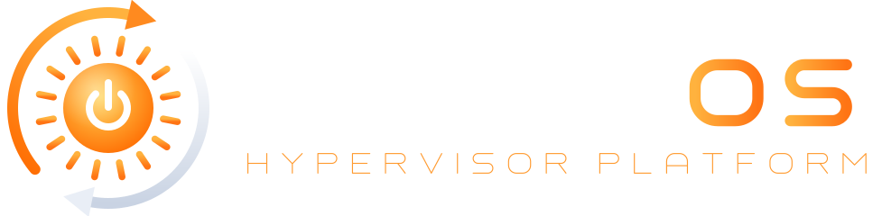
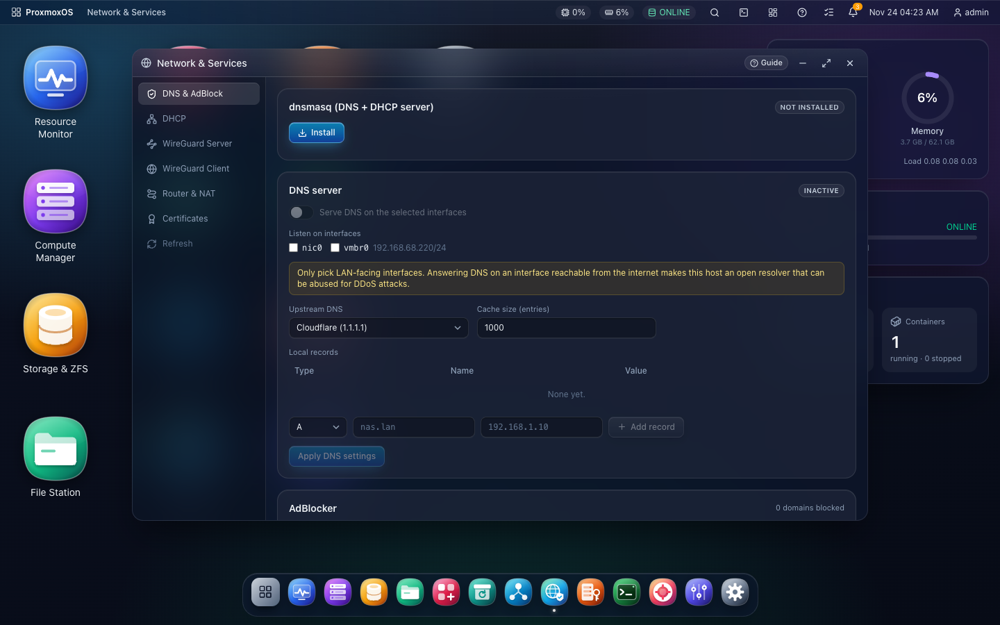

<div align="center">


&nbsp;&nbsp;&nbsp;


# Your server, as a beautiful desktop in the browser

**SolarDeck** turns a home server into something that feels like a NAS: windows, a dock, live widgets and
point-and-click apps for virtual machines, containers, ZFS storage, shares, backups, VPN and GPUs.
No config files, no command-line gymnastics.

[](https://github.com/Legend-Services/SolarOS/releases/latest)
[](https://www.proxmox.com/en/proxmox-virtual-environment)
[](#solaros-a-complete-server-os)
[](#license)

[**Install on Proxmox VE**](#solardeck-for-proxmox-ve) · [**Download SolarOS**](#solaros-a-complete-server-os) · [Quick start](#5-minute-quick-start) · [Features](#what-you-get) · [Docs](#documentation) · [**📖 Manual**](docs/README.md)

<br>


</div>

## Pick your edition

Both editions are the same desktop, built from the same code, and update with one click.

| | 🟠 **SolarDeck for Proxmox VE** | ☀️ **SolarOS** |
|---|---|---|
| **For you if…** | you already run Proxmox VE | you have a spare PC or server and want a fresh start |
| **What it is** | a friendly desktop on top of Proxmox, in its own container | a complete server OS: SolarDeck *is* the hypervisor |
| **Install** | one command in the Proxmox Shell | boot the ISO, pick a disk, done |
| **Time** | about 3 minutes | one install and one reboot |
| **Touches your setup?** | no, Proxmox keeps working as before | installs on its own disk |

---

## SolarDeck for Proxmox VE

**You need:** a Proxmox VE 8 or 9 server with internet access. That's it.

1. Open your Proxmox web interface (for example `https://192.168.1.10:8006`), click your node, then **Shell**.
2. Paste this and press **Enter**:

   ```bash
   bash -c "$(curl -fsSL https://raw.githubusercontent.com/Legend-Services/SolarOS/main/install.sh)"
   ```

3. After 2–3 minutes you get a box with the **web address**, the username **`admin`** and a **password**.
   Open the address and sign in: the Server Setup Wizard and the Desktop Tour show you around.

The installer finds everything by itself (free container ID, storage, IP address) and creates one new container
named `proxmox-os`. Your existing VMs and containers are not touched.

> **Lost the password?** In the Proxmox Shell: `pct exec <container ID> -- grep ADMIN_PASSWORD /opt/proxmox-os/backend/.env`

---

## SolarOS: a complete server OS

No Proxmox needed. SolarOS installs Ubuntu Server LTS with KVM virtual machines, containers, OpenZFS and the
SolarDeck desktop, all set up for you.

### Install on a PC or server

1. **Download** the latest `SolarOS-vX.Y.Z-amd64.iso` from the
   [**Releases page**](https://github.com/Legend-Services/SolarOS/releases/latest).
2. **Write it to a USB stick** (8 GB or larger) with [balenaEtcher](https://etcher.balena.io/) or
   [Rufus](https://rufus.ie/), or attach it as virtual media on your server's IPMI/iDRAC.
3. **Boot from the USB stick** and choose **Install SolarOS (Interactive Disk Selection)**. Pick the disk to install
   on. Only that disk is erased.
4. **Wait for the reboot.** The first start sets up the rest by itself. Then the screen shows the web address and
   a one-time **setup code**.
5. **Open the address** from any computer on your network, enter the setup code and choose your own user name and
   password. There are no default passwords; the same account also signs in to the server itself (SSH, with sudo).

No internet needed: the ISO carries every package SolarOS installs, so it works on an air-gapped machine without a
network cable or DHCP server (connect the network later to reach the web desktop and get online updates). Your CPU needs virtualization (Intel VT-x or AMD-V) switched on in the BIOS. We test with 4 cores, 8 GB RAM and a
32 GB system disk; add more disks to build ZFS pools from the desktop.

### Try it in a Proxmox VE virtual machine

Curious, but not ready to wipe a machine? Run SolarOS as a VM on your Proxmox server:

1. In Proxmox, go to **local → ISO Images → Download from URL** and paste the ISO link from the
   [Releases page](https://github.com/Legend-Services/SolarOS/releases/latest) (or upload the file you downloaded).
2. **Create VM**: pick the SolarOS ISO, *Machine* `q35`, *BIOS* `OVMF (UEFI)`, *CPU type* `host`, 4 cores,
   8 GB memory and a 32 GB disk. Add one or two extra disks if you want to play with ZFS.
3. Turn on nested virtualization so SolarOS can run its own VMs. In the Proxmox Shell, check it with
   `cat /sys/module/kvm_intel/parameters/nested` (or `kvm_amd`); it should say `Y` or `1`.
4. Start the VM, open its **Console** and follow the same steps as above.

Prefer scripts? `hypervisor/test-in-proxmox-vm.sh` creates and starts a ready-made test VM for you; add `--offline`
to install with the VM's network cable "unplugged" and prove that nothing needs the internet. See
[docs/TECHNICAL.md](docs/TECHNICAL.md#testing-the-solaros-iso-inside-a-proxmox-ve-vm).

### Already running Ubuntu Server?

On a clean Ubuntu Server 24.04 or 26.04 LTS machine, as root:

```bash
bash -c "$(curl -fsSL https://raw.githubusercontent.com/Legend-Services/SolarOS/solaros/hypervisor/install-hypervisor.sh)" -- --with-console-tui
```

---

## What you get

| | |
|---|---|
## 5-minute quick start

1. **Sign in** at the address the installer showed. On a new installation the **Server Setup Wizard** opens: tick
   the roles this server plays (storage & media, virtualization host, gateway & VPN, AI compute, …), pick the apps
   to install and press **Setup My Server**. The **Desktop Tour** then points out the search bar, tray, widgets and Dock.
2. **Check the server** in **Settings → System → Info**: release, kernel, uptime, *Check for Updates*, and a hardware
   summary of CPU, memory, GPUs, disks and pools.
3. **Hide what you don't use** in **Settings → System → Features & Services** (presets such as *Minimal Core* or
   *Home & Media Server*, or single switches like *WireGuard VPN Server* vs. *Client*).
4. **Create storage** in **Settings → Storage & Data → Storage & ZFS Pools**: turn empty disks into a mirror or RAIDZ pool.
5. **Create your first VM or container** in **Compute → Create**, or install an app from **App Center**.

Press **⌘K / Ctrl+K** at any time to search every app, setting and help article.

## What you get

| | |
|---|---|
| 🖥️ **A real desktop** | Movable windows with snapping, a dock or taskbar, live widgets, Spotlight search (⌘K / Ctrl+K), a guided Server Setup Wizard and a speech-balloon Desktop Tour. |
| ⚙️ **One Settings hub** | Five categories (System, Storage & Data, Privilege & Security, Network & Services, Hypervisor & Runtime), each with its own sidebar. **System → Info** shows the OS, updates, power buttons and a hardware summary; **Features & Services** switches every optional feature and sub-feature on or off. |
| 📦 **Virtual machines & containers** | Step-by-step wizards, browser consoles and GPU, PCI and USB passthrough. **Smart Compute Groups** group machines by network or by your own groups (Grouped or Flat List), with multi-homed badges and group power actions. Every guest has a **Wireframe Architecture** view with the Hardware Device Inspector & Editor below it, and an **OSI Architecture** view. |
| 💽 **ZFS storage made easy** | Mirrors and RAIDZ pools, datasets, snapshots and schedules, SMART health and disk benchmarks. |
| 🗂️ **Files, shares & backups** | A file browser, built-in SMB shares, and a Backup Center to back up and restore guests. |
| 🛒 **App Center** | One click for Portainer CE, Local AI Studio, Jellyfin Media Server, AdGuard Home and Immich, as many labelled instances as you like. Docker Engine & Compose, SMB shares and the reverse proxy with SSL are built in. |
| 🧠 **Local AI** | Ollama + Open WebUI on your own GPU (NVIDIA, Intel, AMD) or CPU, with a model library that tells you what fits. |
| 🌐 **Network & VPN** | A visual virtual switch with drag-and-drop VLANs and VLAN templates (including **60 · DMZ**), a top-down **Network Topology**, the **Network Architect** Overview and Infrastructure Blueprint with 3-level semantic zoom, DNS with ad blocking, DHCP per VLAN, WireGuard VPN server and client, port forwarding and Let's Encrypt. |
| 🎓 **Learn as you go** | The **7-Layer OSI Architecture Explorer** in Compute, Network and App Center shows which layer each device, network and app works on, with plain-language learning cards. |
| 🧪 **Labs, virtual hardware & multi-seat** | Emulated peripherals, CPU and network throttling, air-gapped lab networks, and multi-seat workstations with their own GPU, USB ports and CPU cores. |
| 🏢 **Cluster & high availability** | Create or join a cluster, live-migrate guests, active/passive HA with ZFS replication, floating VIPs and clustered switches. |
| 🔐 **Secure by design** | Two-factor sign-in, confirmation before destructive actions, encrypted secrets, a tamper-evident audit log and a security score with 1-click host hardening. |
| 🎨 **Make it yours** | 11 themes in dark and light, generative and custom wallpapers, a theme creator and five languages (English, Nederlands, Deutsch, Español, Français). |

## Screenshots

| Sign in | Storage & ZFS |
|---|---|
|  |  |
| **Virtual machines & containers** | **Network & Services** |
|  |  |

## Documentation

The same manual is built into the desktop under **Help & Support → Manual**.

| Guide | What's in it |
|---|---|
| [Manual](docs/README.md) | Start page: Global Search, App Gallery, Settings and Help, with screenshots |
| [Apps](docs/apps.md) | Compute (Smart Groups, Wireframe, OSI, Docker), Files, App Center, Local AI, Network Architect, Help and more |
| [Settings › System](docs/settings-system.md) | Info, General & Appearance, Features & Services, Installed Apps & Instances, Hardware, GPU & BIOS, Services & Repositories |
| [Settings › Storage & Data](docs/settings-storage.md) | ZFS pools, disks & SMART, backups, Shared Folders & SMB, ISO & template library |
| [Settings › Privilege & Security](docs/settings-security.md) | Users & Roles, Security & 2FA, Security Posture & Hardening, audit logs |
| [Settings › Network & Services](docs/settings-network.md) | Virtual switch & VLANs (DMZ template), Network Topology, DNS/DHCP, certificates, reverse proxy, firewall, WireGuard |
| [Settings › Hypervisor & Runtime](docs/settings-hypervisor.md) | Hypervisor defaults, Local AI runtime, Cluster & High Availability |
| [Feature deep dives](docs/features.md) | Virtual switch, virtual hardware & labs, multi-seat, clustering & HA, security internals |
| [Technical notes](docs/TECHNICAL.md) | Architecture, both hypervisor drivers, running from source, testing the ISO, troubleshooting |
| [REST API](docs/api/README.md) | Every REST endpoint and WebSocket, per driver ([OpenAPI schema](docs/api/openapi.json)) |
| [SolarOS hypervisor](hypervisor/README.md) | The ISO, the installer and the server console |
| [Changelog](CHANGELOG.md) | Every release |

## Updating

Open **Settings → System → Info** and click **Check for Updates**, then **Install Update**. A progress bar shows each
step, and the page reloads by itself when the update reaches 100%. Your settings, users, pools and shares are never
touched. Schedules, version history and rollback live in **Settings → System → System Services & Repositories**.

SolarDeck checks for new versions in the background and shows an **Update Ready** badge in the top bar (or in the
taskbar tray). Under **Automatic Updates & Schedule** you can keep updates manual or let them install daily, weekly or
monthly at a time you choose.

## Good to know

- The administrator controls the whole server. Keep SolarDeck on your home network, turn on **2FA** in
  Settings → Privilege & Security → Security & 2FA, and give other people their own account with a limited role in
  **Settings → Privilege & Security → Users & Roles**.
- Found a bug? Click **Report a Bug** in the **?** menu. It opens a pre-filled GitHub issue with anonymized details.
- Want to know how it works, run it from source or see the known limits? Read [docs/TECHNICAL.md](docs/TECHNICAL.md),
  [hypervisor/README.md](hypervisor/README.md), the [REST API reference](docs/api/README.md) and the [CHANGELOG](CHANGELOG.md).

## License

SolarDeck is dual-licensed:

- **GNU Affero General Public License v3.0 (AGPLv3)** for personal, home-lab and open-source use. If you modify SolarDeck and offer it to others over a network, you must publish your changes under the same license.
- **Commercial License** for companies that want to embed, resell or offer SolarDeck as a service without the AGPLv3 obligations. See [COMMERCIAL_LICENSE.md](COMMERCIAL_LICENSE.md) and contact the maintainers through GitHub to discuss terms.

## Trademark Notice

*SolarDeck* and *SolarOS* are an independent open-source project by Ty Gultekin / Legend IT. They are not affiliated with, endorsed by, or sponsored by Proxmox Server Solutions GmbH. Proxmox® is a registered trademark of Proxmox Server Solutions GmbH; it is used here only to describe compatibility with Proxmox VE.

Installations from before the SolarDeck name keep working unchanged: the app still lives in `/opt/proxmox-os` (with an `/opt/solardeck` alias), the systemd units keep their names, and re-running `install.sh` upgrades a `proxmox-os` container in place.
