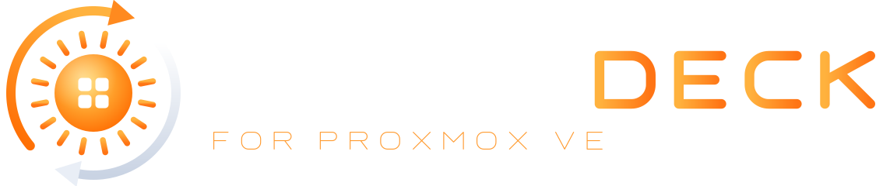
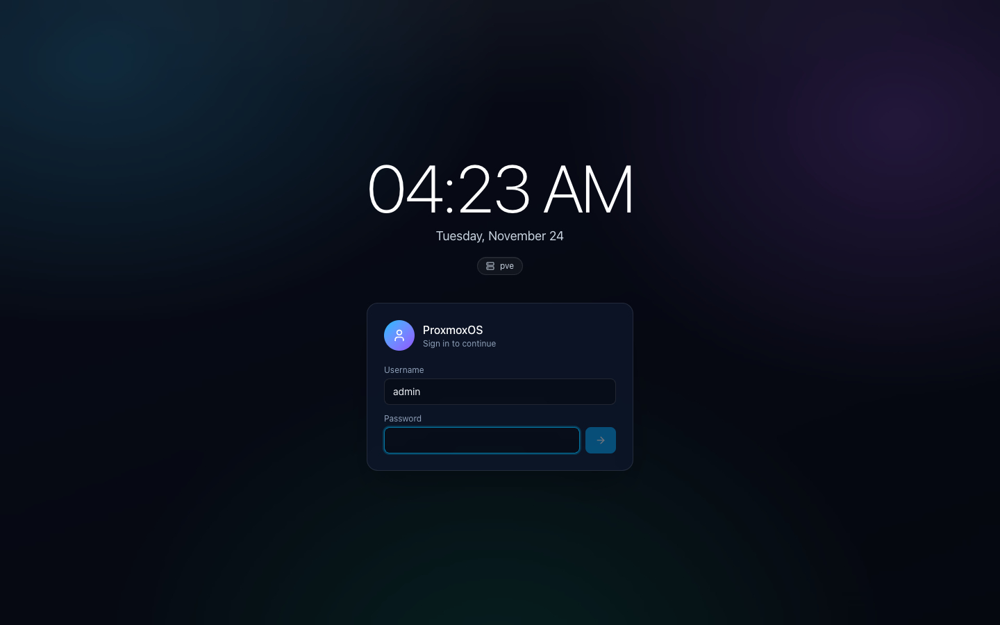

<div align="center">


&nbsp;&nbsp;&nbsp;


# Your server, as a beautiful desktop in the browser

**SolarDeck** turns a home server into something that feels like a NAS: windows, a dock, live widgets and
point-and-click apps for virtual machines, containers, ZFS storage, shares, backups, VPN and GPUs.
No config files, no command-line gymnastics.

[](https://github.com/Legend-Services/SolarOS/releases/latest)
[](https://www.proxmox.com/en/proxmox-virtual-environment)
[](#solaros-a-complete-server-os)
[](#license)

[**Install on Proxmox VE**](#solardeck-for-proxmox-ve) · [**Download SolarOS**](#solaros-a-complete-server-os) · [Screenshots](#screenshots) · [Features](#what-you-get)

<br>


</div>

## Pick your edition

Both editions are the same desktop, built from the same code, and update with one click.

| | 🟠 **SolarDeck for Proxmox VE** | ☀️ **SolarOS** |
|---|---|---|
| **For you if…** | you already run Proxmox VE | you have a spare PC or server and want a fresh start |
| **What it is** | a friendly desktop on top of Proxmox, in its own container | a complete server OS: SolarDeck *is* the hypervisor |
| **Install** | one command in the Proxmox Shell | boot the ISO, pick a disk, done |
| **Time** | about 3 minutes | one install and one reboot |
| **Touches your setup?** | no, Proxmox keeps working as before | installs on its own disk |

---

## SolarDeck for Proxmox VE

**You need:** a Proxmox VE 8 or 9 server with internet access. That's it.

1. Open your Proxmox web interface (for example `https://192.168.1.10:8006`), click your node, then **Shell**.
2. Paste this and press **Enter**:

   ```bash
   bash -c "$(curl -fsSL https://raw.githubusercontent.com/Legend-Services/SolarOS/main/install.sh)"
   ```

3. After 2–3 minutes you get a box with the **web address**, the username **`admin`** and a **password**.
   Open the address, sign in, and the Welcome Tour shows you around.

The installer finds everything by itself (free container ID, storage, IP address) and creates one new container
named `proxmox-os`. Your existing VMs and containers are not touched.

> **Lost the password?** In the Proxmox Shell: `pct exec <container ID> -- grep ADMIN_PASSWORD /opt/proxmox-os/backend/.env`

---

## SolarOS: a complete server OS

No Proxmox needed. SolarOS installs Ubuntu Server LTS with KVM virtual machines, containers, OpenZFS and the
SolarDeck desktop, all set up for you.

### Install on a PC or server

1. **Download** the latest `SolarOS-vX.Y.Z-amd64.iso` from the
   [**Releases page**](https://github.com/Legend-Services/SolarOS/releases/latest).
2. **Write it to a USB stick** (8 GB or larger) with [balenaEtcher](https://etcher.balena.io/) or
   [Rufus](https://rufus.ie/), or attach it as virtual media on your server's IPMI/iDRAC.
3. **Boot from the USB stick** and choose **Install SolarOS (Interactive Disk Selection)**. Pick the disk to install
   on. Only that disk is erased.
4. **Wait for the reboot.** The first start sets up the rest by itself (it needs internet). Then the screen shows
   the web address and your `admin` password.
5. **Open the address** from any computer on your network and sign in.

Your CPU needs virtualization (Intel VT-x or AMD-V) switched on in the BIOS. We test with 4 cores, 8 GB RAM and a
32 GB system disk; add more disks to build ZFS pools from the desktop.

### Try it in a Proxmox VE virtual machine

Curious, but not ready to wipe a machine? Run SolarOS as a VM on your Proxmox server:

1. In Proxmox, go to **local → ISO Images → Download from URL** and paste the ISO link from the
   [Releases page](https://github.com/Legend-Services/SolarOS/releases/latest) (or upload the file you downloaded).
2. **Create VM**: pick the SolarOS ISO, *Machine* `q35`, *BIOS* `OVMF (UEFI)`, *CPU type* `host`, 4 cores,
   8 GB memory and a 32 GB disk. Add one or two extra disks if you want to play with ZFS.
3. Turn on nested virtualization so SolarOS can run its own VMs. In the Proxmox Shell, check it with
   `cat /sys/module/kvm_intel/parameters/nested` (or `kvm_amd`); it should say `Y` or `1`.
4. Start the VM, open its **Console** and follow the same steps as above.

Prefer scripts? `hypervisor/test-in-proxmox-vm.sh` creates and starts a ready-made test VM for you. See
[docs/TECHNICAL.md](docs/TECHNICAL.md#testing-the-solaros-iso-inside-a-proxmox-ve-vm).

### Already running Ubuntu Server?

On a clean Ubuntu Server 24.04 or 26.04 LTS machine, as root:

```bash
bash -c "$(curl -fsSL https://raw.githubusercontent.com/Legend-Services/SolarOS/main/hypervisor/install-hypervisor.sh)" -- --with-console-tui
```

---

## What you get

| | |
|---|---|
| 🖥️ **A real desktop** | Movable windows with snapping, a dock or taskbar, live widgets, Spotlight search (Ctrl+K) and a Welcome Tour. |
| 📦 **Virtual machines & containers** | Create them with step-by-step wizards, open their screen or shell in the browser, pass through GPUs, PCI and USB devices. Windows-ready out of the box. |
| 💽 **ZFS storage made easy** | Build mirrors and RAIDZ pools, datasets, snapshots and schedules, check SMART health and benchmark your disks. |
| 🗂️ **Files, shares & backups** | A file browser, SMB shares for your network, and a Backup Center to back up and restore guests. |
| 🛒 **App Center** | One click for Jellyfin, Docker + Portainer, AdGuard Home, Nginx Proxy Manager, Immich and more. |
| 🧠 **Local AI** | Ollama + Open WebUI on your own GPU (NVIDIA, Intel, AMD) or CPU, with a model library that tells you what fits. |
| 🌐 **Network & VPN** | A live network map, DNS with ad blocking, DHCP, WireGuard VPN with QR codes, port forwarding and Let's Encrypt. |
| 🔔 **Alerts & automation** | "When the GPU gets hot, tell me on Telegram" style rules, without writing code. |
| 🎨 **Make it yours** | 11 themes in dark and light, custom wallpapers, and a theme creator. |
| 🌍 **Five languages** | English, Nederlands, Deutsch, Español and Français. |
| 🛟 **Help built in** | Guided wizards, health checks with "Fix it for me", BIOS guides and a bug reporter. |

## Screenshots

| Sign in | Storage & ZFS |
|---|---|
|  |  |
| **Virtual machines & containers** | **Network & Services** |
|  |  |

## Updating

Open **Control Panel → System & Updates** and click **Install Update Now**. Your settings, users, pools and shares
are never touched, and you can roll back to an earlier version from the same screen.

## Good to know

- Anyone who can sign in to SolarDeck can control the whole server. Keep it on your home network and turn on
  **2FA** in Control Panel → User & Security.
- Found a bug? Click **Report a Bug** in the **?** menu. It opens a pre-filled GitHub issue with anonymized details.
- Want to know how it works, run it from source or see the known limits? Read [docs/TECHNICAL.md](docs/TECHNICAL.md),
  [hypervisor/README.md](hypervisor/README.md) and the [CHANGELOG](CHANGELOG.md).

## License

SolarDeck is dual-licensed:

- **GNU Affero General Public License v3.0 (AGPLv3)** for personal, home-lab and open-source use. If you modify SolarDeck and offer it to others over a network, you must publish your changes under the same license.
- **Commercial License** for companies that want to embed, resell or offer SolarDeck as a service without the AGPLv3 obligations. See [COMMERCIAL_LICENSE.md](COMMERCIAL_LICENSE.md) and contact the maintainers through GitHub to discuss terms.

## Trademark Notice

*SolarDeck* and *SolarOS* are an independent open-source project by Ty Gultekin / Legend IT. They are not affiliated with, endorsed by, or sponsored by Proxmox Server Solutions GmbH. Proxmox® is a registered trademark of Proxmox Server Solutions GmbH; it is used here only to describe compatibility with Proxmox VE.

SolarDeck was previously named ProxmoxOS. Existing installations keep working unchanged: the app still lives in `/opt/proxmox-os` (with an `/opt/solardeck` alias), the systemd units keep their names, and re-running `install.sh` upgrades a `proxmox-os` container in place.
