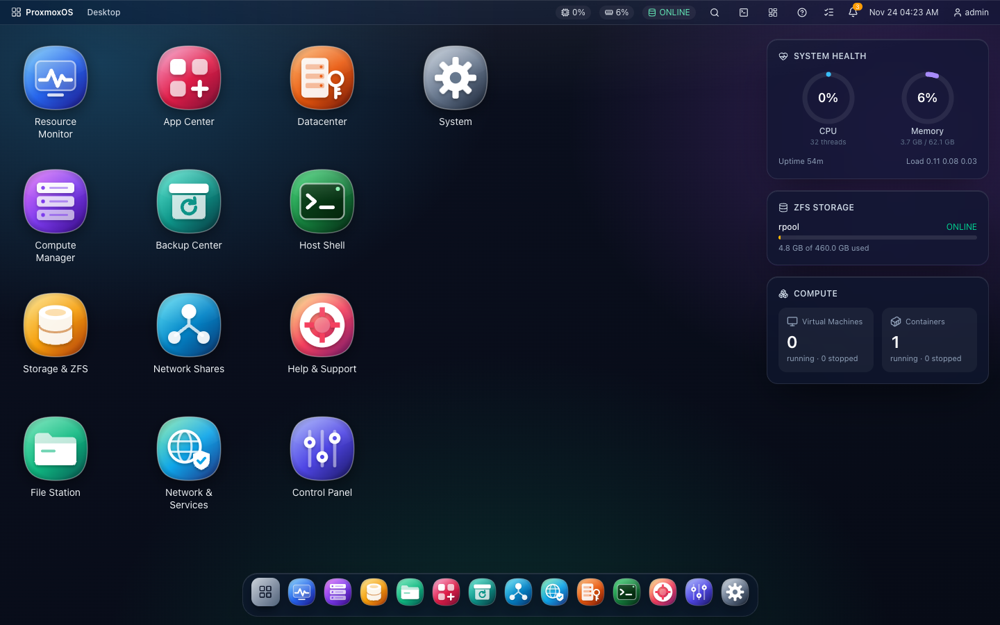

<div align="center">


&nbsp;&nbsp;&nbsp;


# Your server, as a beautiful desktop in the browser

**SolarDeck** turns a home server into something that feels like a NAS: windows, a dock, live widgets and
point-and-click apps for virtual machines, containers, ZFS storage, shares, backups, VPN and GPUs.
No config files, no command-line gymnastics.

[](https://github.com/Legend-Services/SolarOS/releases/latest)
[](https://www.proxmox.com/en/proxmox-virtual-environment)
[](#solaros-a-complete-server-os)
[](#license)

[**Install on Proxmox VE**](#solardeck-for-proxmox-ve) · [**Download SolarOS**](#solaros-a-complete-server-os) · [Screenshots](#screenshots) · [Features](#what-you-get) · [**📖 Manual**](docs/README.md)

<br>



</div>

## Pick your edition

Both editions are the same desktop, built from the same code, and update with one click.

| | 🟠 **SolarDeck for Proxmox VE** | ☀️ **SolarOS** |
|---|---|---|
| **For you if…** | you already run Proxmox VE | you have a spare PC or server and want a fresh start |
| **What it is** | a friendly desktop on top of Proxmox, in its own container | a complete server OS: SolarDeck *is* the hypervisor |
| **Install** | one command in the Proxmox Shell | boot the ISO, pick a disk, done |
| **Time** | about 3 minutes | one install and one reboot |
| **Touches your setup?** | no, Proxmox keeps working as before | installs on its own disk |

---

## SolarDeck for Proxmox VE

**You need:** a Proxmox VE 8 or 9 server with internet access. That's it.

1. Open your Proxmox web interface (for example `https://192.168.1.10:8006`), click your node, then **Shell**.
2. Paste this and press **Enter**:

   ```bash
   bash -c "$(curl -fsSL https://raw.githubusercontent.com/Legend-Services/SolarOS/main/install.sh)"
   ```

3. After 2–3 minutes you get a box with the **web address**, the username **`admin`** and a **password**.
   Open the address, sign in, and the Welcome Tour shows you around.

The installer finds everything by itself (free container ID, storage, IP address) and creates one new container
named `proxmox-os`. Your existing VMs and containers are not touched.

> **Lost the password?** In the Proxmox Shell: `pct exec <container ID> -- grep ADMIN_PASSWORD /opt/proxmox-os/backend/.env`

---

## SolarOS: a complete server OS

No Proxmox needed. SolarOS installs Ubuntu Server LTS with KVM virtual machines, containers, OpenZFS and the
SolarDeck desktop, all set up for you.

### Install on a PC or server

1. **Download** the latest `SolarOS-vX.Y.Z-amd64.iso` from the
   [**Releases page**](https://github.com/Legend-Services/SolarOS/releases/latest).
2. **Write it to a USB stick** (8 GB or larger) with [balenaEtcher](https://etcher.balena.io/) or
   [Rufus](https://rufus.ie/), or attach it as virtual media on your server's IPMI/iDRAC.
3. **Boot from the USB stick** and choose **Install SolarOS (Interactive Disk Selection)**. Pick the disk to install
   on. Only that disk is erased.
4. **Wait for the reboot.** The first start sets up the rest by itself. Then the screen shows the web address and
   a one-time **setup code**.
5. **Open the address** from any computer on your network, enter the setup code and choose your own user name and
   password. There are no default passwords; the same account also signs in to the server itself (SSH, with sudo).

Connect the machine to the internet with a network cable before you start: the installer downloads the latest
packages. Your CPU needs virtualization (Intel VT-x or AMD-V) switched on in the BIOS. We test with 4 cores, 8 GB RAM and a
32 GB system disk; add more disks to build ZFS pools from the desktop.

### Try it in a Proxmox VE virtual machine

Curious, but not ready to wipe a machine? Run SolarOS as a VM on your Proxmox server:

1. In Proxmox, go to **local → ISO Images → Download from URL** and paste the ISO link from the
   [Releases page](https://github.com/Legend-Services/SolarOS/releases/latest) (or upload the file you downloaded).
2. **Create VM**: pick the SolarOS ISO, *Machine* `q35`, *BIOS* `OVMF (UEFI)`, *CPU type* `host`, 4 cores,
   8 GB memory and a 32 GB disk. Add one or two extra disks if you want to play with ZFS.
3. Turn on nested virtualization so SolarOS can run its own VMs. In the Proxmox Shell, check it with
   `cat /sys/module/kvm_intel/parameters/nested` (or `kvm_amd`); it should say `Y` or `1`.
4. Start the VM, open its **Console** and follow the same steps as above.

Prefer scripts? `hypervisor/test-in-proxmox-vm.sh` creates and starts a ready-made test VM for you. See
[docs/TECHNICAL.md](docs/TECHNICAL.md#testing-the-solaros-iso-inside-a-proxmox-ve-vm).

### Already running Ubuntu Server?

On a clean Ubuntu Server 24.04 or 26.04 LTS machine, as root:

```bash
bash -c "$(curl -fsSL https://raw.githubusercontent.com/Legend-Services/SolarOS/solaros/hypervisor/install-hypervisor.sh)" -- --with-console-tui
```

---

## What you get

| | |
|---|---|
| 🖥️ **A real desktop** | Movable windows with snapping, a dock or taskbar, live widgets, Spotlight search (Ctrl+K) and a Welcome Tour. |
| ⚙️ **One Settings hub** | Every system, storage, security, network and hypervisor setting in one app: 5 categories, 24 sub-modules, a live filter and deep links from the top bar. The App Gallery stays focused on Settings, Compute, Files, App Center, Terminal and the apps you install. |
| 📦 **Virtual machines & containers** | Create them with step-by-step wizards, open their screen or shell in the browser, pass through GPUs, PCI and USB devices. Windows-ready out of the box. |
| 💽 **ZFS storage made easy** | Build mirrors and RAIDZ pools, datasets, snapshots and schedules, check SMART health and benchmark your disks. |
| 🗂️ **Files, shares & backups** | A file browser, SMB shares for your network, and a Backup Center to back up and restore guests. |
| 🛒 **App Center** | One click for Jellyfin, Docker + Portainer, AdGuard Home, Nginx Proxy Manager, Immich and more. |
| 🧠 **Local AI** | Ollama + Open WebUI on your own GPU (NVIDIA, Intel, AMD) or CPU, with a model library that tells you what fits. |
| 🧪 **Virtual hardware & labs** | Give any VM or container emulated peripherals (HD audio + microphone, retro sound, virtual webcam, SAS/RAID HBA, NVMe, 56k modem, 10 Mbps NIC, TPM 2.0, smartcard reader, watchdog, entropy), slow down its CPU and network (10 Mbps, 56k, 4G or your own latency and packet loss) and launch air-gapped lab networks in one click. |
| 🔌 **Visual virtual switch** | Every virtual switch as a rack faceplate: drag ports onto color-coded VLANs, add virtual network cards in two clicks, set host IPs safely and run a DHCP server per VLAN. |
| 🌐 **Network & VPN** | A live network map, DNS with ad blocking, DHCP, WireGuard VPN with QR codes, port forwarding and Let's Encrypt. |
| 🔔 **Alerts & automation** | "When the GPU gets hot, tell me on Telegram" style rules, without writing code. |
| 🎨 **Make it yours** | 11 themes in dark and light with 4 generative wallpapers each, custom wallpapers, a theme creator and a **Wallpaper Studio** that puts the logo and your server or node name on the desktop as a glass watermark. |
| 🌍 **Five languages** | English, Nederlands, Deutsch, Español and Français. |
| 🛟 **Help built in** | Guided wizards, health checks with "Fix it for me", BIOS guides and a bug reporter. |
| 🔐 **Secure by design** | Two-factor sign-in, confirmation before destructive actions, encrypted secrets, a tamper-evident audit log and a security score with 1-click host hardening. |

## Visual Virtual Switch, VLANs & Per-VLAN DHCP

Open **Settings → Network & Services → Network & Virtual Switch**:

- **Switch faceplates.** Each virtual switch shows its physical ports (link LED, speed badge) and the virtual ports of its VMs, containers and host NICs. A port's colored ring is its VLAN; a striped ring is a trunk.
- **Drag and drop VLANs.** Drag a port onto a VLAN card to make it an access port on that VLAN, onto **Trunk Port** to tick the VLANs it carries, or onto **Unplug**. Animated patch cables show which port sits on which VLAN. Click a port for a plain-English inspector with the same actions. Switches become VLAN-aware by themselves when a VLAN needs it.
- **Virtual NICs.** Add a network card to any VM or container (switch, VLAN, adapter model, MAC), or a host VLAN interface / dummy NIC; edit bandwidth limits and plug or unplug the virtual cable.
- **IP configurator.** Static or DHCP addresses, gateway, DNS, MTU and autostart for switches, ports and VLAN interfaces; bridged, NAT and isolated switches.
- **Safe by default.** Host changes are staged first. **Apply safely** snapshots the network config, reloads it and starts a 60-second countdown on the host: confirm to keep the new settings, or they are restored by themselves, even when the change cut off the browser.
- **DHCP per VLAN.** Flip one switch to run an isolated DHCP server on a VLAN, bound only to that VLAN's interface (created with the gateway IP when missing). See live leases and pin any device to a static address with one click.

## Virtual Hardware, Retro Throttling & Isolated Labs

Open a guest in **Compute** and pick the **Virtual Hardware & Lab** tab:

- **Virtual devices.** Press **+ Add Virtual Device** and pick from *Audio & Voice* (HD Audio Card + Microphone, Retro Sound Card AC97 / SB16), *Video & Capture* (Virtual Webcam fed by a test pattern, an RTSP camera, a looping video file or another VM's screen; containers), *Storage Controllers* (SAS / RAID HBA, virtual NVMe drive), *Communication & Legacy* (Virtual 56k Modem with a built-in AT-command emulator that dials host:port over TCP/IP, Retro 10/100 Mbps Ethernet) and *Security & Reliability* (TPM 2.0, USB SmartCard Reader, Hardware Watchdog, Hardware Entropy). Every device works with the guest's universal inbox drivers; legacy PCI / ISA devices are marked when a running VM needs a power cycle.
- **CPU Speed Limiter.** Limit a guest to 5–100 % of its vCPUs and pick a CPU architecture (*Modern Host*, *Standard 64-bit*, *Retro Pentium*, *Retro 486*) for speed-sensitive retro software.
- **Network Link Speed & Latency Simulator.** Per network card: *Native*, *100 Mbps*, *10 Mbps*, *56k Modem* (~120 ms), *4G Mobile* (25 Mbps, 45 ms, 10 ms jitter) or *Custom* bandwidth, latency, jitter and packet loss. Shaping uses Linux traffic control on the guest's host-side interface, is non-destructive and comes back after every guest start.
- **Isolated Lab Sandbox.** In **Compute** or **Settings → Network & Virtual Switch → Isolated Labs**, name a lab (e.g. *Retro Gaming LAN*), pick a private subnet and DHCP range and the guests to isolate, and press **Launch lab**: SolarDeck creates a virtual switch without physical ports, a lab VLAN with its own DHCP server, moves the guests' first network card onto it and blocks every route in or out (*Air-Gapped · Zero LAN Leak*). **Tear down** puts the guests back on their previous network.

## Security by Design & Hardening

The same security layer runs in both editions (SolarDeck for Proxmox VE and SolarOS). Open **Settings →
Security & Hardening** to see it all in one place.

- **Two-factor sign-in (TOTP).** Scan a QR code with any authenticator app. You also get 8 single-use recovery codes.
  With 2FA on, the password step returns a short-lived challenge and the sign-in finishes only with a valid code.
- **Sessions you can end.** Every sign-in is tracked (device, address, last seen). Revoke one device or all others; the
  token stops working immediately. Changing the password signs out every other device.
- **Brute-force protection.** After 5 failed sign-ins within 10 minutes an address is locked out for 1 minute, then 2,
  4, 8 … (at most an hour), with a `Retry-After` header.
- **Step-up confirmation.** Wiping a disk, destroying a pool or dataset, taking a mirror disk offline, deleting a VM or
  container, switching a GPU to passthrough, editing firewall rules, applying host hardening and opening a root host
  shell all ask for the password (or a 2FA code) again. The confirmation lasts 5 minutes and only for that sign-in.
- **Encrypted secrets.** Alert tokens, webhook URLs, the SMTP password and the TOTP secret are stored encrypted
  (Fernet) with a machine-local key in `backend/data/.vault.key` (`0600`). Older plaintext files keep working and are
  encrypted on the next save.
- **Tamper-evident audit log.** Sign-ins, 2FA changes, session revocations, step-up confirmations, guest and ZFS
  changes, disk wipes, firewall edits, updates and host shells go to `backend/data/audit_log.jsonl`. Each entry stores
  `sha256(previous hash + entry)`, so **Verify Hash Chain** spots any edited, removed or reordered line. Export as
  JSON or CSV.
- **Security score (0–100).** Eight weighted checks: strong admin password, 2FA, HTTPS, key-only SSH, default-deny
  firewall, kernel hardening, automatic security updates and audit log integrity. Host fixes are one click.
- **Host hardening** (`deploy/host-hardening.sh`, applied by the SolarOS installer and from the security score):
  `/etc/sysctl.d/99-solardeck-hardening.conf` (ASLR, symlink/hardlink protection, `kptr_restrict`, `dmesg_restrict`,
  SYN cookies, no ICMP redirects); SSH via `/etc/ssh/sshd_config.d/10-solardeck-hardening.conf` (key-only once a
  person's key is authorized, so you are never locked out; root by key only); `ufw` default-deny incoming with
  80/443 tcp, 51820 udp, rate-limited 22 tcp, shares and guest networks allowed; AppArmor; `unattended-upgrades`.
  On Proxmox VE the platform's own firewall is checked instead of adding ufw.
- **Web server and service.** nginx sends `X-Frame-Options`, `X-Content-Type-Options`, `Referrer-Policy`,
  `Permissions-Policy` and a Content-Security-Policy, and hides its version. The container edition's backend runs
  with `NoNewPrivileges`, a private `/tmp` and read-only `/usr`, `/boot` and home directories; `.env` and the SSH key
  are kept at `0600`.
- **On the server's own screen** (SolarOS console): **[7] Security & SSH Lock-Down** blocks or allows SSH from the
  network, shows the firewall and lists recent failed SSH and web sign-ins.

## Screenshots

| Sign in | Storage & ZFS |
|---|---|
|  |  |
| **Virtual machines & containers** | **Network & Services** |
|  |  |

The complete illustrated manual (every app, every Settings category, sub-module and screen, with step-by-step
instructions) is in **[docs/README.md](docs/README.md)**. The same articles are built into the desktop under
**Help & Support → Manual**, and the TopBar search (**⌘K / Ctrl+K**) finds apps, settings and help in one place.

The status icons in the top bar (or the taskbar tray) are yours to arrange: right-click the bar and choose
**Customize Bar & Tray...** (or open **Settings → System → General & Appearance → Top Bar & Taskbar Tray**) to reorder
them by dragging, hide the ones you do not need and choose how many stay on the bar; the rest wait behind a small
chevron. Notifications and the Task Center share the bell icon.

## Updating

Open **Settings → Software & Repositories** and click **Install Update Now**. A progress bar shows each step, and the
page reloads by itself when the update reaches 100%. Your settings, users, pools and shares are never touched, and you
can roll back to an earlier version from the same screen.

SolarDeck checks for new versions in the background and shows an **Update Ready** badge in the top bar (or in the
taskbar tray). Under **Automatic Updates & Schedule** you can keep updates manual or let them install daily, weekly or
monthly at a time you choose.

## Good to know

- Anyone who can sign in to SolarDeck can control the whole server. Keep it on your home network and turn on
  **2FA** in Settings → Security & 2FA.
- Found a bug? Click **Report a Bug** in the **?** menu. It opens a pre-filled GitHub issue with anonymized details.
- Want to know how it works, run it from source or see the known limits? Read [docs/TECHNICAL.md](docs/TECHNICAL.md),
  [hypervisor/README.md](hypervisor/README.md) and the [CHANGELOG](CHANGELOG.md).

## License

SolarDeck is dual-licensed:

- **GNU Affero General Public License v3.0 (AGPLv3)** for personal, home-lab and open-source use. If you modify SolarDeck and offer it to others over a network, you must publish your changes under the same license.
- **Commercial License** for companies that want to embed, resell or offer SolarDeck as a service without the AGPLv3 obligations. See [COMMERCIAL_LICENSE.md](COMMERCIAL_LICENSE.md) and contact the maintainers through GitHub to discuss terms.

## Trademark Notice

*SolarDeck* and *SolarOS* are an independent open-source project by Ty Gultekin / Legend IT. They are not affiliated with, endorsed by, or sponsored by Proxmox Server Solutions GmbH. Proxmox® is a registered trademark of Proxmox Server Solutions GmbH; it is used here only to describe compatibility with Proxmox VE.

SolarDeck was previously named ProxmoxOS. Existing installations keep working unchanged: the app still lives in `/opt/proxmox-os` (with an `/opt/solardeck` alias), the systemd units keep their names, and re-running `install.sh` upgrades a `proxmox-os` container in place.
