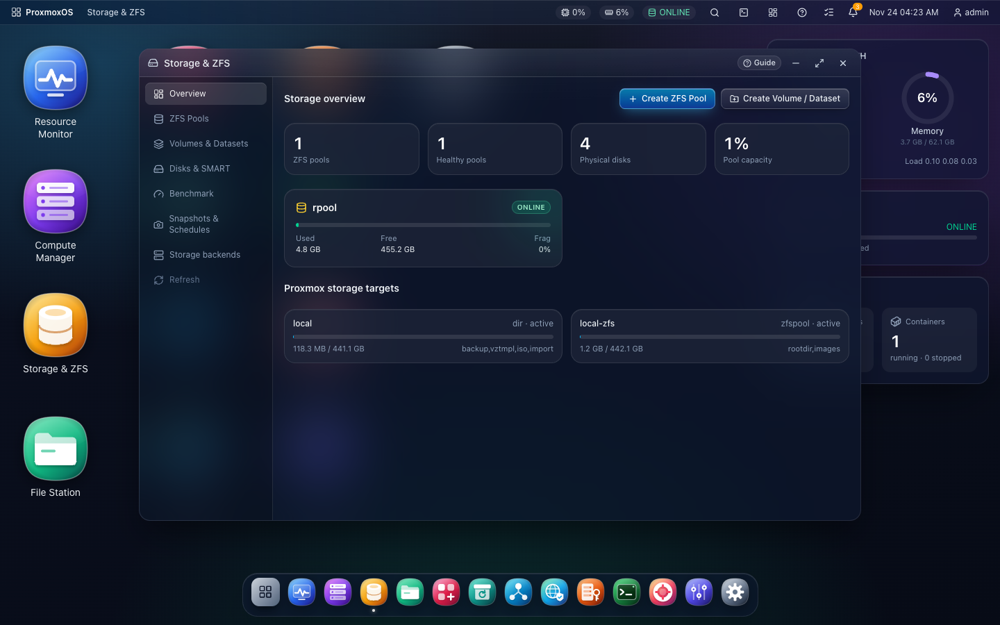
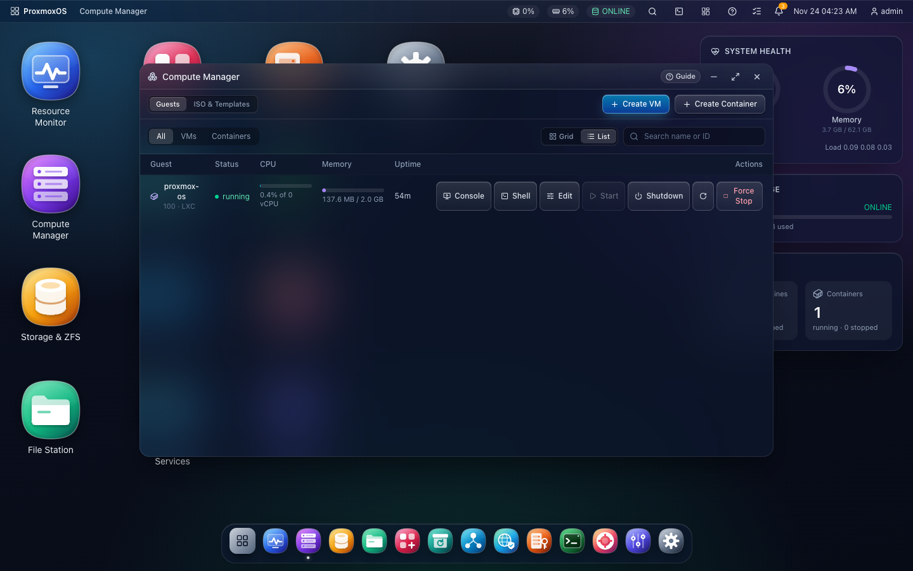
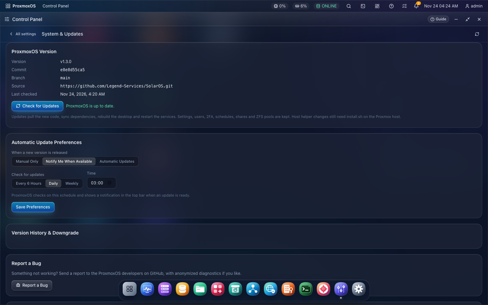

# SolarDeck

*SolarDeck for Proxmox VE* — a web desktop for your Proxmox VE server.

[](CHANGELOG.md)
[](https://www.proxmox.com/en/proxmox-virtual-environment)
[](#license)
[](#architecture)

**Your Proxmox server, as a friendly desktop in the browser.** SolarDeck puts a Liquid Glass Desktop on top of Proxmox VE: windows, a Parabolic Dock, live widgets and point-and-click apps for virtual machines, containers, ZFS storage, network shares, backups, VPN and GPUs. Installing takes one command, and you don't need to touch a config file.


## Features

| | |
|---|---|
| 🖥️ **Liquid Glass Desktop** | Multi-window desktop with snapping, Grid or List icons aligned left or centered (View Options or right-click → Align Icons), live CPU/RAM/ZFS widgets, Spotlight search (Ctrl+K) and the Parabolic Dock. |
| 💽 **SolarDeck Storage Manager** | Create ZFS pools (Mirror, RAID10, RAIDZ1–3), datasets and ZVOLs, snapshots and schedules, SMART health, disk tuning, surface scans, disk replacement and benchmarks. |
| 📦 **Compute Manager** | Create VMs and containers with wizards, GPU/PCI/USB passthrough, cloud-init, built-in screen console and shell. |
| 🌐 **Network & Services** | DNS server with ad blocking, DHCP, WireGuard VPN with QR codes, router/NAT and port forwarding, Let's Encrypt certificates. |
| 🗂️ **Files, Shares & Backups** | File Station, SMB shares (each with its own ZFS dataset), Network Backup Target, and the SolarDeck Backup Center for VM/container backups and restores. |
| 🛒 **App Center** | One-click Jellyfin, Docker + Portainer, AdGuard Home, Nginx Proxy Manager, Immich, Ollama and more, each in its own container. |
| 🎛️ **Control Panel** | 2FA, hardware inventory, one-click NVIDIA/Intel/AMD drivers, appearance, and **System & Updates** with one-click updates and downgrades. |
| 🛟 **Help built in** | Guided wizards in every app, a Welcome Tour, health checks with "Fix it for me", tutorials, BIOS guides, and an in-app bug reporter. |

## Screenshots

| Sign in | Storage & ZFS |
|---|---|
|  |  |
| **Compute Manager** | **Network & Services** |
|  |  |
| **Control Panel → System & Updates** | **Desktop** |
|  |  |

## Quick Start (1-Command Installation)

You need a Proxmox VE 8 or 9 server with internet access. That's all.

1. Open your Proxmox VE web interface in your browser (for example `https://192.168.1.10:8006`).
2. Select your Proxmox node in the left sidebar and click **Shell**.
3. Paste this command and press **Enter**:

   ```bash
   bash -c "$(curl -fsSL https://raw.githubusercontent.com/Legend-Services/SolarOS/main/install.sh)"
   ```

4. Wait about 2–3 minutes. At the end, the shell prints a box like this. Copy the **Web UI URL**, the **`admin` username** and the **auto-generated password**:

   ```
   ╔════════════════════════════════════════════════════════════════════════════╗
   ║                   SolarDeck for Proxmox VE v1.5.0 is ready                 ║
   ╠════════════════════════════════════════════════════════════════════════════╣
   ║  Web UI URL:      http://192.168.1.230                                     ║
   ║  Username:        admin                                                    ║
   ║  Password:        Xk3v9QmP2LrT8w                                           ║
   ║                   (Saved in /opt/proxmox-os/backend/.env)                  ║
   ║  Container ID:    105                                                      ║
   ║  Proxmox Host:    pve (192.168.1.10)                                       ║
   ║  Storage Mount:   /mnt/storage (2 ZFS dataset(s))                          ║
   ╠════════════════════════════════════════════════════════════════════════════╣
   ║  Tip:             Save these credentials now. You can update SolarDeck     ║
   ║                   anytime from Control Panel -> System & Updates.          ║
   ╚════════════════════════════════════════════════════════════════════════════╝
   ```

5. Open the URL in your browser and log in. The Welcome Tour shows you around.

> **Lost the password?** In the Proxmox Shell run `pct exec <Container ID> -- grep ADMIN_PASSWORD /opt/proxmox-os/backend/.env`. You can change it in Control Panel → User & Security.

### What the installer does

It finds everything by itself: the node name, the next free container ID, the best storage (ZFS > `local-lvm` > `local`), the latest Debian 12 template, and a free static IP in `.230`–`.249` (DHCP if none is free). Then it:

- creates the `pve-desktop@pve` API user with a token (`Administrator` role, needed for host updates and power control),
- creates the unprivileged container `proxmox-os` (2 cores, 2 GB RAM, 16 GB disk) and bind-mounts every ZFS dataset outside `rpool` at `/mnt/storage/<dataset>`,
- generates a random 14-character admin password and JWT secret,
- sets up passwordless SSH from the container to the host (for the Host Shell, ZFS snapshots, drivers and network services),
- installs Python, Node 22, nginx and Samba, builds the app and runs a health check.

## Updating & Downgrading Without Losing Settings

**From the desktop (recommended):** open **Control Panel → System & Updates**.

- **Check for Updates** compares your version with GitHub and lists what's new. **Install Update Now** updates in about a minute.
- **Automatic Update Preferences**: *Manual Only*, *Notify Me When Available* (default: a notification appears in the top bar) or *Automatic Updates*. You pick how often to check (every 6 hours, daily or weekly) and at what time.
- **Version History & Downgrade** lists every release and recent change. **Downgrade to This Version** switches back if a new version gives you trouble. You can move forward again from the same list.

Updates and downgrades only replace program files. **Your settings, users, passwords, 2FA, schedules, ZFS pools and datasets, and network shares are never touched.** Before each switch, `backend/.env`, `backend/data/`, `backend/.ssh/` and the Samba share config are copied to `/tmp/proxmox-os-state-backup` and restored afterwards. New settings that a release introduces are added with safe defaults, and existing values are never changed.

**From the Proxmox Shell:** run the same install command again. The installer detects the existing container and switches to **Upgrade Mode**. It backs up `.env` and `data/` to `/var/backups/proxmox-os-preupgrade-<timestamp>/` inside the container, keeps every setting and your password, refreshes the code and dependencies, and restarts the services. Running `install.sh` inside the SolarDeck container also upgrades it in place. Re-run it on the host after updates that change the host helper (`deploy/proxmox-os-helper.sh`).

> **Private fork?** Add `GITHUB_TOKEN=<token with read access>` to `/opt/proxmox-os/backend/.env` and restart the backend (`systemctl restart proxmox-os-backend`) so the updater can reach GitHub.

## Reporting Bugs

Found a problem? Click **Report a Bug**. It's in the **?** Help menu and the user menu in the top bar, in Control Panel → System & Updates, and in the desktop right-click menu.

1. Pick a category, give it a short title, and describe what happened and how to reproduce it.
2. Leave **Attach anonymized system diagnostics** on. It adds the SolarDeck and Proxmox VE versions, kernel, CPU/RAM and the last 30 backend log lines. IP and MAC addresses, e-mail addresses, passwords, tokens, JWTs and SSH keys are removed first. Click **Preview** to see exactly what is sent.
3. Click **Submit to GitHub**. A pre-filled GitHub issue opens in a new tab; review it and click *Submit new issue*. With a GitHub token (entered in the dialog, or `GITHUB_TOKEN` in `.env`) the issue is created directly. **Copy Report Markdown** copies the report so you can paste it anywhere.

## Architecture

```
 Browser ──HTTP──▶ nginx ──▶ FastAPI backend ──Proxmox API (token)──▶ Proxmox VE host
 (React SPA)        │          │                                    ▲
                    │          ├──SSH (restricted helper key)───────┤  ZFS snapshots, bind mounts, pct exec
                    │          └──SSH (root bridge key)─────────────┘  Host Shell, drivers, network services
                    └── frontend/dist        all inside the unprivileged "proxmox-os" LXC container
```

- **Frontend**: React 19, TypeScript, Vite, Tailwind 4, Zustand, lucide-react, noVNC and xterm.js.
- **Backend**: FastAPI, httpx, asyncssh and PyJWT, running as `proxmox-os-backend` (systemd) behind nginx in `/opt/proxmox-os`.
- **State**: `backend/.env` (credentials, generated by the installer) and `backend/data/*.json` (2FA, schedules, preferences, benchmarks, update settings). Both are outside Git's tracked files, so updates never overwrite them.
- **Updater**: `backend/app/updater.py` + `deploy/self-update.sh`, run as a detached systemd unit so it can restart the backend safely.

```
install.sh                 zero-touch installer and upgrader (runs on the PVE host)
deploy.sh                  push a local checkout to a PVE host over SSH and run install.sh there
deploy/                    systemd unit, nginx site, self-update.sh, merge-env.sh + env-defaults, proxmox-os-helper.sh
backend/app/               one FastAPI router per area: pve, files, console, apps, shares, storage_admin, provisioning,
                           backups, net_services, hardware_admin, guest_hardware, pve_access, updater, bug_report, ...
backend/tests/             self-check scripts (python -m tests.<name>)
frontend/src/apps/         one component per desktop app
frontend/src/components/   desktop, top bar, dock, windows, wizards, BugReportModal, Liquid Glass UI kit
docs/screenshots/          README screenshots
```

### Host helper and permissions

Some operations are limited to root on the host and can't be done with the API token: ZFS dataset snapshots, bind mounts and `/dev/dri` passthrough for App Center containers, and running installers inside new containers. The installer puts `deploy/proxmox-os-helper.sh` on the host at `/usr/local/sbin/proxmox-os-helper`. The container's SSH key for it is locked to that script (`command="…",restrict`). The helper accepts only a fixed list of commands, validates every argument, and refuses guests that SolarDeck didn't tag.

The Host Shell, container shells, GPU drivers and network services use a second, unrestricted root key. **Anyone signed in to SolarDeck is root on the host, so turn on 2FA** (Control Panel → User & Security).

Container root in an unprivileged container is uid `100000` on the host. The installer grants it access to your datasets with additive POSIX ACLs (`setfacl -R`), never `chown`, so existing ownership on the host is unchanged.

## Development

```bash
# Deploy your working copy to a Proxmox host over SSH (no GitHub push needed)
./deploy.sh                                  # root@192.168.68.220
./deploy.sh --host 10.0.0.5 --user admin     # non-root users need passwordless sudo

# Backend
cd backend && python3 -m venv .venv && .venv/bin/pip install -r requirements.txt
cp .env.example .env                         # point PVE_* at a real host and token
for t in tests/test_*.py; do .venv/bin/python -m tests.$(basename $t .py); done
.venv/bin/uvicorn app.main:app --reload --port 8000

# Frontend (proxies /api to :8000)
cd frontend && npm ci && npm run dev
```

## Known limits

- There is a single admin account from `.env` and no login rate limiting. Keep the UI on a trusted network.
- The installer doesn't add bind mounts for pools created after the container. Delete the container and re-run the installer to pick them up.
- Network throughput and ZFS ARC come from Proxmox's 1-minute averages, so those charts update in steps.
- Schedules and update checks run inside the backend. A run that is due while it is down is skipped, not replayed.
- 2FA has no recovery codes. If you lose your authenticator, delete `backend/data/security.json` in the container.
- PCIe passthrough needs IOMMU enabled on the host; Help & Support can check it and walk you through the BIOS.
- App Center installer logs are kept in memory and are lost when the backend restarts (the containers remain).

See [CHANGELOG.md](CHANGELOG.md) for the full feature history.

## License

SolarDeck is dual-licensed:

- **GNU Affero General Public License v3.0 (AGPLv3)** for personal, home-lab and open-source use. If you modify SolarDeck and offer it to others over a network, you must publish your changes under the same license.
- **Commercial License** for companies that want to embed, resell or offer SolarDeck as a service without the AGPLv3 obligations. See [COMMERCIAL_LICENSE.md](COMMERCIAL_LICENSE.md) and contact the maintainers through GitHub to discuss terms.

## Trademark Notice

*SolarDeck* is an independent open-source project by Ty Gultekin / Legend IT. It is not affiliated with, endorsed by, or sponsored by Proxmox Server Solutions GmbH. Proxmox® is a registered trademark of Proxmox Server Solutions GmbH; it is used here only to describe compatibility with Proxmox VE.

SolarDeck was previously named ProxmoxOS. Existing installations keep working unchanged: the app still lives in `/opt/proxmox-os` (with an `/opt/solardeck` alias), the systemd units keep their names, and re-running `install.sh` upgrades a `proxmox-os` container in place.

