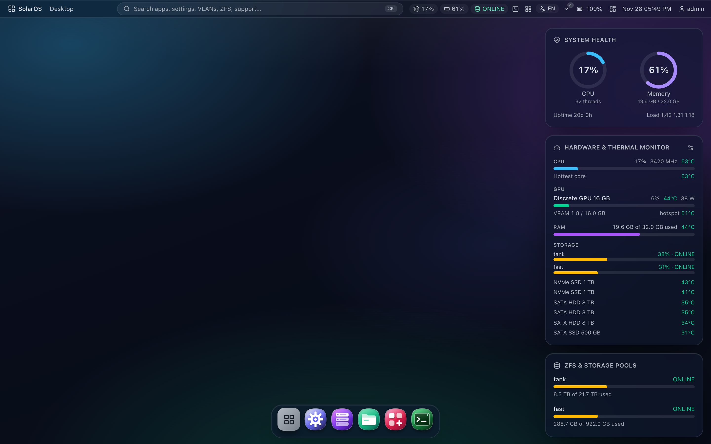
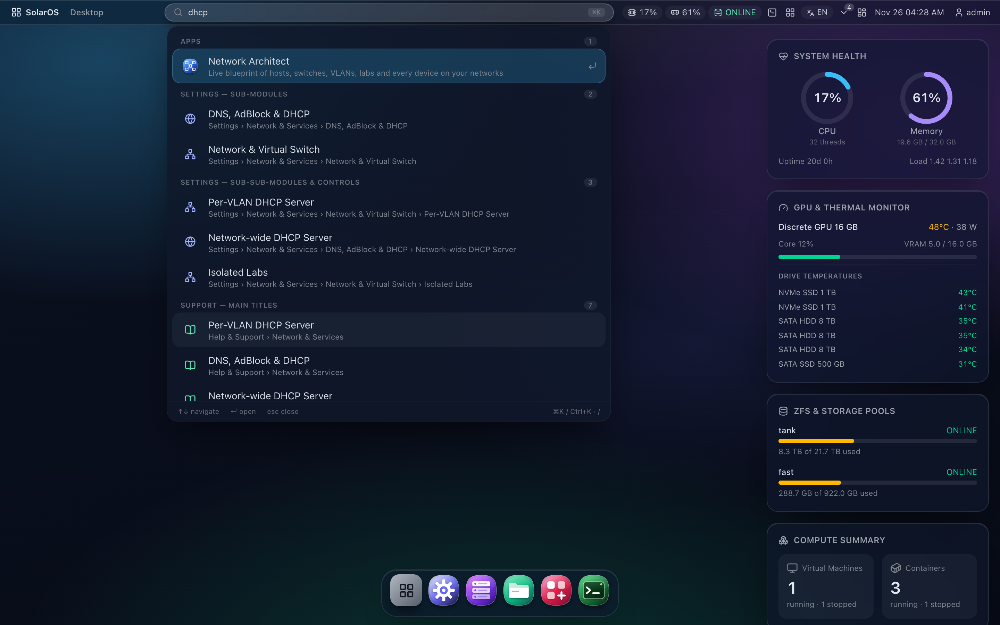
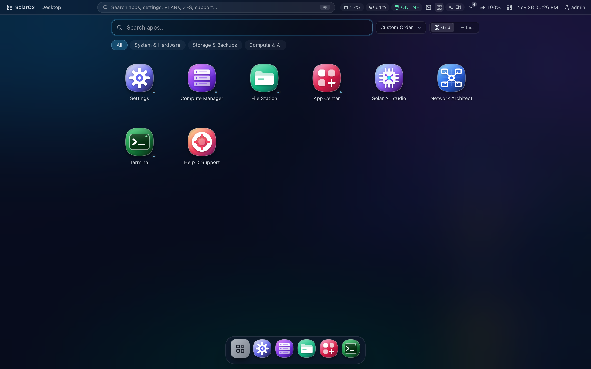
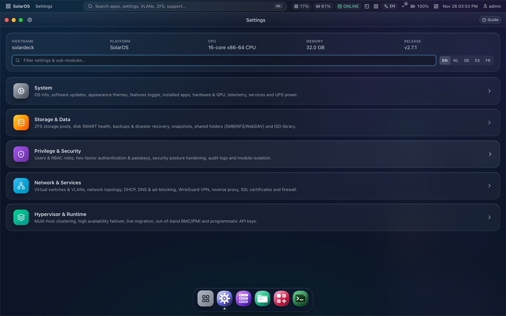
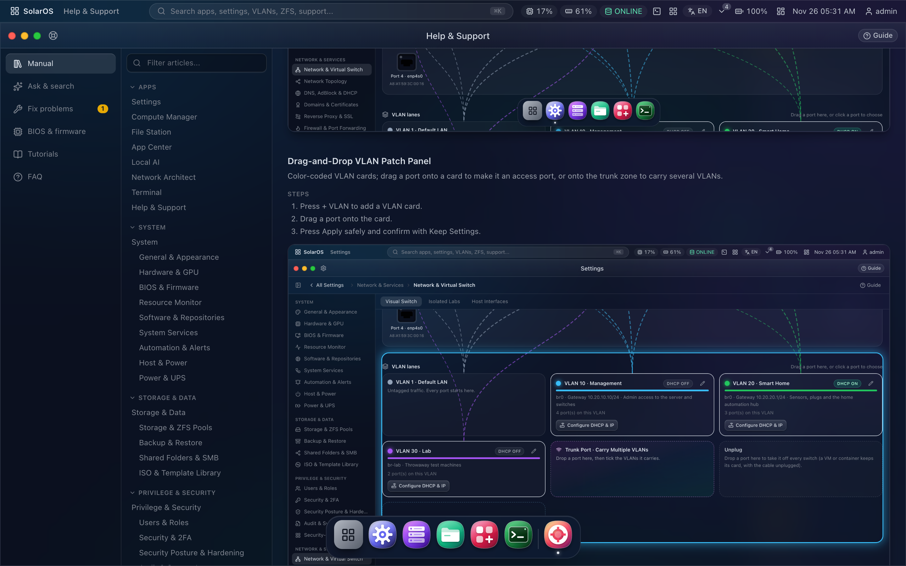

<!-- Generated by scripts/generate-support-docs.mjs from frontend/src/data/knowledgeRegistry.ts. Do not edit by hand. -->

# SolarDeck Manual

The illustrated guide to every app and setting. The same articles are built into the desktop: open **Help & Support › Manual**, or search for anything from the TopBar.

## Global Search

The search bar in the center of the TopBar finds apps, settings and help in one place. Click it or press **⌘K / Ctrl+K** (or **/** when you are not typing in a field). Use ↑ ↓ to move, Enter to open and Esc to close. Results always come in this order:

1. **Apps**
2. **Settings — Main Categories**
3. **Settings — Sub-Modules**
4. **Settings — Sub-Sub-Modules & Controls**
5. **Support — Main Titles**
6. **Support — Subtitles**
7. **Support — Help Content**

Opening a setting jumps straight to its tab and briefly highlights the card; opening a help result shows the article with the matched words highlighted. Live virtual machines, containers, pools and shares are listed after the seven groups.

## Contents

- [Apps](apps.md): Settings, Compute Manager, File Station, App Center, Solar AI Studio, Network Architect, Terminal, Help & Support
- [Settings › System](settings-system.md): Info, General & Appearance, Features & Services, Installed Apps & Instances, Hardware, BIOS/Firmware & Multi-Seat, Resource & Thermal Monitor, System Services & Repositories, Automation & Alerts, Power & UPS
- [Settings › Storage & Data](settings-storage.md): Storage & ZFS Pools, Backup & Restore, Shared Folders & SMB, ISO & Template Library
- [Settings › Privilege & Security](settings-security.md): Users & Roles, Security & 2FA, Security Posture & Hardening, Audit & System Logs, Security-by-Design Modules
- [Settings › Network & Services](settings-network.md): Network & Virtual Switch, Network Topology, DNS, AdBlock & DHCP, Domains & Certificates, Reverse Proxy & SSL, Firewall & Port Forwarding, Firewall & IDS, WireGuard VPN
- [Settings › Hypervisor & Runtime](settings-hypervisor.md): Hypervisor Defaults, Solar AI Studio Runtime, Cluster & High Availability
- [Feature deep dives](features.md): virtual switch, virtual hardware & labs, multi-seat, live thermals & monitor, clustering & HA, security internals
- [REST API reference](api/README.md): every endpoint and WebSocket by area (regenerate with `node scripts/generate-api-docs.mjs`)

## The App Gallery

## Settings

## Help & Support

For installation, architecture and development notes see [TECHNICAL.md](TECHNICAL.md).
