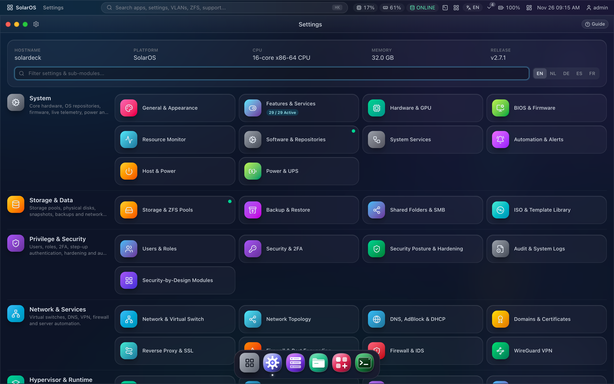
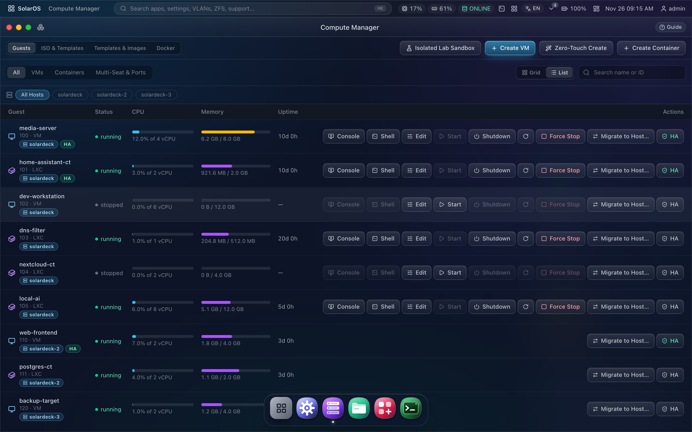
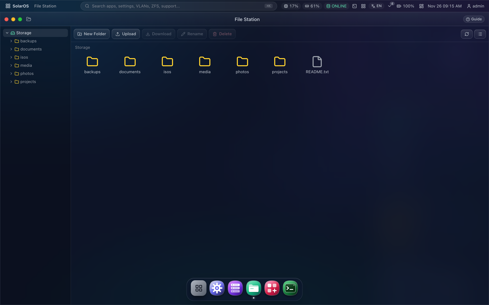
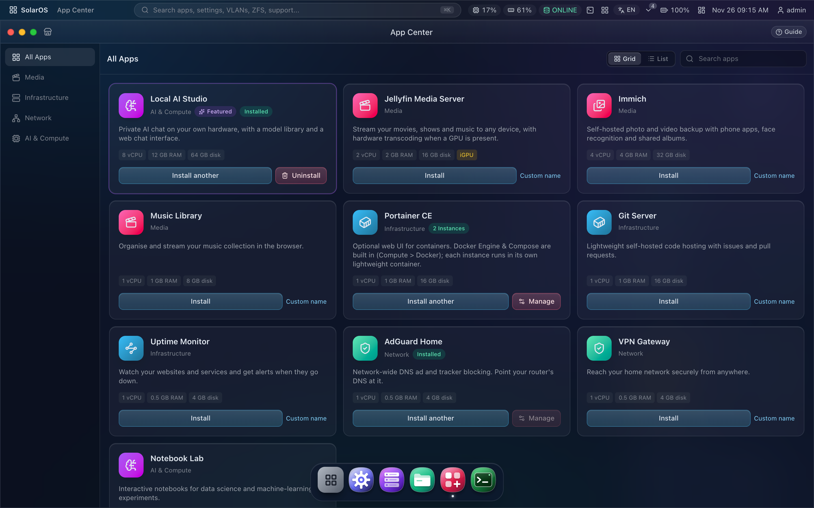
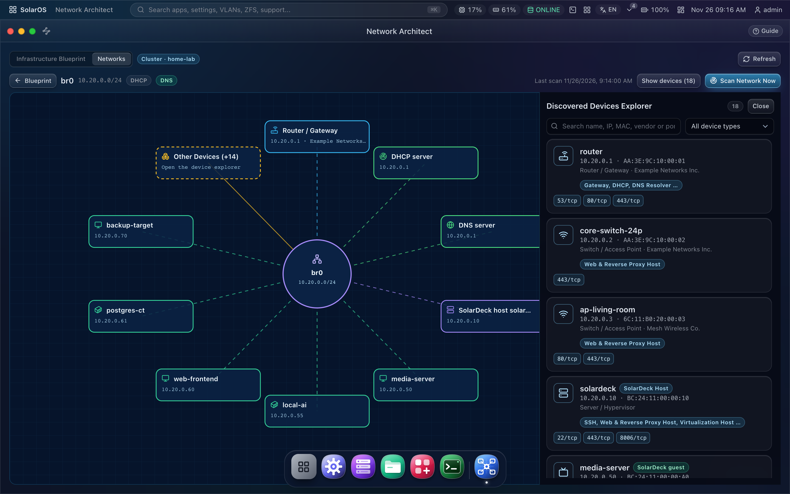

<!-- Generated by scripts/generate-support-docs.mjs from frontend/src/data/knowledgeRegistry.ts. Do not edit by hand. -->

# Apps

Every app on the SolarDeck desktop. Open them from the Dock, the App Gallery or the TopBar search (⌘K / Ctrl+K).

[← Manual](README.md)

## Settings

### Overview

Settings is the hub for every system, storage, security, network and hypervisor option. Five main categories hold the sub-modules; each sub-module opens the screens it owns.

1. Open Settings from the Dock, the App Gallery or the TopBar search.
2. Type in the search field at the top to filter sub-modules, or click a tile.
3. Inside a sub-module, use the left tree to jump to another one and the breadcrumb to go back to all settings.
4. Press “? Guide” in the breadcrumb for a step-by-step tour of the current screen.

> **Tip:** The language buttons next to the search field switch the whole desktop between English, Nederlands, Deutsch, Español and Français.

## Compute Manager

### Overview

Compute Manager lists every virtual machine and container with live status, and creates, starts, stops, edits and opens the console of each one.

1. Press “New VM” or “New Container” to start the guided wizard.
2. Use the play, stop and restart buttons on a row to control a guest.
3. Click a guest's name to open its settings drawer: CPU, memory, disks, network cards, snapshots and passthrough devices.
4. Press Console (VMs) or Shell (containers) to see the screen or get a root prompt.
5. The drawer's Virtual Hardware & Lab tab adds emulated devices (HD audio + microphone, retro sound, virtual webcam, SAS/RAID HBA, NVMe, 56k modem, 10 Mbps NIC, TPM 2.0, smartcard reader, watchdog, entropy) and throttles CPU speed and network links (10 Mbps, 56k modem, 4G, custom latency and packet loss).
6. Press Isolated Lab Sandbox to launch an air-gapped lab network with its own switch, VLAN and DHCP server in one click.
7. The Multi-Seat & Ports tab turns one machine into several workstations: give each seat VM its own GPU with its monitors, physical USB ports (Plug to Assign) and CPU cores, then press Start All Seats.
8. Switch the guest drawer from Form View to Wireframe Architecture to see the guest as a blueprint computer: click any network card, PCIe card, peripheral or drive to open the Hardware Device Inspector (name, MAC with randomizer, driver model, slot, vendor and device ID, serial, link and speed) and press Save & Apply.
9. In the wireframe, give a virtual capture card or webcam the Guest Device Manager name the guest should show (e.g. “Studio HDMI Capture Pro”); fields marked Visible in guest reach the guest, the rest are SolarDeck labels.
10. Click a network line or switch node in the wireframe to re-patch that network card to another virtual switch, physical bridge, router, VLAN or isolated lab in one click; the host node shows Standalone Mode or the cluster's preferred active host, standby hosts, ZFS sync and floating VIP.

> **Tip:** Install media lives in the ISO & Template Library; download an ISO there before creating a VM.

> **Tip:** Legacy PCI and ISA devices need a power cycle (shut down, then start) before a running VM sees them.

### Built-In Docker Engine & Compose

Docker Engine and Docker Compose are part of the platform; no app is needed. The Docker tab (shown while Docker Engine & Compose is on in Settings › Features & Services) starts with its Security-by-Design header: run the engine in an Isolated Container (recommended: its own runtime container, so the hypervisor host stays untouched) or Host Native, and pin it to the management network, a VLAN, the DMZ or an isolated lab with least-privilege firewall rules. Below it, every container shows its image, state, published ports and Compose stack, with start, stop, restart and remove, and every Compose stack shows its status and compose files. Prefer a web UI? Install Portainer CE from App Center (as many instances as you like) and add this engine to it through the Portainer Agent.

1. Open Compute and pick the Docker tab.
2. Choose Isolated Container or Host Native and the network, then switch the module on.
3. Press Install Docker Engine when it is not installed yet and follow the progress card.
4. Use the buttons on a container row to start, stop, restart or remove it; the list of Compose stacks updates with it.

### Wireframe Node Architecture & Hardware ID Overrides

The Wireframe Architecture view draws the guest as a blueprint computer: live specs and a status LED on the case, then its network adapters, motherboard PCIe cards, capture / audio / USB peripherals and storage. Animated lines run from each network adapter to its switch or VLAN (with DHCP and DNS indicators and the guest's IP address), to an isolated lab when it is in one, and the case connects to the host placement node (Standalone Mode, or the cluster's preferred active host, standby hosts, ZFS sync and floating VIP).

1. Click a device to open the Hardware Device Inspector & Editor and press Save & Apply.
2. For a network adapter: interface name or label, MAC address (the shuffle button generates a valid one), driver model, switch, VLAN tag, trunk VLANs, link state and rate limit.
3. For a virtual device: Guest Device Manager display name, vendor ID (VID), device ID (PID), serial number and address, plus its own settings such as a camera's stream source.
4. Click a network line or switch node and pick another virtual switch, physical bridge, router, VLAN or lab, then press Apply Now.

## File Station

### Overview

File Station browses the folders on your storage: upload, download, rename, move and delete files from the browser.

1. Pick a storage location in the left sidebar.
2. Double-click a folder to open it; use the path bar to go back.
3. Drag files onto the window or press Upload to add them.
4. Right-click a file for rename, download and delete.

> **Tip:** Folders you share with the network are managed in Settings › Storage & Data › Shared Folders & SMB.

## App Center

### Overview

App Center installs ready-made applications (media servers, ad blockers, home automation and more) into their own container with one click.

1. Browse the categories or search for an app.
2. Open an app card and review the suggested resources.
3. Press Deploy and wait until the job log says done.
4. Open the address shown on the deployment card to use the app.

> **Tip:** Tick Storage when the app should see your files.

> **Tip:** File sharing, the reverse proxy and Docker Engine are built in rather than apps: Settings › Storage & Data › Shared Folders & SMB, Settings › Network & Services › Reverse Proxy & SSL and Compute › Docker. Searching App Center for them shows a shortcut.

> **Tip:** Apps installed on an older version that are now built in show a Built-In Native Feature Available badge in Settings › Hypervisor & Runtime › Installed Apps & Instances; they keep working and can be opened or uninstalled as usual.

## Local AI

### Overview

Local AI Studio downloads AI models and runs them on your own hardware, with a private chat to test them. Nothing leaves your server.

1. Open the model library and download a model that fits your GPU memory.
2. Start a new chat and pick the model at the top.
3. Add custom instructions to shape the answers.

> **Tip:** GPU assignment and the model storage folder are in Settings › Hypervisor & Runtime › Local AI Runtime.

## Network Architect

### Overview

Network Architect draws your whole environment as a live blueprint: the standalone host or every cluster host with quorum and floating VIPs, the gateway and physical switch neighbors, network ports, virtual switches, VLANs with DHCP and DNS badges, isolated labs, and every VM and container with its IP addresses. Click a network to drill into it and scan for every other device on it.

1. Open Network Architect from the App Gallery or with Open Network Architect in Settings › Network & Services › Network Topology.
2. Drag to pan, scroll or use + and − to zoom the blueprint.
3. Click a switch, VLAN or lab (or pick it under Networks) to open its schematic: router, DHCP server, DNS server, this host and your guests around the network hub.
4. Press Scan Network Now: the host pings the subnet, reads the ARP and DHCP tables, looks up names (reverse DNS and mDNS) and checks common service ports.
5. More than six other devices are grouped into one Other Devices (+N) hub; click it (or Show Devices) to search and filter them by type.
6. Each device shows its type icon, name, IP and MAC address with hardware vendor, a functionality badge (e.g. Gateway, DHCP & DNS Resolver; Network Printer; RTSP IP Camera) and its open ports — click the port pills to read what every port is for.

> **Tip:** A network can only be scanned when the host has an address on it.

> **Tip:** Scans only open a connection to each port and close it again; they never log in or send data.

### Network Drill-Down & Discovered Devices Explorer

The network view puts the network hub in the middle with the router / gateway, DHCP server, DNS server, this SolarDeck host and the network's VMs and containers around it. Above six other devices the diagram shows one Other Devices (+N) hub; the Discovered Devices Explorer lists every device with its type icon, name, IP and MAC address with hardware vendor, a functionality badge and its open ports with a plain-English explanation of each.

## Terminal

### Overview

Terminal opens an instant root command line on the host and on its containers, right in the browser.

1. Open Terminal from the Dock or the terminal icon in the TopBar.
2. Choose the host or a running container.
3. Type commands; copy and paste work as usual.

> **Tip:** Commands on the host affect every guest. Take a snapshot before risky changes.

## Help & Support

### Overview

Help & Support holds this manual, an offline “Ask” search, one-click problem fixes, BIOS guides, tutorials and the FAQ.

1. Pick Manual to read the illustrated guide for every app and setting.
2. Use the filter field above the article tree to find a topic.
3. Press “Open This Setting / App →” in an article to jump straight to that screen.
4. Fix problems runs a health check and fixes common issues for you.

### Interactive Desktop Tour

Five Liquid Glass speech balloons point at the live desktop: the TopBar search (⌘K), the system tray and Task Center, the desktop widgets with Edit Widgets, the Dock or taskbar with your apps, and Settings › Features & Services. It starts by itself after the Server Setup Wizard unless you ticked Skip interactive get-started guide, and any time from Start tour on the Help & Support home page or the top bar's help menu.

1. Press Start tour.
2. Use Next and Back, or press Skip Guide (×) or Escape to end it at any step.

