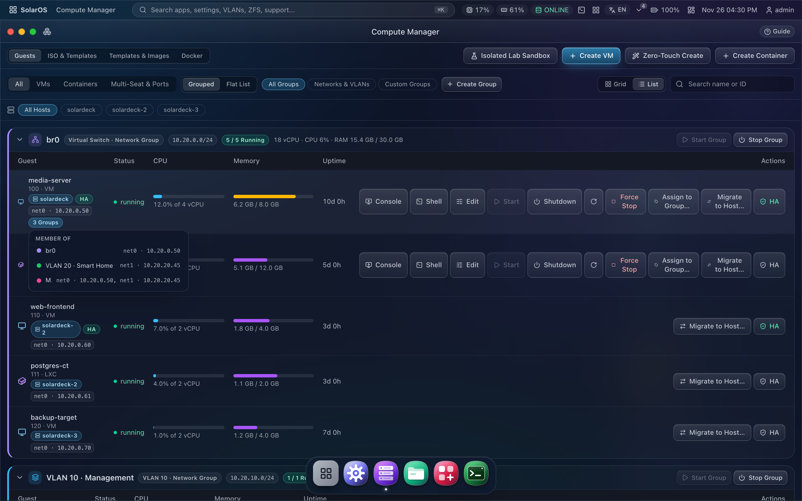
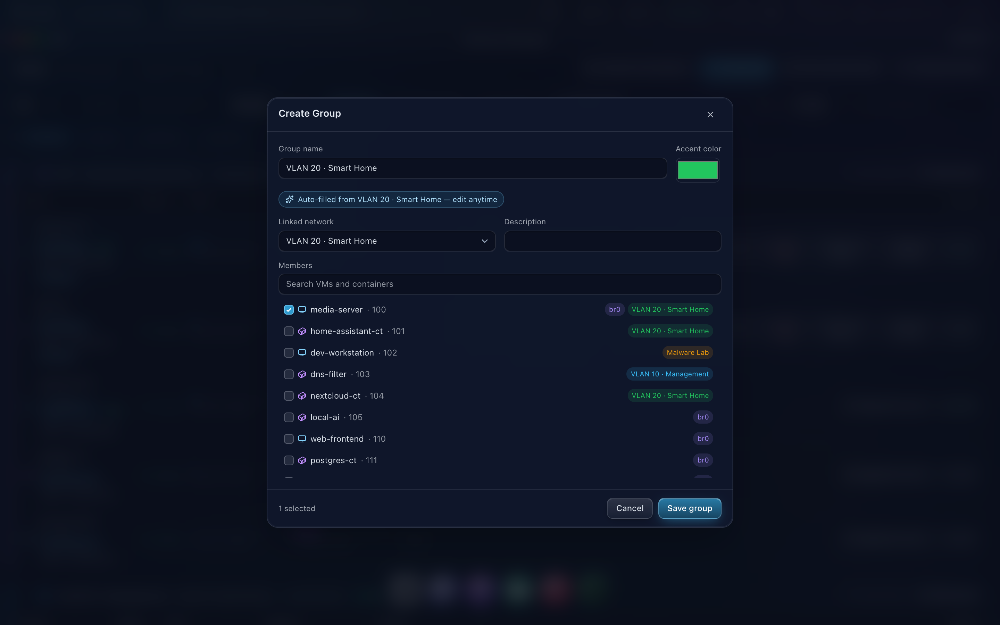
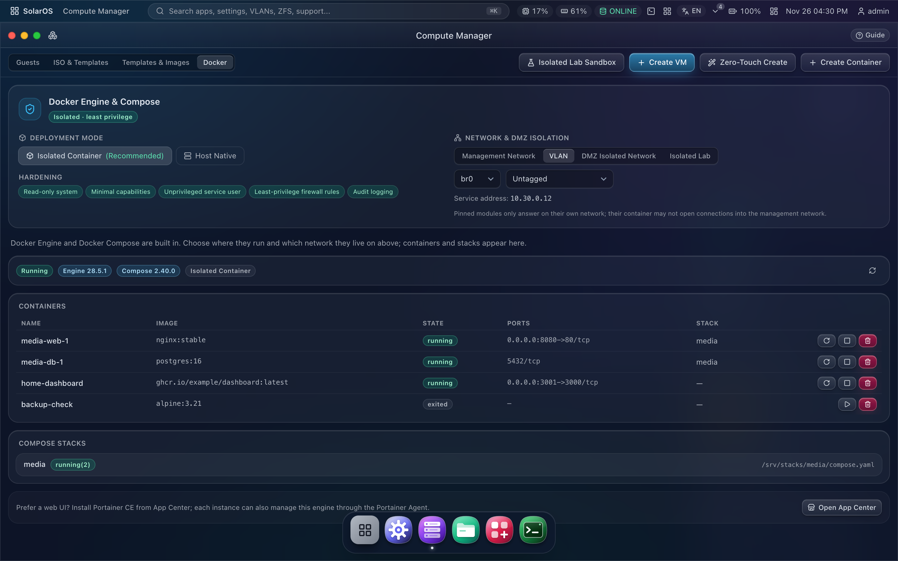
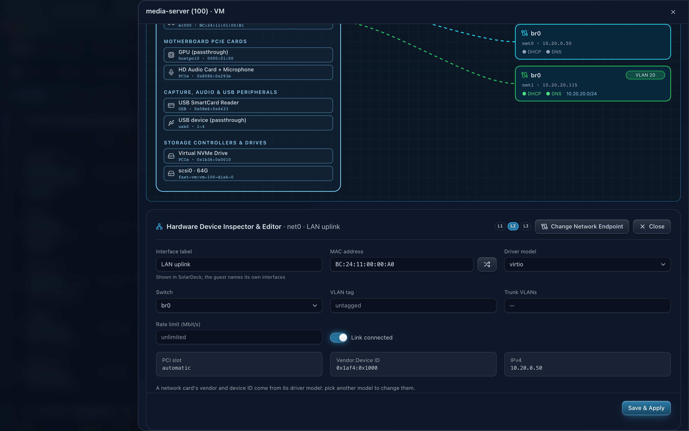
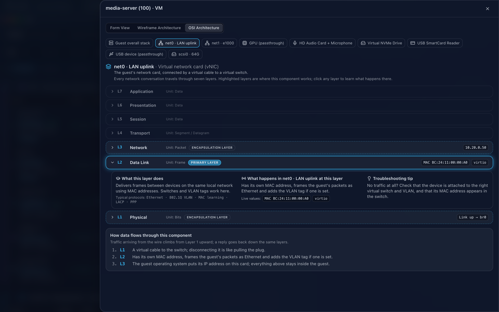
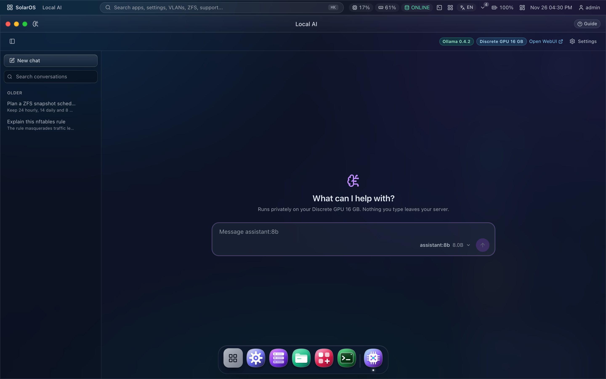
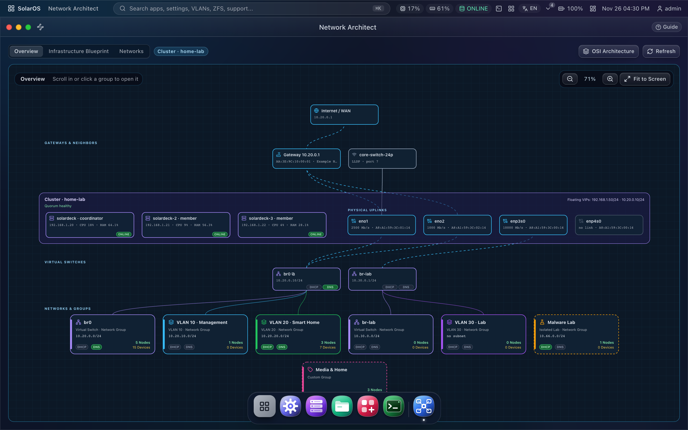
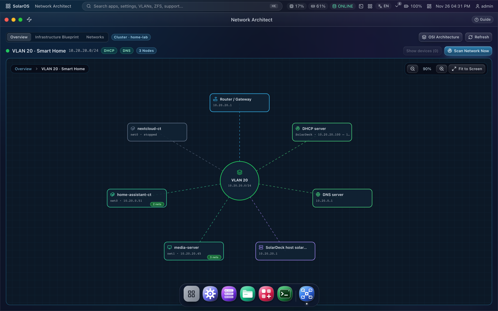

<!-- Generated by scripts/generate-support-docs.mjs from frontend/src/data/knowledgeRegistry.ts. Do not edit by hand. -->

# Apps

Every app on the SolarDeck desktop. Open them from the Dock, the App Gallery or the TopBar search (⌘K / Ctrl+K).

[← Manual](README.md)

## Settings

### Overview

Settings is the hub for every system, storage, security, network and hypervisor option. The All Settings page shows the five main categories as large cards; opening one shows its title, a breadcrumb and a sidebar with only that category's sub-modules. System opens on Info.

1. Open Settings from the Dock, the App Gallery or the TopBar search.
2. Click a category card, or type in the search field at the top to find any sub-module and click it.
3. Inside a category, use the left sidebar to jump to another sub-module of that category and ← All Settings in the breadcrumb to go back.
4. Press “? Guide” in the breadcrumb for a step-by-step tour of the current screen.

> **Tip:** The language buttons next to the search field switch the whole desktop between English, Nederlands, Deutsch, Español and Français.

## Compute Manager

### Overview

Compute Manager lists every virtual machine and container with live status, and creates, starts, stops, edits and opens the console of each one.

1. Press “New VM” or “New Container” to start the guided wizard.
2. Use the play, stop and restart buttons on a row to control a guest.
3. Pick Grouped or Flat List in the toolbar. Grouped shows every network, VLAN and isolated lab as its own collapsible group, plus your custom groups and the ungrouped rest; the pills filter to All Groups, Networks & VLANs or Custom Groups.
4. Press Start Group or Stop Group on a group's header to power every member at once; a progress card follows the batch.
5. Press + Create Group (or Assign to Group… on a guest) to make a custom group; picking a machine on a named VLAN, switch or lab fills in the group name and color for you.
6. Click a guest's name to open its settings drawer: CPU, memory, disks, network cards, snapshots and passthrough devices.
7. Press Console (VMs) or Shell (containers) to see the screen or get a root prompt.
8. The drawer's Virtual Hardware & Lab tab adds emulated devices (HD audio + microphone, retro sound, virtual webcam, SAS/RAID HBA, NVMe, 56k modem, 10 Mbps NIC, TPM 2.0, smartcard reader, watchdog, entropy) and throttles CPU speed and network links (10 Mbps, 56k modem, 4G, custom latency and packet loss).
9. Press Isolated Lab Sandbox to launch an air-gapped lab network with its own switch, VLAN and DHCP server in one click.
10. The Multi-Seat & Ports tab turns one machine into several workstations: give each seat VM its own GPU with its monitors, physical USB ports (Plug to Assign) and CPU cores, then press Start All Seats.
11. Switch the guest drawer from Form View to Wireframe Architecture to see the guest as a blueprint computer: click any network card, PCIe card, peripheral or drive to open the Hardware Device Inspector below the diagram (name, MAC with randomizer, driver model, slot, vendor and device ID, serial, link and speed) and press Save & Apply.
12. In the wireframe, give a virtual capture card or webcam the Guest Device Manager name the guest should show (e.g. “Studio HDMI Capture Pro”); fields marked Visible in guest reach the guest, the rest are SolarDeck labels.
13. Click a network line or switch node in the wireframe to re-patch that network card to another virtual switch, physical bridge, router, VLAN or isolated lab in one click; the host node shows Standalone Mode or the cluster's preferred active host, standby hosts, ZFS sync and floating VIP.
14. Switch the guest drawer to OSI Architecture to see the guest's 7-layer OSI stack, or pick any vNIC, drive, peripheral or GPU above the diagram to see which layers that device works on; the L1–L7 pills in the Hardware Device Inspector jump straight there.

> **Tip:** Install media lives in the ISO & Template Library; download an ISO there before creating a VM.

> **Tip:** Legacy PCI and ISA devices need a power cycle (shut down, then start) before a running VM sees them.

### Smart Compute Groups & Multi-Homed Machines

In the Grouped view, Compute Manager sorts your machines the way your network is built. Every virtual switch, VLAN and isolated lab is an automatic Network Group holding each VM and container with a network adapter on it; Custom Groups hold any machines you choose, optionally linked to a network; Ungrouped lists the machines on no named network or group, so nothing is ever hidden. Each group header shows its color, origin (for example VLAN 20 · Network Group or Custom Group), subnet and DHCP, how many members run, their combined vCPU, average CPU and memory, and Start Group / Stop Group buttons. A machine with adapters on several networks, or in several groups, appears in every one of them: under its name you see the adapter and IP address it uses in that group (such as net1 · 10.10.40.12) and a 2 Networks or 3 Groups badge that lists every group it belongs to.

1. Press + Create Group, tick the VMs and containers that belong together and press Save Group.
2. As soon as you tick a machine on a named VLAN, switch or lab, the name and accent color fill in from that network (Auto-filled from VLAN 20 · Production — edit anytime); type your own name to keep it.
3. Link the group to a network to show that network's adapters, subnet and DHCP on the group, or leave it unlinked.
4. Use Assign to Group… on a machine to add it to or remove it from custom groups in one click.
5. Press Start Group or Stop Group to power the whole group; machines already in that state are skipped.

### Create Group: Automatic Names from VLANs and Networks

The Create Group dialog lists every VM and container with the networks it sits on. Ticking a machine looks up the network the selected machines share most, preferring a VLAN or isolated lab over a plain switch, and fills in the group name and accent color from it with a small Auto-filled from … hint. Picking a Linked network does the same. Once you type a name yourself, auto-fill stops.

### Built-In Docker Engine & Compose

Docker Engine and Docker Compose are part of the platform; no app is needed. The Docker tab (shown while Docker Engine & Compose is on in Settings › System › Features & Services) starts with its Security-by-Design header: run the engine in an Isolated Container (recommended: its own runtime container, so the hypervisor host stays untouched) or Host Native, and pin it to the management network, a VLAN, the DMZ or an isolated lab with least-privilege firewall rules. Below it, every container shows its image, state, published ports and Compose stack, with start, stop, restart and remove, and every Compose stack shows its status and compose files. Prefer a web UI? Install Portainer CE from App Center (as many instances as you like) and add this engine to it through the Portainer Agent.

1. Open Compute and pick the Docker tab.
2. Choose Isolated Container or Host Native and the network, then switch the module on.
3. Press Install Docker Engine when it is not installed yet and follow the progress card.
4. Use the buttons on a container row to start, stop, restart or remove it; the list of Compose stacks updates with it.

### Wireframe Node Architecture & Hardware ID Overrides

The Wireframe Architecture view draws the guest as a blueprint computer: live specs and a status LED on the case, then its network adapters, motherboard PCIe cards, capture / audio / USB peripherals and storage. Animated lines run from each network adapter to its switch or VLAN (with DHCP and DNS indicators and the guest's IP address), to an isolated lab when it is in one, and the case connects to the host placement node (Standalone Mode, or the cluster's preferred active host, standby hosts, ZFS sync and floating VIP).

1. Click a device to open the Hardware Device Inspector & Editor below the diagram, edit its fields and press Save & Apply in its footer.
2. For a network adapter: interface name or label, MAC address (the shuffle button generates a valid one), driver model, switch, VLAN tag, trunk VLANs, link state and rate limit.
3. For a virtual device: Guest Device Manager display name, vendor ID (VID), device ID (PID), serial number and address, plus its own settings such as a camera's stream source.
4. Click a network line or switch node and pick another virtual switch, physical bridge, router, VLAN or lab, then press Apply Now.

### 7-Layer OSI Architecture Explorer

The OSI Architecture view teaches how network traffic travels through each part of your server. It draws the seven OSI layers as a stack, from L7 Application at the top to L1 Physical at the bottom. The layers where the inspected component does its main job glow with a Primary Layer badge, and the layers it relies on or wraps traffic in carry an Encapsulation Layer badge. Each layer shows its unit (Data, Segment / Datagram, Packet, Frame or Bits) and the component's live values as chips: MAC address, VLAN tag, IP address and subnet, TCP/UDP ports, TLS and the application endpoint. Click any layer to open its learning card. The card explains what the layer does in plain words, what happens inside this component at that layer, and a troubleshooting tip, for example: if Layer 2 shows link down, check the virtual switch attachment; if Layer 2 is up but ping fails, check the Layer 3 subnet, gateway or firewall rules. Below the stack, How data flows through this component lists the steps from the wire upward.

1. Open a VM or container and pick OSI Architecture next to Form View and Wireframe Architecture.
2. Pick Guest overall stack, or any network adapter, drive, peripheral or GPU, to see its layers: a vNIC works at Layer 2, a disk on a virtual bus at Layer 1, a remote display at Layers 6–7.
3. In Wireframe Architecture, click the L1–L7 pills in the Hardware Device Inspector to jump to that device's breakdown.
4. The same breakdown opens from the OSI Architecture button in Network Topology, in Network Architect (turn on the OSI Architecture toggle, then click any host, gateway, uplink, switch, VLAN, guest or discovered device), in the Port Inspector, the switch, VLAN and DHCP dialogs, the DNS, DHCP, WireGuard, Router, Reverse Proxy and Firewall pages, and on every App Center card and installed app instance.

## File Station

### Overview

File Station browses the folders on your storage: upload, download, rename, move and delete files from the browser.

1. Pick a storage location in the left sidebar.
2. Double-click a folder to open it; use the path bar to go back.
3. Drag files onto the window or press Upload to add them.
4. Right-click a file for rename, download and delete.

> **Tip:** Folders you share with the network are managed in Settings › Storage & Data › Shared Folders & SMB.

## App Center

### Overview

App Center installs ready-made applications (media servers, ad blockers, home automation and more) into their own container with one click.

1. Browse the categories or search for an app.
2. Open an app card and review the suggested resources.
3. Press Deploy and wait until the job log says done.
4. Open the address shown on the deployment card to use the app.

> **Tip:** Tick Storage when the app should see your files.

> **Tip:** Press OSI Architecture on a card to see how the app is reached: its container veth (L2), IP (L3), web port (L4), HTTPS (L6) and web interface (L7).

> **Tip:** File sharing, the reverse proxy and Docker Engine are built in rather than apps: Settings › Storage & Data › Shared Folders & SMB, Settings › Network & Services › Reverse Proxy & SSL and Compute › Docker. Searching App Center for them shows a shortcut.

> **Tip:** Apps installed on an older version that are now built in show a Built-In Native Feature Available badge in Settings › Hypervisor & Runtime › Installed Apps & Instances; they keep working and can be opened or uninstalled as usual.

## Local AI

### Overview

Local AI Studio downloads AI models and runs them on your own hardware, with a private chat to test them. Nothing leaves your server.

1. Open the model library and download a model that fits your GPU memory.
2. Start a new chat and pick the model at the top.
3. Add custom instructions to shape the answers.

> **Tip:** GPU assignment and the model storage folder are in Settings › Hypervisor & Runtime › Local AI Runtime.

## Network Architect

### Overview

Network Architect draws your whole environment at three zoom levels. The Overview runs top to bottom: the internet and gateways, the standalone host or every cluster host with its network ports, the virtual switches, then every network, VLAN, isolated lab and custom group as one card. Zoom in or click a card to open that network or group with its gateway, DHCP and DNS servers and members, then click a machine or the Other Devices hub to inspect it. The Blueprint view draws the full detailed topology in the same top-down tiers, down to every VM and container.

1. Open Network Architect from the App Gallery or with Open Network Architect in Settings › Network & Services › Network Topology.
2. Drag to pan and scroll to zoom. The floating bar shows where you are (Overview › VLAN 20 · Production), the zoom level with − and + buttons, and Fit to Screen.
3. Level 1 — Overview: every network, VLAN, lab and custom group is a card with its color, subnet, DHCP and DNS badges, the number of managed nodes and discovered devices.
4. Level 2 — zoom in past 75 % over a card, or click it, to open that network or group: router, DHCP server, DNS server, this host and every member around the hub. Each member shows the adapter and IP address it uses on this network, and a badge when it is on more networks.
5. Level 3 — click a VM or container to open its hardware and console drawer, or click Other Devices (+N) to search the discovered devices. Click Overview in the bar, or zoom back out, to return.
6. Press Scan Network Now: the host pings the subnet, reads the ARP and DHCP tables, looks up names (reverse DNS and mDNS) and checks common service ports.
7. More than six other devices are grouped into one Other Devices (+N) hub; click it (or Show Devices) to search and filter them by type.
8. Each device shows its type icon, name, IP and MAC address with hardware vendor, a functionality badge (e.g. Gateway, DHCP & DNS Resolver; Network Printer; RTSP IP Camera) and its open ports — click the port pills to read what every port is for.
9. Turn on OSI Architecture in the toolbar, then click any host, gateway, uplink, switch, VLAN, guest or discovered device to see its seven OSI layers with live MAC, VLAN, IP and port values; each device in Other Devices also has its own OSI Architecture button.

> **Tip:** A network can only be scanned when the host has an address on it.

> **Tip:** Scans only open a connection to each port and close it again; they never log in or send data.

### 3-Tier Semantic Zoom

Large environments stay readable because Network Architect changes what it draws as you zoom. Below 75 % you see the Overview: hosts, network ports, virtual switches and one card per network, VLAN, isolated lab and custom group. Zooming in over a card past 75 %, or clicking it, opens that network or group; zooming well back out, or clicking Overview in the breadcrumb bar, returns. From the network view, a click on a machine opens its hardware and console drawer and a click on Other Devices (+N) opens the device explorer. The groups are the same ones Compute Manager shows, and Settings › Network & Services › Network & Virtual Switch › Visual Switch lists them as pills that open Network Architect zoomed into that group.

### Network Drill-Down & Discovered Devices Explorer

The network view puts the network hub in the middle with the router / gateway, DHCP server, DNS server, this SolarDeck host and the network's VMs and containers around it. Above six other devices the diagram shows one Other Devices (+N) hub; the Discovered Devices Explorer lists every device with its type icon, name, IP and MAC address with hardware vendor, a functionality badge and its open ports with a plain-English explanation of each.

## Terminal

### Overview

Terminal opens an instant root command line on the host and on its containers, right in the browser.

1. Open Terminal from the Dock or the terminal icon in the TopBar.
2. Choose the host or a running container.
3. Type commands; copy and paste work as usual.

> **Tip:** Commands on the host affect every guest. Take a snapshot before risky changes.

## Help & Support

### Overview

Help & Support holds this manual, an offline “Ask” search, one-click problem fixes, BIOS guides, tutorials and the FAQ.

1. Pick Manual to read the illustrated guide for every app and setting.
2. Use the filter field above the article tree to find a topic.
3. Press “Open This Setting / App →” in an article to jump straight to that screen.
4. Fix problems runs a health check and fixes common issues for you.

### Interactive Desktop Tour

Five Liquid Glass speech balloons point at the live desktop: the TopBar search (⌘K), the system tray and Task Center, the desktop widgets with Edit Widgets, the Dock or taskbar with your apps, and Settings › System › Features & Services. It starts by itself after the Server Setup Wizard unless you ticked Skip interactive get-started guide, and any time from Start tour on the Help & Support home page or the top bar's help menu.

1. Press Start tour.
2. Use Next and Back, or press Skip Guide (×) or Escape to end it at any step.

