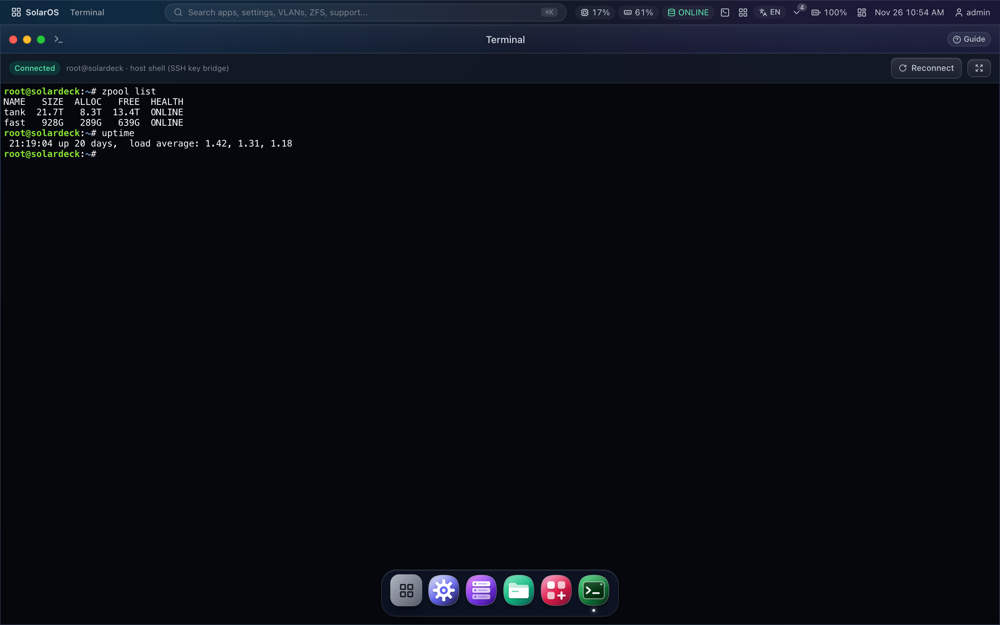
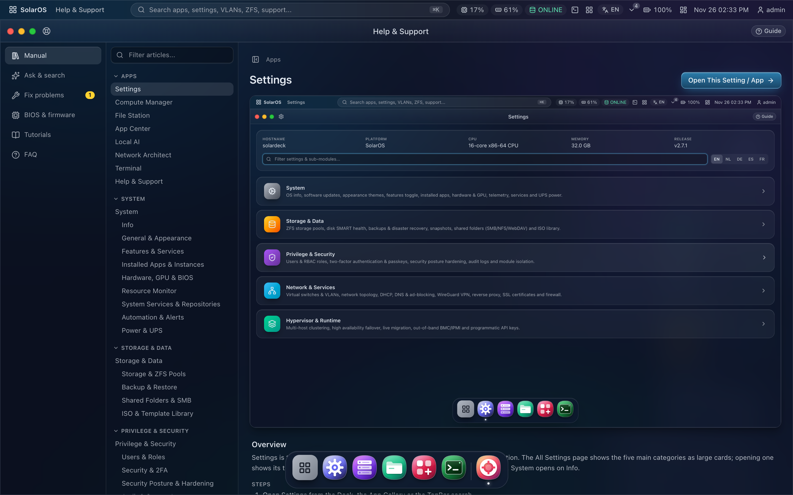

<!-- Generated by scripts/generate-support-docs.mjs from frontend/src/data/knowledgeRegistry.ts. Do not edit by hand. -->

# Apps

Every app on the SolarDeck desktop. Open them from the Dock, the App Gallery or the TopBar search (⌘K / Ctrl+K).

[← Manual](README.md)

## Settings

### Overview

Settings is the hub for every system, storage, security, network and hypervisor option. Five main categories hold the sub-modules; each sub-module opens the screens it owns.

1. Open Settings from the Dock, the App Gallery or the TopBar search.
2. Type in the search field at the top to filter sub-modules, or click a tile.
3. Inside a sub-module, use the left tree to jump to another one and the breadcrumb to go back to all settings.
4. Press “? Guide” in the breadcrumb for a step-by-step tour of the current screen.

> **Tip:** The language buttons next to the search field switch the whole desktop between English, Nederlands, Deutsch, Español and Français.

## Compute Manager

### Overview

Compute Manager lists every virtual machine and container with live status, and creates, starts, stops, edits and opens the console of each one.

1. Press “New VM” or “New Container” to start the guided wizard.
2. Use the play, stop and restart buttons on a row to control a guest.
3. Click a guest's name to open its settings drawer: CPU, memory, disks, network cards, snapshots and passthrough devices.
4. Press Console (VMs) or Shell (containers) to see the screen or get a root prompt.
5. The drawer's Virtual Hardware & Lab tab adds emulated devices (HD audio + microphone, retro sound, virtual webcam, SAS/RAID HBA, NVMe, 56k modem, 10 Mbps NIC, TPM 2.0, smartcard reader, watchdog, entropy) and throttles CPU speed and network links (10 Mbps, 56k modem, 4G, custom latency and packet loss).
6. Press Isolated Lab Sandbox to launch an air-gapped lab network with its own switch, VLAN and DHCP server in one click.
7. The Multi-Seat & Ports tab turns one machine into several workstations: give each seat VM its own GPU with its monitors, physical USB ports (Plug to Assign) and CPU cores, then press Start All Seats.

> **Tip:** Install media lives in the ISO & Template Library; download an ISO there before creating a VM.

> **Tip:** Legacy PCI and ISA devices need a power cycle (shut down, then start) before a running VM sees them.

## File Station

### Overview

File Station browses the folders on your storage: upload, download, rename, move and delete files from the browser.

1. Pick a storage location in the left sidebar.
2. Double-click a folder to open it; use the path bar to go back.
3. Drag files onto the window or press Upload to add them.
4. Right-click a file for rename, download and delete.

> **Tip:** Folders you share with the network are managed in Settings › Storage & Data › Shared Folders & SMB.

## App Center

### Overview

App Center installs ready-made applications (media servers, ad blockers, home automation and more) into their own container with one click.

1. Browse the categories or search for an app.
2. Open an app card and review the suggested resources.
3. Press Deploy and wait until the job log says done.
4. Open the address shown on the deployment card to use the app.

> **Tip:** Tick Storage when the app should see your files.

## Local AI

### Overview

Local AI Studio downloads AI models and runs them on your own hardware, with a private chat to test them. Nothing leaves your server.

1. Open the model library and download a model that fits your GPU memory.
2. Start a new chat and pick the model at the top.
3. Add custom instructions to shape the answers.

> **Tip:** GPU assignment and the model storage folder are in Settings › Hypervisor & Runtime › Local AI Runtime.

## Terminal

### Overview

Terminal opens an instant root command line on the host and on its containers, right in the browser.

1. Open Terminal from the Dock or the terminal icon in the TopBar.
2. Choose the host or a running container.
3. Type commands; copy and paste work as usual.

> **Tip:** Commands on the host affect every guest. Take a snapshot before risky changes.

## Help & Support

### Overview

Help & Support holds this manual, an offline “Ask” search, one-click problem fixes, BIOS guides, tutorials and the FAQ.

1. Pick Manual to read the illustrated guide for every app and setting.
2. Use the filter field above the article tree to find a topic.
3. Press “Open This Setting / App →” in an article to jump straight to that screen.
4. Fix problems runs a health check and fixes common issues for you.

