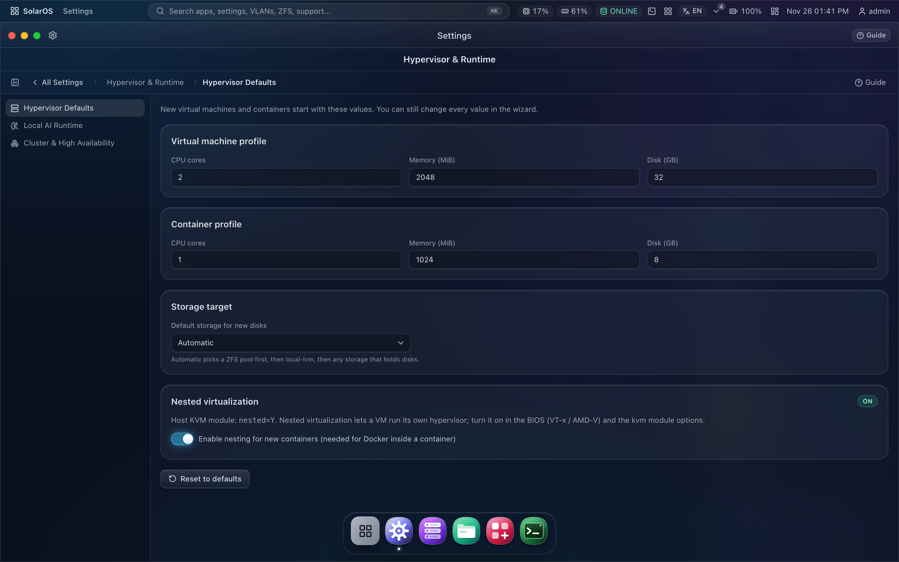
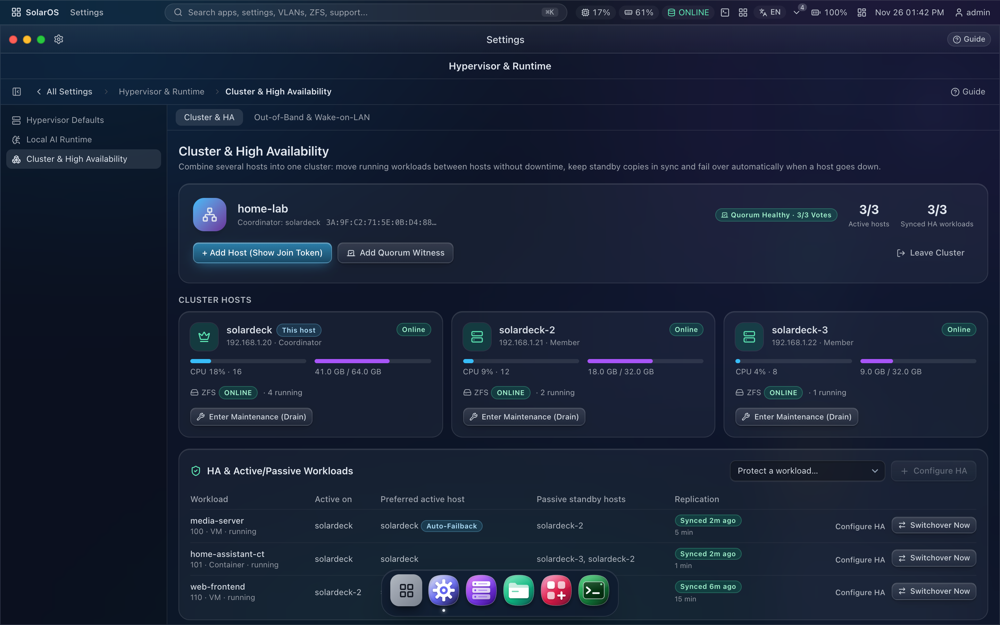
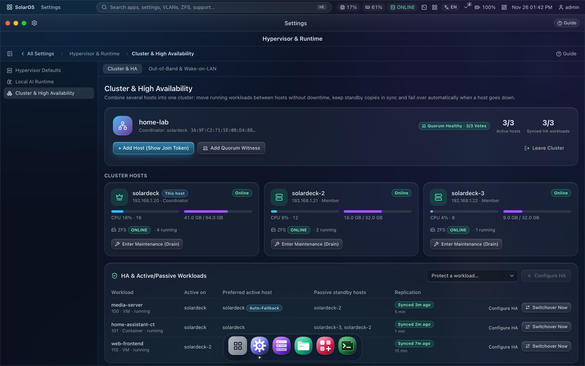
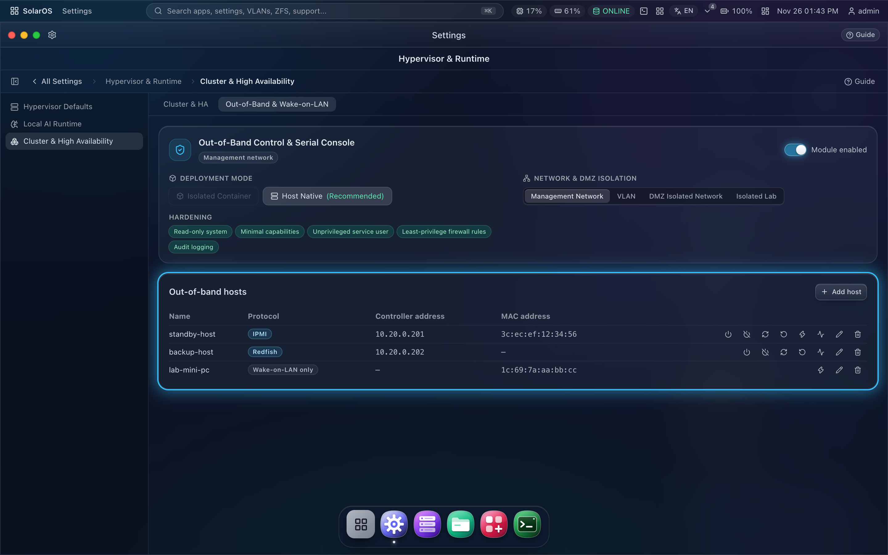

<!-- Generated by scripts/generate-support-docs.mjs from frontend/src/data/knowledgeRegistry.ts. Do not edit by hand. -->

# Settings › Hypervisor & Runtime

Multi-host clustering, high availability failover, live migration, out-of-band BMC/IPMI and programmatic API keys.

[← Manual](README.md)

**Sub-modules:** [Hypervisor Defaults](#hypervisor-defaults) · [Local AI Runtime](#local-ai-runtime) · [Cluster & High Availability](#cluster-high-availability)

## Hypervisor Defaults

### Overview

Default CPU, memory and disk profiles for new VMs and containers, the default storage target and nested virtualization.

1. Open Settings › Hypervisor & Runtime › Hypervisor Defaults (or press “Open This Setting / App →” above).
2. Adjust the VM and container profiles.
3. Choose the default storage target.
4. Turn on nested virtualization if guests run their own hypervisor.

### Virtual Machine Profile

Default cores, memory and disk size for new VMs.

1. Change the numbers; the VM wizard starts with them.

### Container Profile

Default cores, memory and disk size for new containers.

1. Change the numbers; the container wizard starts with them.

### Default Storage Target

The storage new guest disks go to by default.

1. Pick the storage in the list.

### Nested Virtualization

Let guests run their own hypervisor.

1. Switch nested virtualization on and restart the affected VMs.

## Local AI Runtime

### Overview

Which GPU runs the AI models, the AI model service and where models are stored.

1. Open Settings › Hypervisor & Runtime › Local AI Runtime (or press “Open This Setting / App →” above).
2. Pick the GPU under GPU assignment.
3. Choose a model storage folder with enough space.

### AI GPU Assignment

Which GPU runs the AI models.

1. Pick the GPU and press Save.

### AI Model Storage

Where AI models are stored.

1. Choose a folder with enough space for the models.

## Cluster & High Availability

### Overview

Combine several hosts into one cluster: live-migrate running workloads between hosts, keep passive standby hosts synchronized with incremental ZFS replication, fail over automatically when a host goes down and keep services reachable at floating virtual IPs.

1. Open Settings › Hypervisor & Runtime › Cluster & High Availability (or press “Open This Setting / App →” above).
2. Check that the readiness list is green.
3. Press Create New Cluster on the first host and copy the join token.
4. On every other host press Join Existing Cluster and paste the token.
5. Protect workloads under HA & Active/Passive Workloads.

### Cluster & High Availability

Standalone host readiness, creating a cluster or joining one with a single-use join token, and the cluster overview with quorum, hosts and synced workloads.

1. Make sure every readiness check is green (network address, clock sync, SSH keys).
2. Press Create New Cluster, enter a name and pick the cluster network.
3. Copy the join token (or scan the QR code).
4. On the next host press Join Existing Cluster and paste the token.

> **Tip:** A 2-host cluster needs a quorum witness to fail over safely.

> **Tip:** Joining keeps the host's running workloads, storage pools and settings.

### Live Migration

Move a running VM to another host without downtime (containers restart on the target), or drain a host for maintenance: every running workload is live-migrated away first.

1. In Compute press Migrate to Host… on a workload.
2. Pick the target host and keep Live Migration (Zero Downtime) on.
3. Follow the progress card until it reaches 100%.
4. To service a host, press Enter Maintenance (Drain) on its card.

### Active/Passive Failover

Per workload: a preferred active host, one or more passive standby hosts kept in sync with incremental ZFS replication (1, 5, 15 or 60 minutes), a failover timeout and optional auto-failback.

1. Pick a workload under Protect a workload… and press Configure HA.
2. Choose the preferred host and the standby hosts.
3. Set the ZFS sync interval and the failover timeout, then press Enable HA.
4. Press Switchover Now to swap active and standby on purpose.

> **Tip:** Without quorum a host stops its HA workloads itself, so a split network never runs them twice.

### Floating Cluster VIPs

Floating IPv4/IPv6 addresses bound to a clustered virtual switch or VLAN that follow the healthy host, preferring the host you choose (VRRP).

1. Enter the address in CIDR notation and the virtual switch.
2. Optionally add the VLAN and a label.
3. Pick the preferred host and press Add VIP.

### Out-of-band hosts

Out-of-band control of physical servers through their IPMI or Redfish management controller: power on, off, cycle and reset, hardware sensors, and Wake-on-LAN for standby hosts.

1. Press Add Host and enter the management controller's address and credentials (or only the MAC address for Wake-on-LAN).
2. Use the power buttons, Sensors or Wake.

