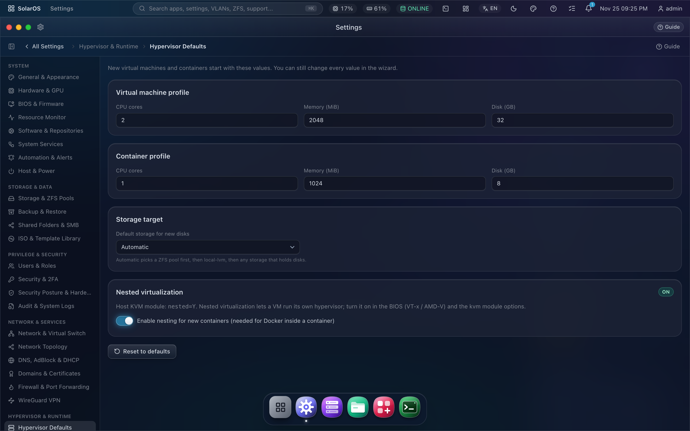
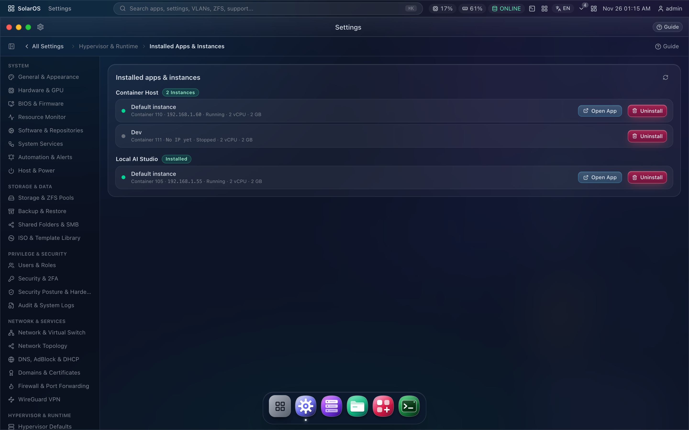
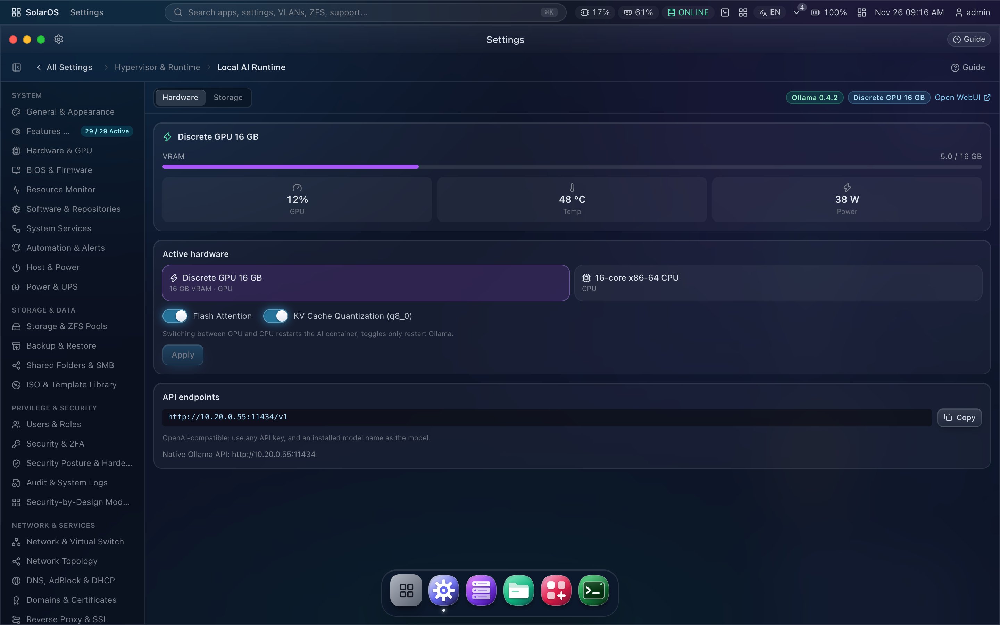

<!-- Generated by scripts/generate-support-docs.mjs from frontend/src/data/knowledgeRegistry.ts. Do not edit by hand. -->

# Settings › Hypervisor & Runtime

Virtualization defaults, AI compute runtime and background daemons.

[← Manual](README.md)

**Sub-modules:** [Hypervisor Defaults](#hypervisor-defaults) · [Installed Apps & Instances](#installed-apps-instances) · [Local AI Runtime](#local-ai-runtime)

## Hypervisor Defaults

### Overview

Default CPU, memory and disk profiles for new VMs and containers, the default storage target and nested virtualization.

1. Open Settings › Hypervisor & Runtime › Hypervisor Defaults (or press “Open This Setting / App →” above).
2. Adjust the VM and container profiles.
3. Choose the default storage target.
4. Turn on nested virtualization if guests run their own hypervisor.

### Virtual Machine Profile

Default cores, memory and disk size for new VMs.

1. Change the numbers; the VM wizard starts with them.

### Container Profile

Default cores, memory and disk size for new containers.

1. Change the numbers; the container wizard starts with them.

### Default Storage Target

The storage new guest disks go to by default.

1. Pick the storage in the list.

### Nested Virtualization

Let guests run their own hypervisor.

1. Switch nested virtualization on and restart the affected VMs.

## Installed Apps & Instances

### Overview

Every app installed from App Center, grouped by app, with each instance's label, container ID, IP address and status.

1. Open Settings › Hypervisor & Runtime › Installed Apps & Instances (or press “Open This Setting / App →” above).
2. Press Open App to open an instance's web interface.
3. Press Uninstall, choose whether to also delete the app's data, and confirm.

## Local AI Runtime

### Overview

Which GPU runs the AI models, the AI model service and where models are stored.

1. Open Settings › Hypervisor & Runtime › Local AI Runtime (or press “Open This Setting / App →” above).
2. Pick the GPU under GPU assignment.
3. Choose a model storage folder with enough space.

### AI GPU Assignment

Which GPU runs the AI models.

1. Pick the GPU and press Save.

### AI Model Storage

Where AI models are stored.

1. Choose a folder with enough space for the models.

