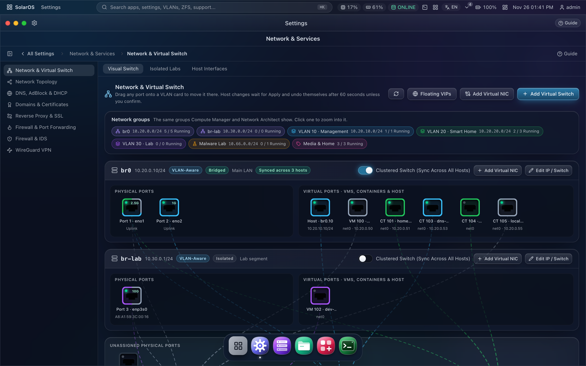
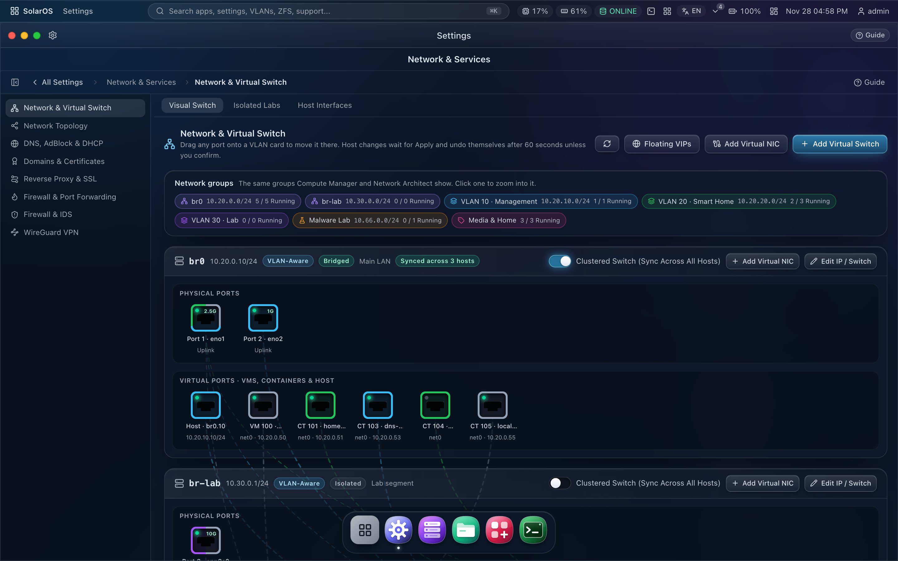
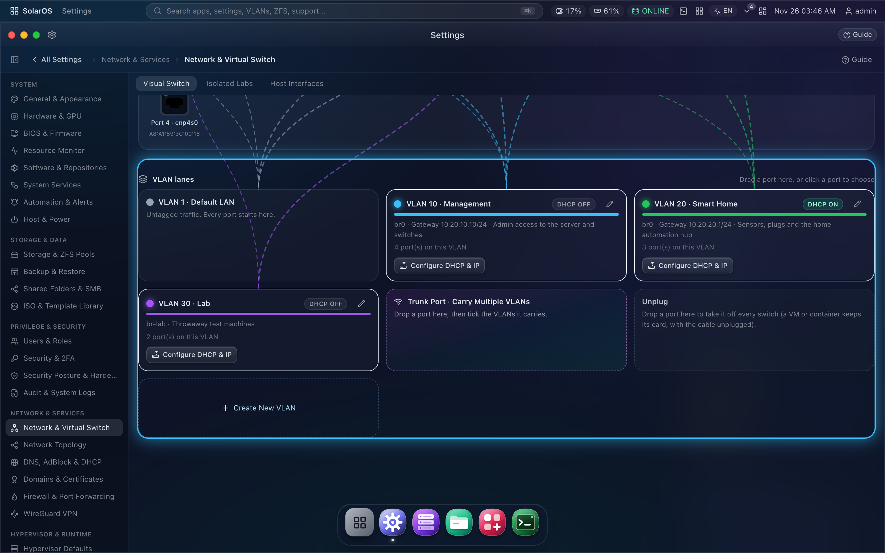
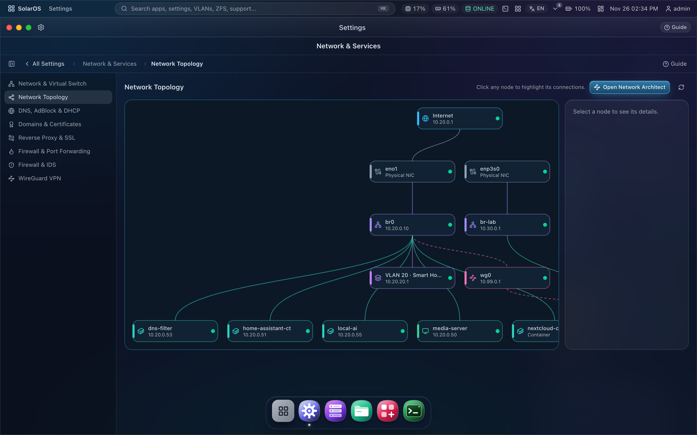
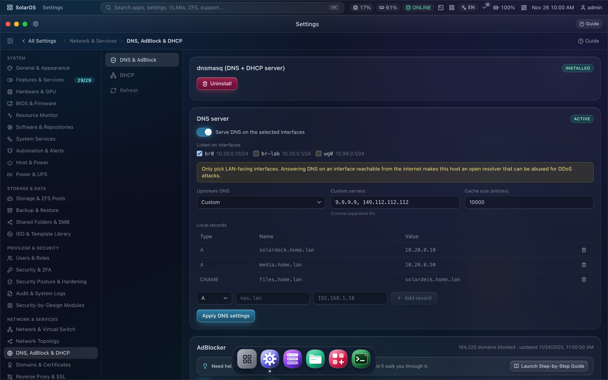
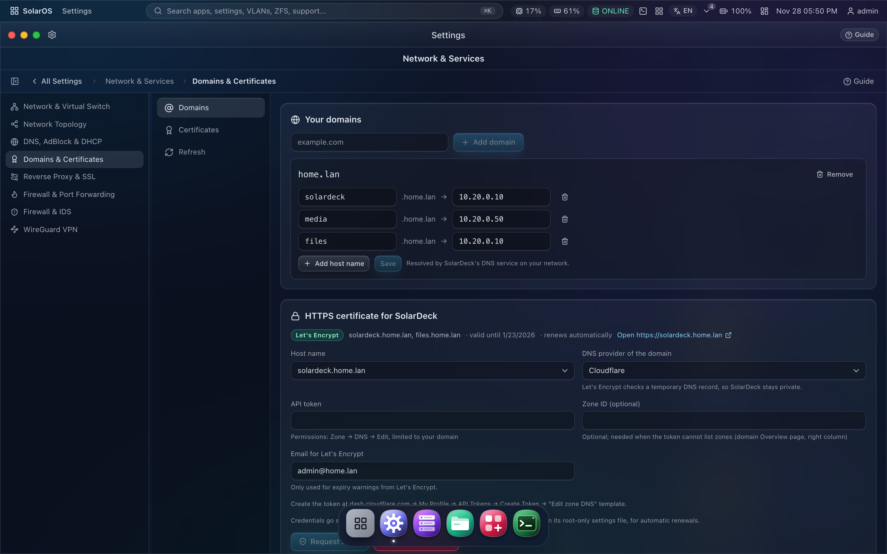
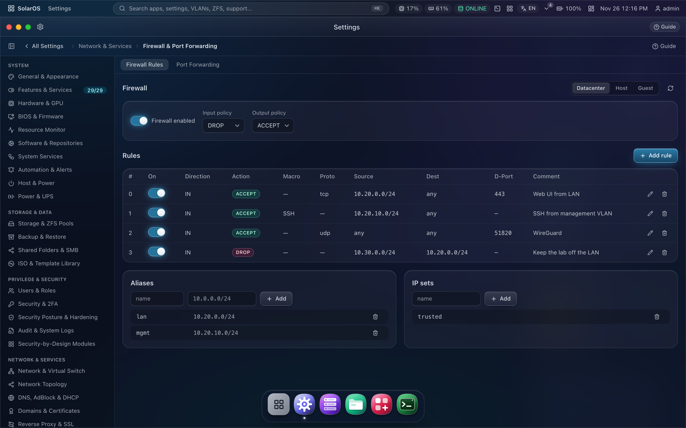
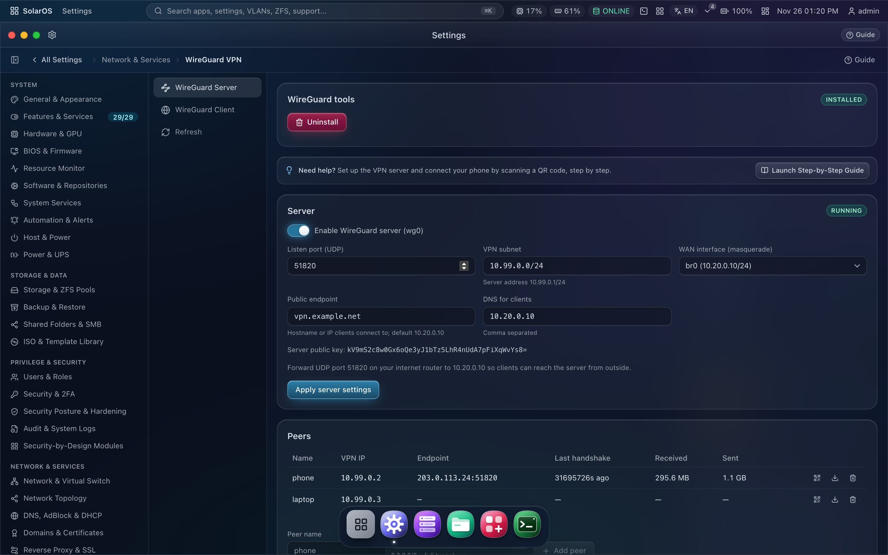

<!-- Generated by scripts/generate-support-docs.mjs from frontend/src/data/knowledgeRegistry.ts. Do not edit by hand. -->

# Settings › Network & Services

Virtual switches, DNS, VPN, firewall and server automation.

[← Manual](README.md)

**Sub-modules:** [Network & Virtual Switch](#network-virtual-switch) · [Network Topology](#network-topology) · [DNS, AdBlock & DHCP](#dns-adblock-dhcp) · [Domains & Certificates](#domains-certificates) · [Firewall & Port Forwarding](#firewall-port-forwarding) · [WireGuard VPN](#wireguard-vpn)

## Network & Virtual Switch

### Overview

A visual virtual switch: VLANs as color-coded cards, drag-and-drop patching of ports, virtual NICs, host IP settings and a DHCP server per VLAN. Changes are applied with a 60-second rollback guard.

1. Open Settings › Network & Services › Network & Virtual Switch (or press “Open This Setting / App →” above).
2. Visual Switch shows every switch with its physical and virtual ports.
3. Drag a port onto a VLAN card to patch it; drop it on the trunk zone to carry several VLANs.
4. Press Apply safely, then Keep Settings within 60 seconds.

> **Tip:** Without confirmation the previous network configuration comes back by itself, so a wrong address cannot lock you out.

### Isolated Labs

Air-gapped lab networks in one click: a switch without physical ports, a lab VLAN with its own DHCP server and the chosen VMs and containers moved onto it; one click tears it down again.

1. Press New Lab and give the lab a name.
2. Pick the subnet, the DHCP range and the guests to isolate.
3. Press Launch lab; Tear down returns the guests to their previous network.

> **Tip:** Lab guests reach only each other and the lab's DHCP server: nothing is routed to your LAN or the internet.

### Visual Switch

Every virtual switch as a rack faceplate with its ports, IP address and VLAN-aware badge.

1. Click a port to open the Port Inspector.
2. Press Edit IP / Switch to change addresses.

### Drag-and-Drop VLAN Patch Panel

Color-coded VLAN cards; drag a port onto a card to make it an access port, or onto the trunk zone to carry several VLANs.

1. Press + VLAN to add a VLAN card.
2. Drag a port onto the card.
3. Press Apply safely and confirm with Keep Settings.

### Per-VLAN DHCP Server

An isolated DHCP server per VLAN with gateway, range, DNS, lease time and static reservations.

1. Open a VLAN card's DHCP & IP button.
2. Set the gateway, range and DNS servers and switch DHCP on.
3. Pin a live lease to make it a static reservation.

### Virtual NICs

Add, edit and remove guest network cards and host VLAN interfaces.

1. Press + Add Virtual NIC on a switch.
2. Choose the guest, VLAN tag and adapter model.

### Host Interfaces

The host's network interfaces and DNS servers.

1. Open the Host Interfaces tab next to Visual Switch.

## Network Topology

### Overview

An interactive live map of the host, its switches, guests and VPN connections.

1. Open Settings › Network & Services › Network Topology (or press “Open This Setting / App →” above).
2. Drag to pan and scroll to zoom.
3. Click a node to see its details and open the screen that owns it.

### Live Topology Map

The live map of the host, switches, guests and VPN peers.

1. Click a node for details.
2. Use the buttons on a node to open the screen that manages it.

## DNS, AdBlock & DHCP

### Overview

A local DNS resolver with ad blocking and custom records, and the network-wide DHCP server.

1. Open Settings › Network & Services › DNS, AdBlock & DHCP (or press “Open This Setting / App →” above).
2. DNS & AdBlock turns on the resolver and the block lists.
3. DHCP hands out addresses to the whole network; add static leases there.

### DNS & AdBlock

Local DNS resolver with ad-blocking lists and custom DNS records.

1. Switch the resolver on.
2. Add block lists and custom records.

### Network-wide DHCP Server

The network-wide DHCP server with leases and static reservations.

1. Set the range and gateway and switch DHCP on.

## Domains & Certificates

### Overview

Local domain names and TLS certificates (Let's Encrypt or your own) for the web interface.

1. Open Settings › Network & Services › Domains & Certificates (or press “Open This Setting / App →” above).
2. Add a domain under Domains.
3. Request or upload a certificate under Certificates.

### Domains

Local domain names for the web interface and services.

1. Add a domain and point it to a service.

### Certificates

Let's Encrypt and custom TLS certificates.

1. Request a Let's Encrypt certificate or upload your own.

## Firewall & Port Forwarding

### Overview

Firewall rules for the host and guests, and NAT port forwarding from the internet to a guest.

1. Open Settings › Network & Services › Firewall & Port Forwarding (or press “Open This Setting / App →” above).
2. Firewall Rules: add allow or deny rules per port and source.
3. Port Forwarding: send an outside port to a guest's address.

### Firewall Rules

Allow and deny rules for the host and guests.

1. Press Add rule, choose direction, port and source.

### Port Forwarding

Forward an outside port to a guest (NAT).

1. Press Add, enter the outside port, the guest address and port.

## WireGuard VPN

### Overview

A WireGuard VPN server for remote access, with peers and QR codes for phones, plus a client to join another VPN.

1. Open Settings › Network & Services › WireGuard VPN (or press “Open This Setting / App →” above).
2. Turn on the server and add a peer per device.
3. Scan the peer's QR code with the WireGuard app on your phone.

### WireGuard Server

The WireGuard VPN server and its peers.

1. Switch the server on.
2. Add a peer and scan its QR code with your phone.

### WireGuard Client

Connect the host to another WireGuard VPN.

1. Paste the configuration you received and press Connect.

