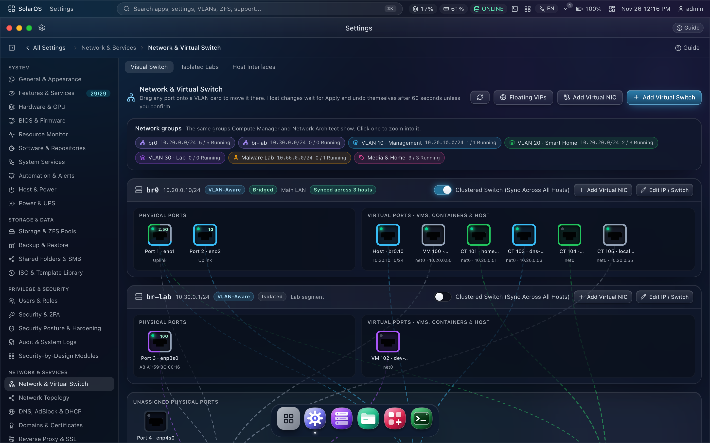
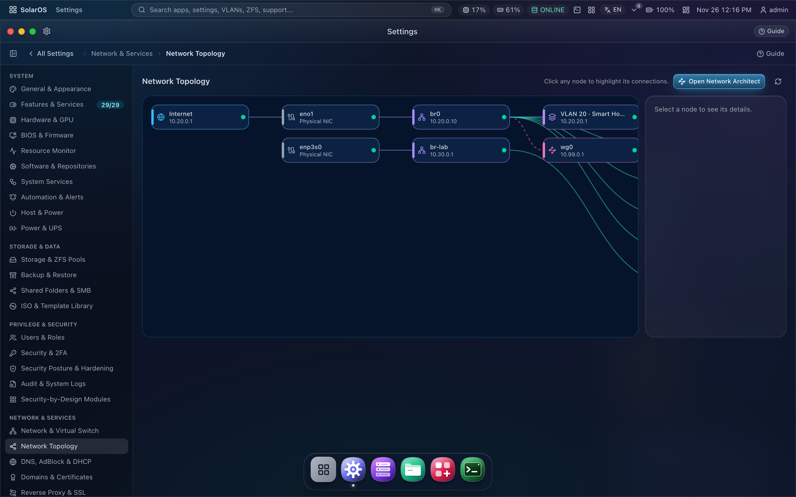
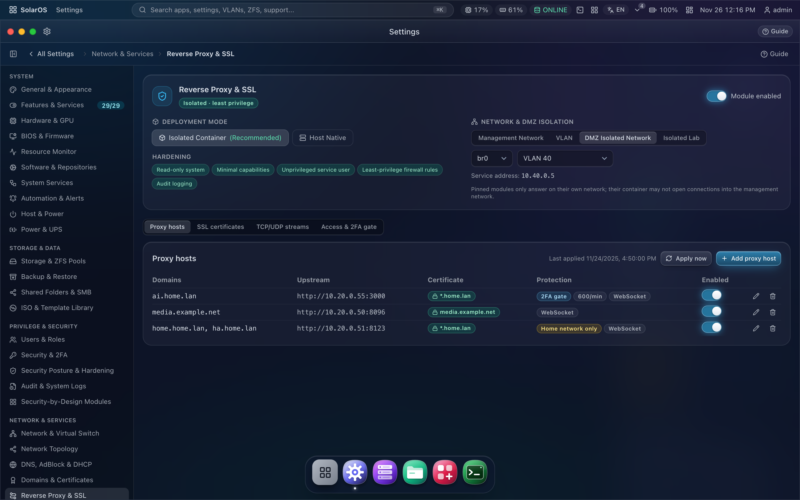
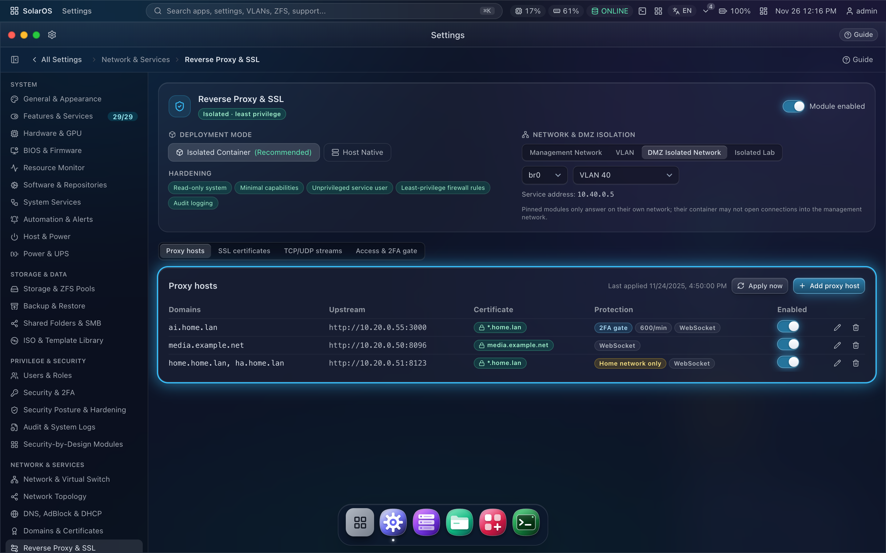
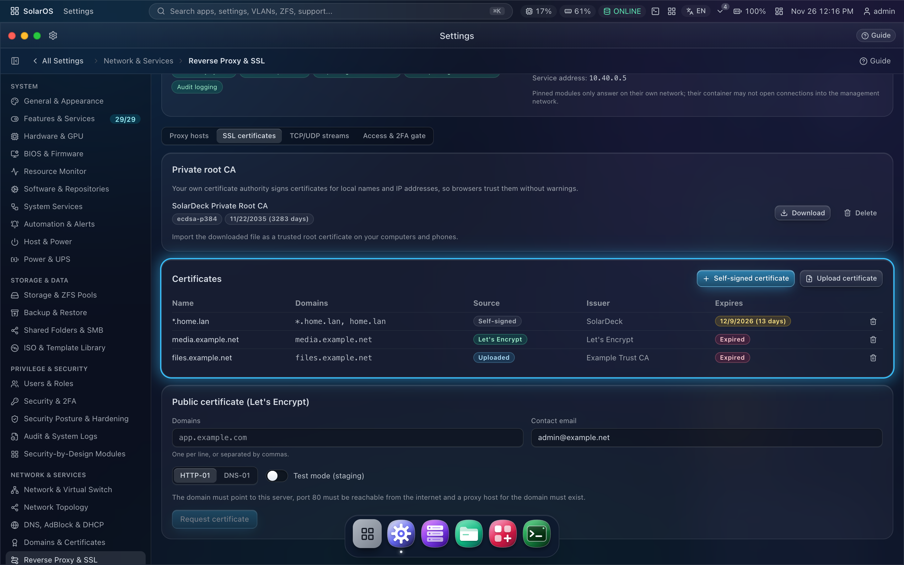
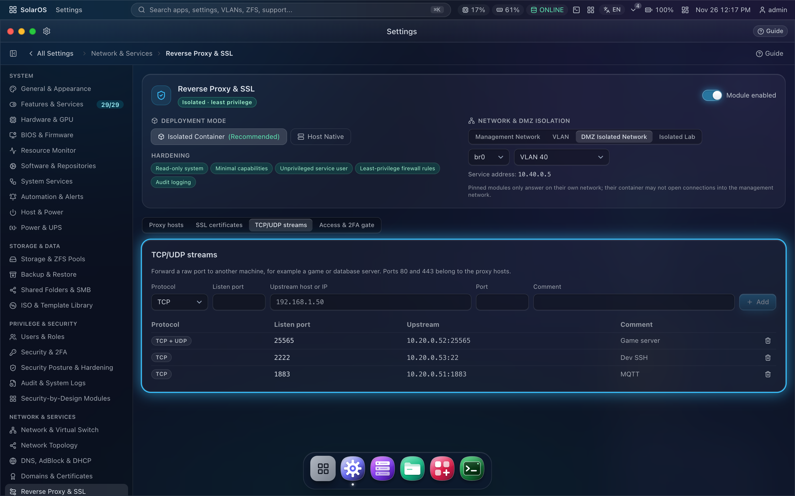
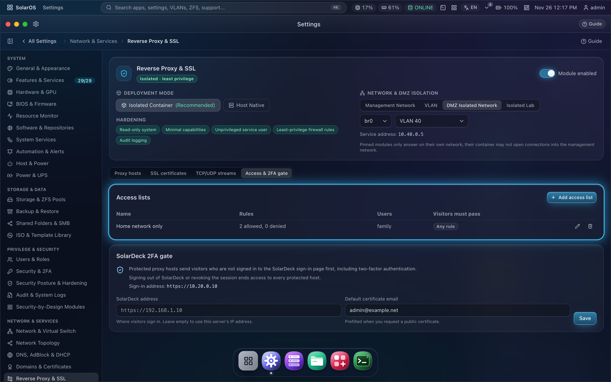
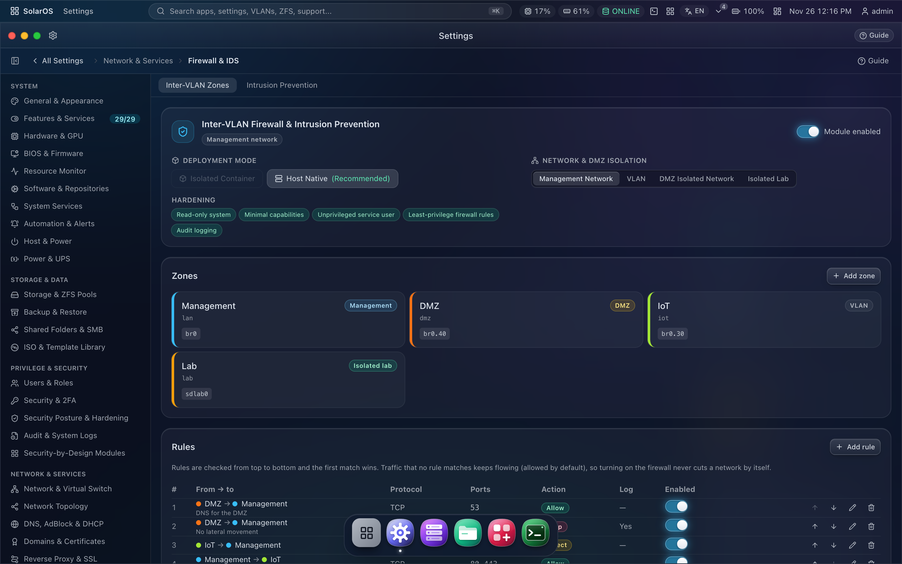
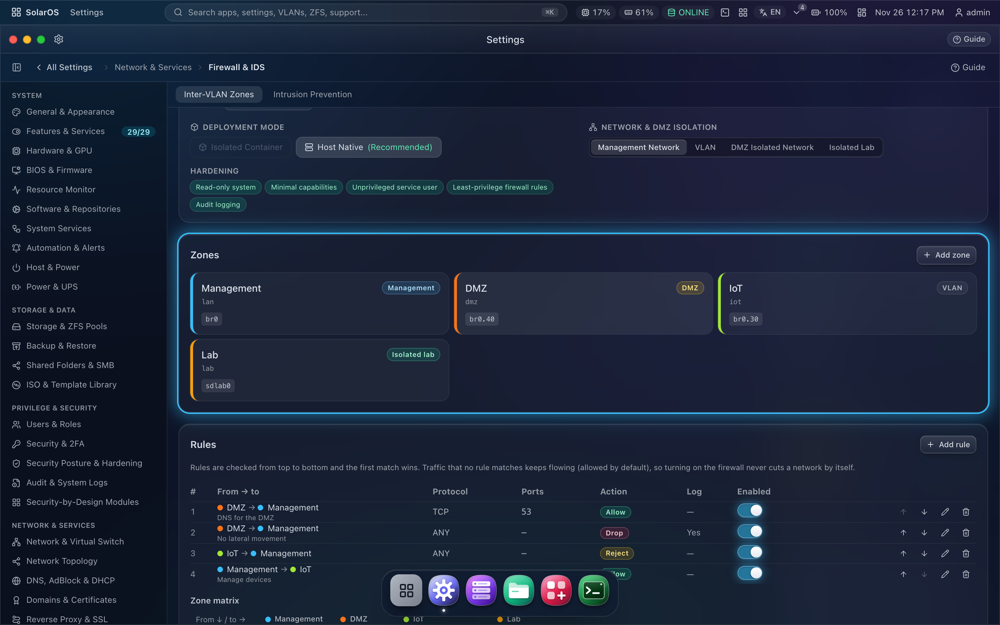
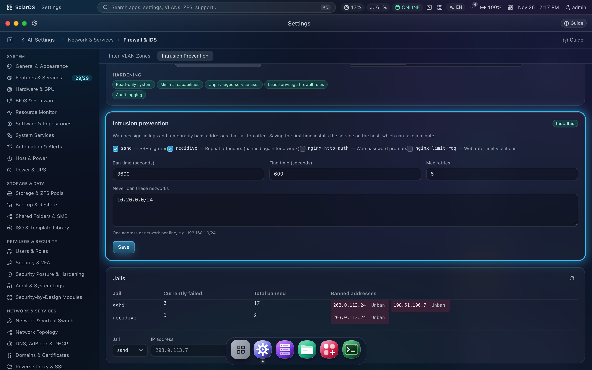

<!-- Generated by scripts/generate-support-docs.mjs from frontend/src/data/knowledgeRegistry.ts. Do not edit by hand. -->

# Settings › Network & Services

Virtual switches, DNS, VPN, firewall and server automation.

[← Manual](README.md)

**Sub-modules:** [Network & Virtual Switch](#network-virtual-switch) · [Network Topology](#network-topology) · [DNS, AdBlock & DHCP](#dns-adblock-dhcp) · [Domains & Certificates](#domains-certificates) · [Reverse Proxy & SSL](#reverse-proxy-ssl) · [Firewall & Port Forwarding](#firewall-port-forwarding) · [Firewall & IDS](#firewall-ids) · [WireGuard VPN](#wireguard-vpn)

## Network & Virtual Switch

### Overview

A visual virtual switch: VLANs as color-coded cards, drag-and-drop patching of ports, virtual NICs, host IP settings and a DHCP server per VLAN. Changes are applied with a 60-second rollback guard.

1. Open Settings › Network & Services › Network & Virtual Switch (or press “Open This Setting / App →” above).
2. Visual Switch shows every switch with its physical and virtual ports.
3. Drag a port onto a VLAN card to patch it; drop it on the trunk zone to carry several VLANs.
4. Press Apply safely, then Keep Settings within 60 seconds.

> **Tip:** Without confirmation the previous network configuration comes back by itself, so a wrong address cannot lock you out.

### Isolated Labs

Air-gapped lab networks in one click: a switch without physical ports, a lab VLAN with its own DHCP server and the chosen VMs and containers moved onto it; one click tears it down again.

1. Press New Lab and give the lab a name.
2. Pick the subnet, the DHCP range and the guests to isolate.
3. Press Launch lab; Tear down returns the guests to their previous network.

> **Tip:** Lab guests reach only each other and the lab's DHCP server: nothing is routed to your LAN or the internet.

### Visual Switch

Every virtual switch as a rack faceplate with its ports, IP address and VLAN-aware badge. Network groups pills above the faceplates show the same groups as Compute Manager; click one to open Network Architect zoomed into it.

1. Click a port to open the Port Inspector.
2. Press Edit IP / Switch to change addresses.

### Drag-and-Drop VLAN Patch Panel

Color-coded VLAN cards; drag a port onto a card to make it an access port, or onto the trunk zone to carry several VLANs.

1. Press + VLAN to add a VLAN card.
2. Drag a port onto the card.
3. Press Apply safely and confirm with Keep Settings.

### Per-VLAN DHCP Server

An isolated DHCP server per VLAN with gateway, range, DNS, lease time and static reservations.

1. Open a VLAN card's DHCP & IP button.
2. Set the gateway, range and DNS servers and switch DHCP on.
3. Pin a live lease to make it a static reservation.

### Virtual NICs

Add, edit and remove guest network cards and host VLAN interfaces.

1. Press + Add Virtual NIC on a switch.
2. Choose the guest, VLAN tag and adapter model.

### Host Interfaces

The host's network interfaces and DNS servers.

1. Open the Host Interfaces tab next to Visual Switch.

### Clustered Virtual Switches

Mark a virtual switch as clustered and it, its VLAN awareness and its VLANs are created on every cluster host, so workloads can migrate or fail over without network changes.

1. Turn on Clustered Switch (Sync Across All Hosts) on the switch.
2. Wait for the green Synced across N hosts badge.
3. Press Floating VIPs to add an address that follows the healthy host.

> **Tip:** Physical ports and host addresses stay per host; only the switch and its VLANs are shared.

## Network Topology

### Overview

An interactive live map of the host, its switches, guests and VPN connections.

1. Open Settings › Network & Services › Network Topology (or press “Open This Setting / App →” above).
2. Scroll the map to see every column; nodes run from the internet uplink through ports and switches to guests and VPN peers.
3. Click a node to highlight its connections, see its details and open the screen that owns it.
4. Press Open Network Architect for the full infrastructure blueprint with per-network device and port discovery.

### Live Topology Map

The live map of the host, switches, guests and VPN peers.

1. Click a node for details.
2. Use the buttons on a node to open the screen that manages it.

## DNS, AdBlock & DHCP

### Overview

A local DNS resolver with ad blocking and custom records, and the network-wide DHCP server.

1. Open Settings › Network & Services › DNS, AdBlock & DHCP (or press “Open This Setting / App →” above).
2. DNS & AdBlock turns on the resolver and the block lists.
3. DHCP hands out addresses to the whole network; add static leases there.

### DNS & AdBlock

Local DNS resolver with ad-blocking lists and custom DNS records.

1. Switch the resolver on.
2. Add block lists and custom records.

### Network-wide DHCP Server

The network-wide DHCP server with leases and static reservations.

1. Set the range and gateway and switch DHCP on.

## Domains & Certificates

### Overview

Local domain names and TLS certificates (Let's Encrypt or your own) for the web interface.

1. Open Settings › Network & Services › Domains & Certificates (or press “Open This Setting / App →” above).
2. Add a domain under Domains.
3. Request or upload a certificate under Certificates.

### Domains

Local domain names for the web interface and services.

1. Add a domain and point it to a service.

### Certificates

Let's Encrypt and custom TLS certificates.

1. Request a Let's Encrypt certificate or upload your own.

## Reverse Proxy & SSL

### Overview

Publish VMs, containers and apps under your own domain names with HTTPS: proxy hosts with WebSocket, HTTP/2, HSTS, upload limits and rate limiting, a private root CA with one-click certificates, Let's Encrypt, your own certificates, IP access lists, the SolarDeck 2FA sign-in gate and raw TCP / UDP stream forwarding.

1. Open Settings › Network & Services › Reverse Proxy & SSL (or press “Open This Setting / App →” above).
2. Turn the module on and pick Isolated Container (recommended) or Host Native, and optionally pin it to a DMZ VLAN.
3. Under SSL Certificates, create the private root CA or request a Let's Encrypt certificate.
4. Under Proxy Hosts, add a domain, pick the VM, container or app it points to, and choose the certificate.
5. Install the downloaded root CA certificate on your devices so they trust the private certificates.

> **Tip:** A proxy host with the SolarDeck 2FA gate only lets visitors through who are signed in to SolarDeck.

> **Tip:** Every change is checked before it is applied; a rejected configuration leaves the previous one running.

### Proxy hosts

Proxy hosts: one or more domain names in front of a VM, container or app, with HTTPS, WebSocket, HTTP/2, HSTS, an upload size limit, rate limiting, an access list, the SolarDeck 2FA gate and optional advanced directives.

1. Press Add Proxy Host.
2. Enter the domain names and pick the VM, container or app (or type an address and port).
3. Choose a certificate and switch on Force HTTPS.
4. Turn on the SolarDeck 2FA gate for apps without a login of their own, then Save.

> **Tip:** A change that cannot be applied is saved and reported; the previous configuration keeps running.

### Certificates

All certificates with their names, source (private CA, Let's Encrypt or uploaded), issuer and expiry date; one-click self-signed and wildcard certificates and certificate upload.

1. Press Self-Signed Certificate and enter the domains (for example *.home.lan) to issue one from the private root CA.
2. Or press Upload to paste your own certificate, private key and chain.

### Private root CA

Your own private root certificate authority (ECDSA P-384 or RSA-4096). Install its certificate on your computers and phones once and every certificate it signs is trusted.

1. Press Create Root CA and choose the key type.
2. Press Download solardeck-root-ca.crt.
3. Import it as a trusted root certificate on each device.

> **Tip:** The private key never leaves the server and is stored encrypted.

### Public certificate (Let's Encrypt)

Free public certificates from Let's Encrypt with the HTTP-01 challenge (port 80 reachable) or the DNS-01 challenge (wildcards, no open ports), renewed automatically 30 days before they expire.

1. Enter the domains and your e-mail address.
2. Pick HTTP-01, or DNS-01 with your DNS provider plugin and its API credentials.
3. Press Request and follow the live log.

### TCP/UDP streams

Raw TCP and UDP port forwarding to a VM or container, for game servers, SSH, MQTT or databases.

1. Enter the listen port, protocol and the target address and port.
2. Press Add.

> **Tip:** Ports 80 and 443 belong to the proxy hosts.

### Access lists

Access lists: networks that may or may not connect, plus optional user names and passwords, attached to proxy hosts.

1. Press Add Access List.
2. Enter allowed and denied networks and optional users.
3. Pick the list in a proxy host.

### SolarDeck 2FA gate

The SolarDeck 2FA gate sends visitors of a protected host to the SolarDeck sign-in (with two-factor code) first; signing out or revoking the session ends access to every protected app.

1. Turn on SolarDeck 2FA gate in a proxy host.
2. Check the gate address here; change it if SolarDeck is reached under another name.

## Firewall & Port Forwarding

### Overview

Firewall rules for the host and guests, and NAT port forwarding from the internet to a guest.

1. Open Settings › Network & Services › Firewall & Port Forwarding (or press “Open This Setting / App →” above).
2. Firewall Rules: add allow or deny rules per port and source.
3. Port Forwarding: send an outside port to a guest's address.

### Firewall Rules

Allow and deny rules for the host and guests.

1. Press Add rule, choose direction, port and source.

### Port Forwarding

Forward an outside port to a guest (NAT).

1. Press Add, enter the outside port, the guest address and port.

## Firewall & IDS

### Overview

Group switches and VLANs into zones (management, DMZ, labs, guests) and decide with ordered rules which traffic may pass between them; intrusion prevention bans addresses that keep failing to sign in.

1. Open Settings › Network & Services › Firewall & IDS (or press “Open This Setting / App →” above).
2. Create zones and add the switches or VLAN interfaces that belong to each.
3. Add rules from top to bottom: source zone, destination zone, protocol, ports and Accept, Drop or Reject.
4. In Intrusion Prevention, choose the jails, ban time and retries, and ban or unban addresses by hand.

> **Tip:** Traffic no rule matches keeps flowing as before, so turning the module on never cuts a network by itself.

### Zones

Zones group switches and VLAN interfaces, such as Management, DMZ, IoT or a lab.

1. Press Add Zone.
2. Give it a name, kind and color and pick its interfaces.

### Rules

Ordered rules between zones (first match wins) with protocol, ports, Accept / Drop / Reject and logging, plus a matrix of what each pair of zones may do.

1. Press Add Rule and choose source and destination zone.
2. Pick the protocol and ports and the action.
3. Move rules up or down; the first match decides.

### Intrusion prevention

Intrusion prevention: which services are watched, how many failures lead to a ban, the ban time and networks that are never banned.

1. Tick the jails to watch.
2. Set ban time, find time and retries, add your own networks under never ban, and Save.

### Jails

Every jail with its failed attempts and banned addresses; unban an address or ban one by hand.

1. Press Unban next to an address to let it in again.
2. Use Ban to block an address by hand.

## WireGuard VPN

### Overview

A WireGuard VPN server for remote access, with peers and QR codes for phones, plus a client to join another VPN.

1. Open Settings › Network & Services › WireGuard VPN (or press “Open This Setting / App →” above).
2. Turn on the server and add a peer per device.
3. Scan the peer's QR code with the WireGuard app on your phone.

### WireGuard Server

The WireGuard VPN server and its peers.

1. Switch the server on.
2. Add a peer and scan its QR code with your phone.

### WireGuard Client

Connect the host to another WireGuard VPN.

1. Paste the configuration you received and press Connect.

