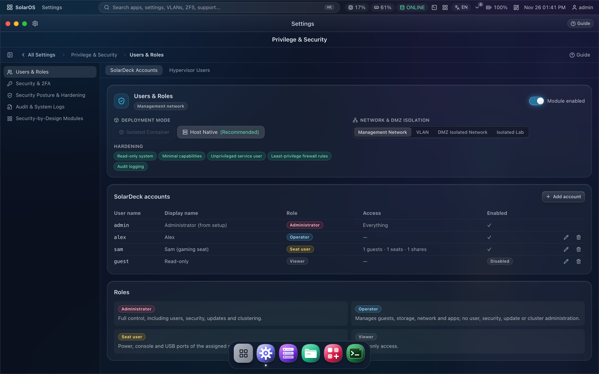
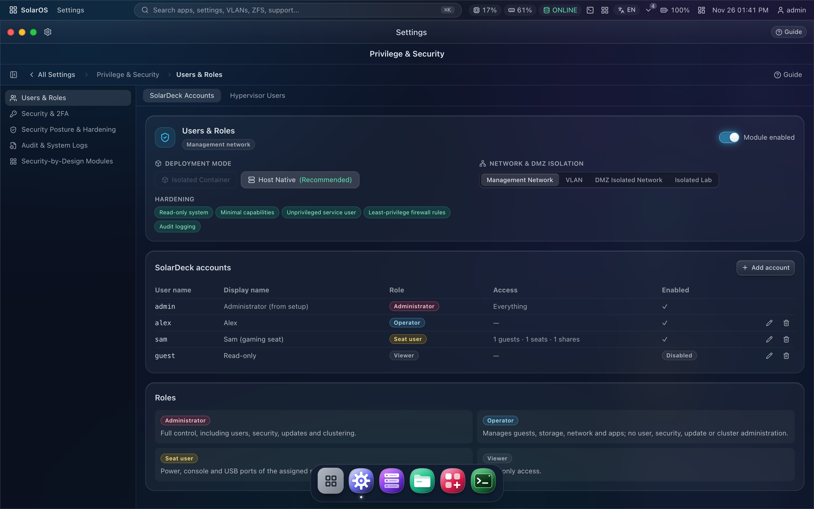
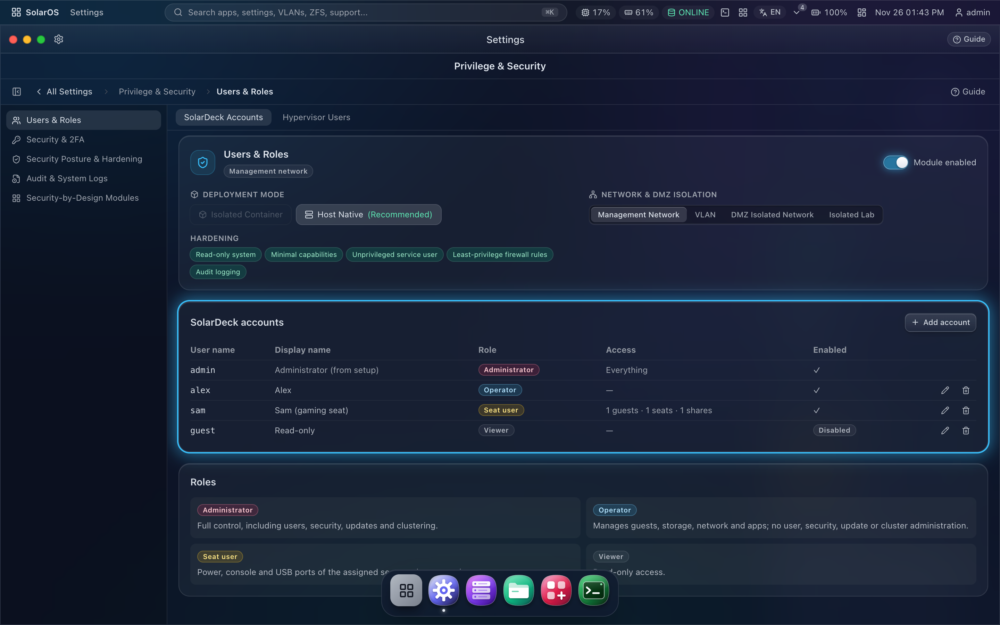
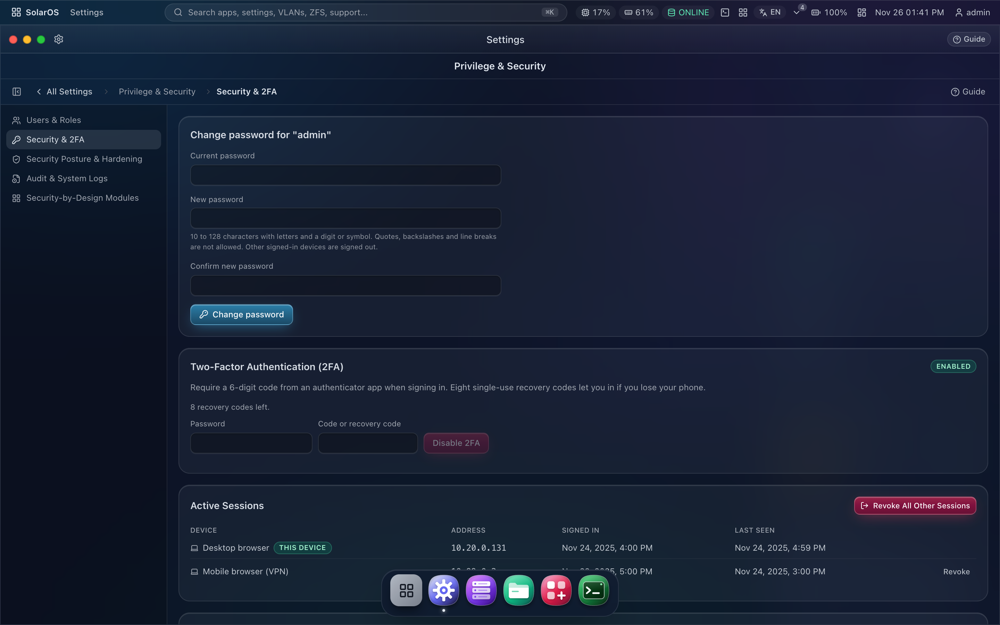
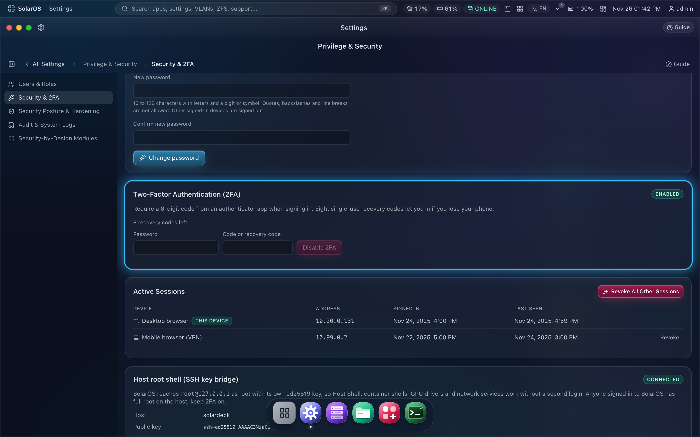
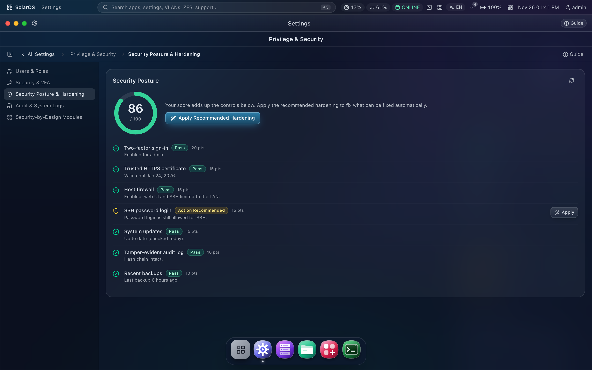
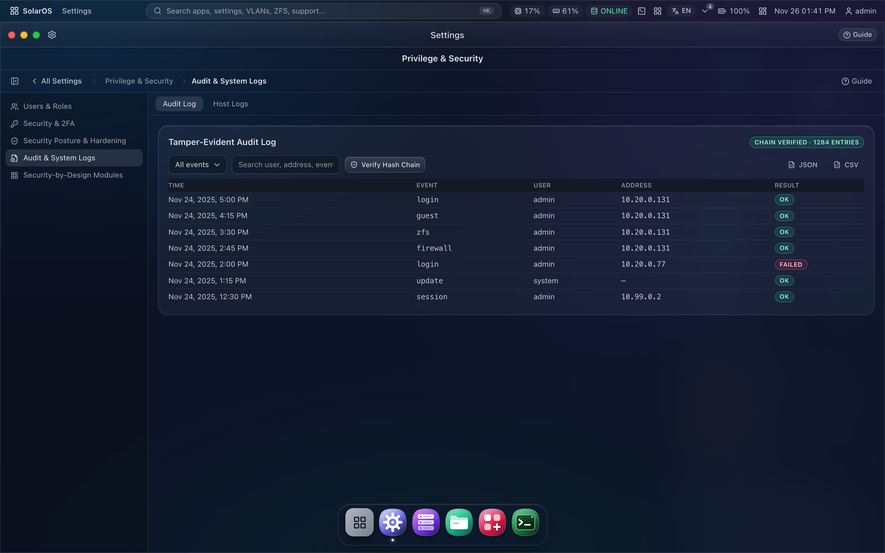
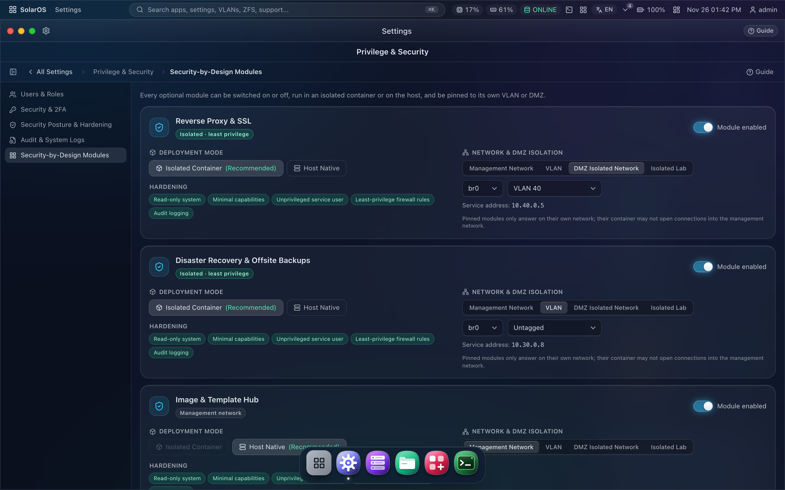

<!-- Generated by scripts/generate-support-docs.mjs from frontend/src/data/knowledgeRegistry.ts. Do not edit by hand. -->

# Settings › Privilege & Security

Users & RBAC roles, two-factor authentication & passkeys, security posture hardening, audit logs and module isolation.

[← Manual](README.md)

**Sub-modules:** [Users & Roles](#users-roles) · [Security & 2FA](#security-2fa) · [Security Posture & Hardening](#security-posture-hardening) · [Audit & System Logs](#audit-system-logs) · [Security-by-Design Modules](#security-by-design-modules)

## Users & Roles

### Overview

Local users, groups, roles, permissions, resource pools, API tokens and authentication realms.

1. Open Settings › Privilege & Security › Users & Roles (or press “Open This Setting / App →” above).
2. Create a user under Users and add it to a group.
3. Give the user or group a role on a path under Permissions.
4. Create API tokens for scripts and integrations.

### Users

Local user accounts.

1. Press Add user, fill in the name and password.

### Groups

Groups that bundle users.

1. Create a group and add users to it.

### Roles

Roles: named sets of privileges.

1. Use a built-in role or create one with the privileges you need.

### Permissions

Who has which role on which path.

1. Press Add, choose the path, the user or group and the role.

### Resource Pools

Resource pools group guests and storage for permissions.

1. Create a pool and add guests and storage to it.

### API Tokens

API tokens for scripts and integrations.

1. Press Add token, choose the user and copy the secret right away.

> **Tip:** The secret is shown only once.

### Authentication Realms

Authentication realms (local, LDAP, OpenID).

1. Add a realm and set it as default if users should sign in with it.

### SolarDeck accounts

SolarDeck accounts besides the administrator, each with a role (admin, operator, seat user, viewer) and the VMs, seats and shares it may use.

1. Press Add Account, choose a role and set a password.
2. For a seat user, select the VMs and seats.
3. Disable or delete accounts that are no longer needed.

> **Tip:** Turning the module off locks every extra account out at once.

## Security & 2FA

### Overview

Change the admin password, turn on TOTP two-factor authentication with recovery codes and manage active sessions.

1. Open Settings › Privilege & Security › Security & 2FA (or press “Open This Setting / App →” above).
2. Change the password in the first card.
3. Press Enable 2FA, scan the QR code with an authenticator app and confirm a code.
4. Store the recovery codes somewhere safe.

### Admin Password

Change the administrator password.

1. Type the current and the new password twice, then press Save.

### Two-Factor Authentication (2FA)

TOTP two-factor authentication with an authenticator app and one-time recovery codes.

1. Press Enable 2FA.
2. Scan the QR code with an authenticator app.
3. Type the 6-digit code to confirm and save the recovery codes.

> **Tip:** Each recovery code works once if you lose your phone.

### Active Sessions

Every signed-in browser with a button to sign it out.

1. Press Sign out next to a session you do not recognize.

## Security Posture & Hardening

### Overview

A live 0–100 security score with kernel and SSH hardening checks and one-click remediation.

1. Open Settings › Privilege & Security › Security Posture & Hardening (or press “Open This Setting / App →” above).
2. Read the score and the list of checks.
3. Press Fix on a failed check to apply the recommended hardening.
4. Export the report for your records.

### Security Posture

The 0–100 score, every hardening check and one-click fixes.

1. Press Fix next to a failed check.
2. Press Re-scan to update the score.

## Audit & System Logs

### Overview

A tamper-evident, hash-chained audit log of every administrative action, and the host's system logs.

1. Open Settings › Privilege & Security › Audit & System Logs (or press “Open This Setting / App →” above).
2. Audit Log lists who did what and when.
3. Press Verify to check the hash chain has not been altered.
4. Host Logs shows the system journal.

### Tamper-Evident Audit Log

Hash-chained log of every administrative action with integrity verification and export.

1. Filter by user or action.
2. Press Verify to check the chain.

### Host Logs

The host's system journal.

1. Pick a time range and filter the journal.

## Security-by-Design Modules

### Overview

One overview of every optional module: switch it on or off, run it in an isolated container or on the host, and pin it to the management network, a VLAN, the DMZ or an isolated lab with least-privilege firewall rules.

1. Open Settings › Privilege & Security › Security-by-Design Modules (or press “Open This Setting / App →” above).
2. Turn a module on with its switch.
3. Choose Isolated Container or Host Native where the module supports both.
4. Pick the network it lives on and press Apply.

### Security-by-Design Modules

Each module's switch, deployment mode (Isolated Container or Host Native) and network (management, VLAN, DMZ or isolated lab) with least-privilege firewall rules.

1. Switch a module on.
2. Choose its deployment mode and network.
3. Press Apply.

