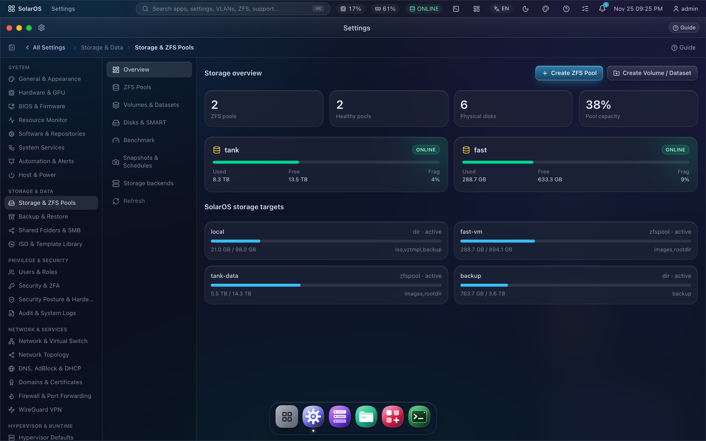
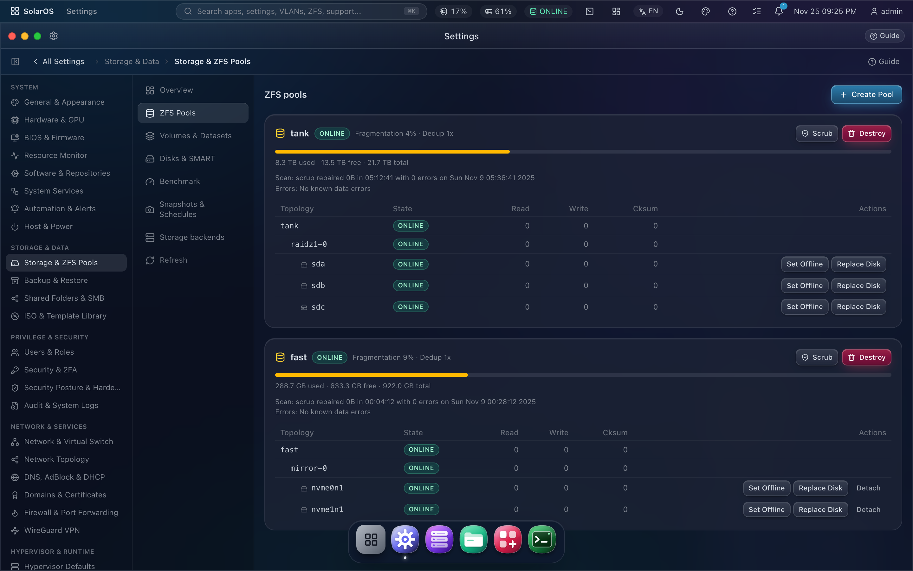
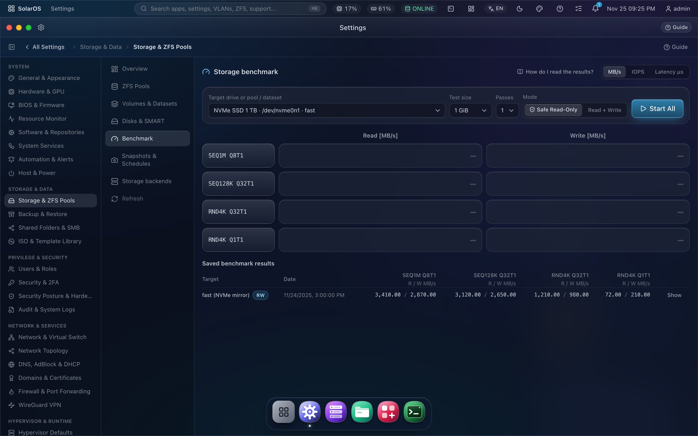
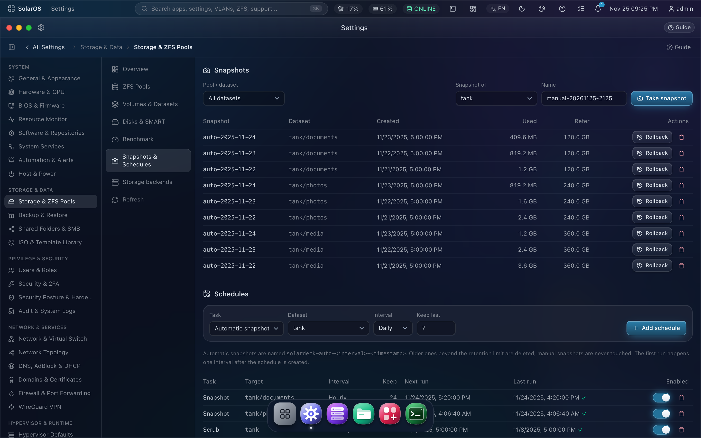
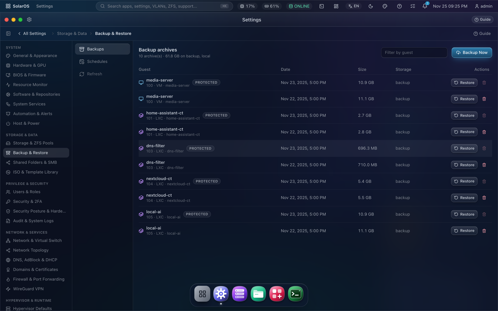
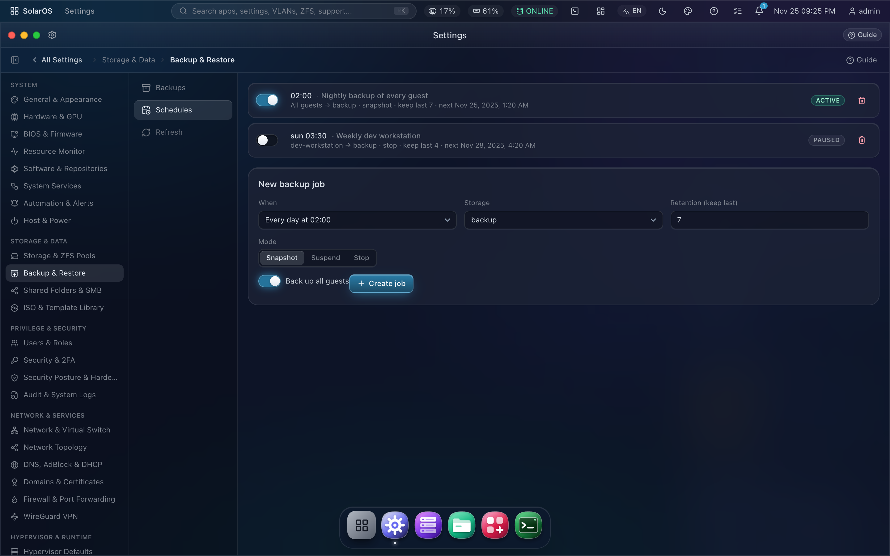
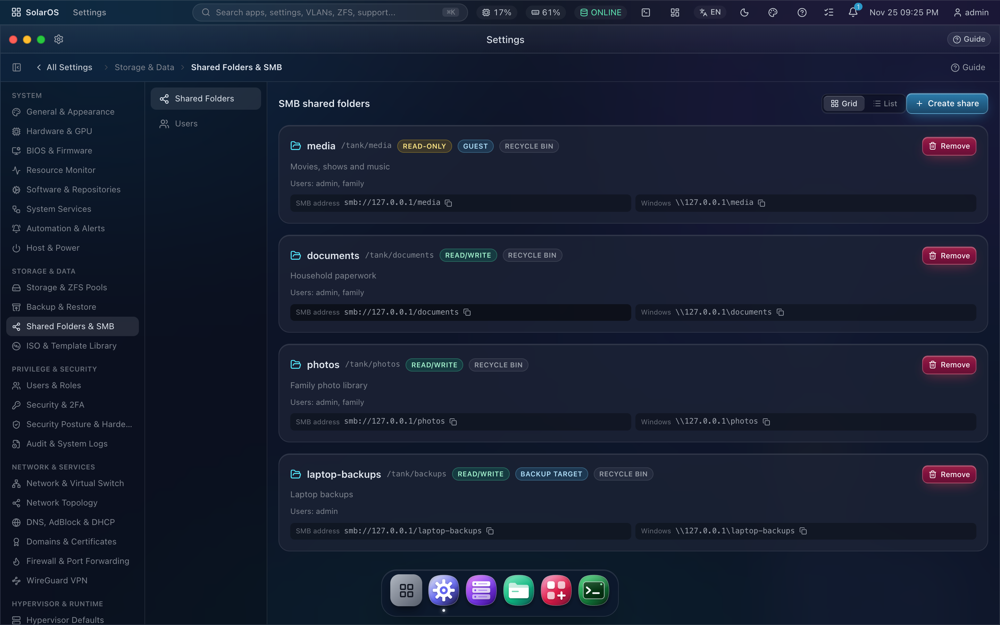

<!-- Generated by scripts/generate-support-docs.mjs from frontend/src/data/knowledgeRegistry.ts. Do not edit by hand. -->

# Settings › Storage & Data

Storage pools, physical disks, snapshots, backups and network shares.

[← Manual](README.md)

**Sub-modules:** [Storage & ZFS Pools](#storage-zfs-pools) · [Backup & Restore](#backup-restore) · [Shared Folders & SMB](#shared-folders-smb) · [ISO & Template Library](#iso-template-library)

## Storage & ZFS Pools

### Overview

Manage ZFS pools (single, mirror, RAIDZ), datasets and volumes, snapshots and schedules, disk SMART health and benchmarks.

1. Open Settings › Storage & Data › Storage & ZFS Pools (or press “Open This Setting / App →” above).
2. Overview shows capacity and health of every pool.
3. ZFS Pools creates a pool from free disks.
4. Disks & SMART shows health per disk; Benchmark measures speed.

### Storage Overview

Capacity and health of every pool and storage at a glance.

1. Open Storage & ZFS Pools; Overview is the first tab.

### ZFS Pools

Create ZFS pools (single, mirror, RAIDZ1/2/3), see their vdevs, scrub and replace disks.

1. Press Create pool.
2. Pick the free disks and a layout (mirror or RAIDZ).
3. Name the pool and press Create.

> **Tip:** A mirror survives all but one disk failing; RAIDZ1 survives one disk failure.

### Volumes & Datasets

Datasets (filesystems) and ZVOLs (block volumes) with compression and quotas.

1. Press Create, choose Dataset or ZVOL, and set its options.

### Disks & SMART Health

Every physical disk with SMART health, temperature and wipe or initialize tools.

1. Click a disk to see its SMART attributes.
2. Use Wipe only on disks that hold no data you need.

### Disk Benchmarks

Measure the read and write speed and IOPS of a disk or pool.

1. Choose a target and a test profile.
2. Press Run and wait for the results.

### ZFS Snapshots & Schedules

ZFS snapshots and automatic snapshot schedules with retention.

1. Press Take snapshot to save the current state.
2. Add a schedule to take snapshots automatically.
3. Use Rollback to return a dataset to a snapshot.

### Storage Backends

The storage locations the hypervisor uses for disks, ISOs and backups.

1. Review the list of storage locations and what each one holds.

## Backup & Restore

### Overview

Back up virtual machines and containers to archives, schedule backups and restore any point in time.

1. Open Settings › Storage & Data › Backup & Restore (or press “Open This Setting / App →” above).
2. Press Back Up Now and choose the guests and the target storage.
3. Create a schedule under Schedules for automatic backups.
4. Select an archive and press Restore to bring a guest back.

### Backups & Restore

Every backup archive with restore and delete.

1. Press Back Up Now for an immediate backup.
2. Select an archive and press Restore.

### Backup Schedules

Automatic backup schedules with retention.

1. Press New schedule.
2. Pick the guests, the time and how many backups to keep.

## Shared Folders & SMB

### Overview

Share folders with every computer and phone on your network over SMB, with per-user permissions.

1. Open Settings › Storage & Data › Shared Folders & SMB (or press “Open This Setting / App →” above).
2. Press New shared folder, choose a path and a name.
3. Add share users under Users and give them read or write access.
4. Connect from another computer with the address shown on the share card.

### SMB Shared Folders

SMB shared folders visible to every computer and phone on the network.

1. Press New shared folder and choose a path.
2. Copy the address on the card to connect from another computer.

### Share Users

Users that can connect to the shared folders, with read or write access.

1. Add a user with a password.
2. Give the user access on each share.

## ISO & Template Library

### Overview

Download and upload bootable ISO images, cloud images and container templates used by the VM and container wizards.

1. Open Settings › Storage & Data › ISO & Template Library (or press “Open This Setting / App →” above).
2. Paste a download link and press Download, or upload a file from your computer.
3. Container templates can be downloaded from the template list.

