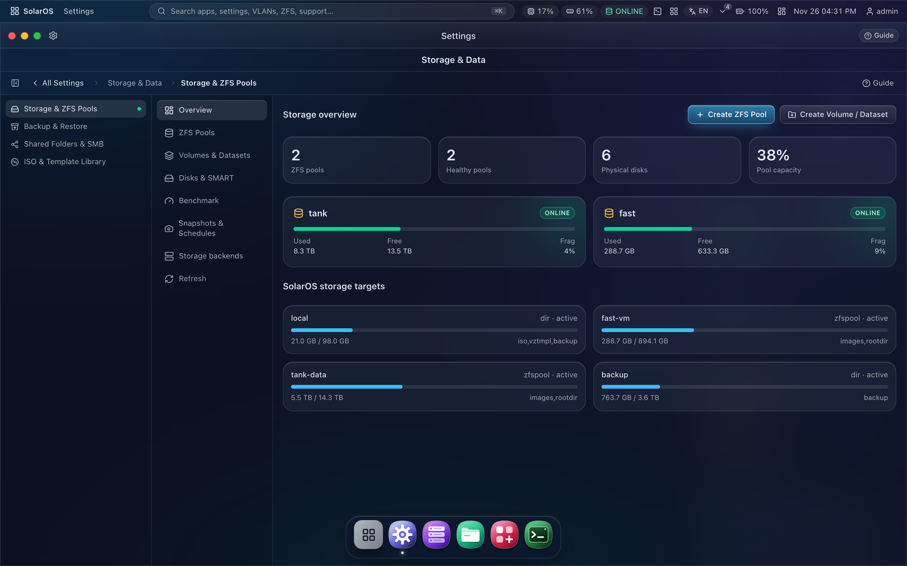
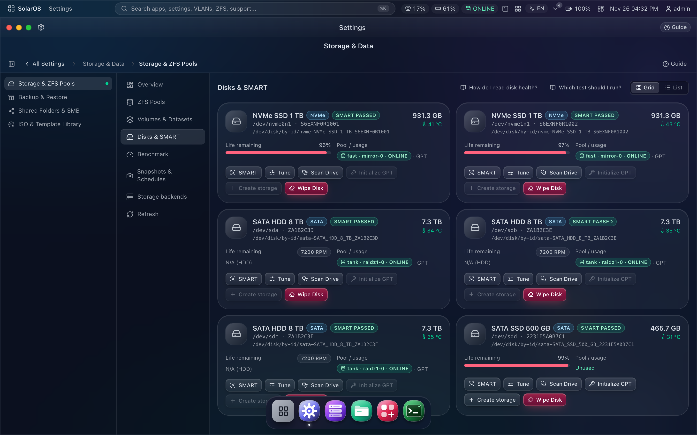
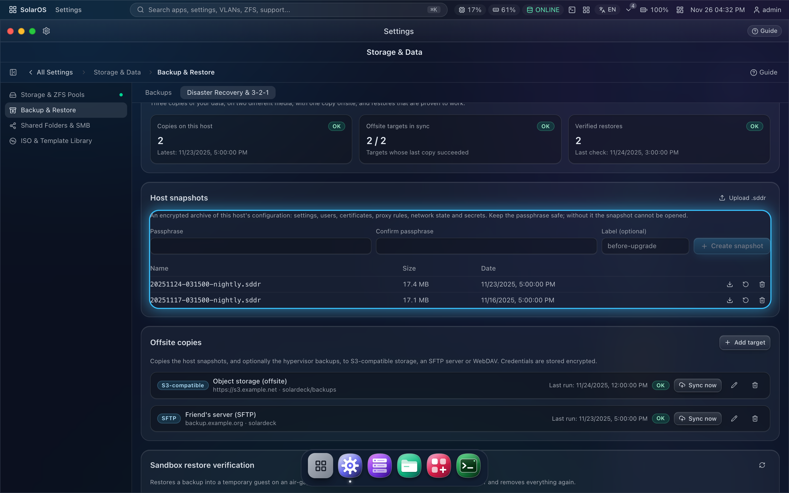
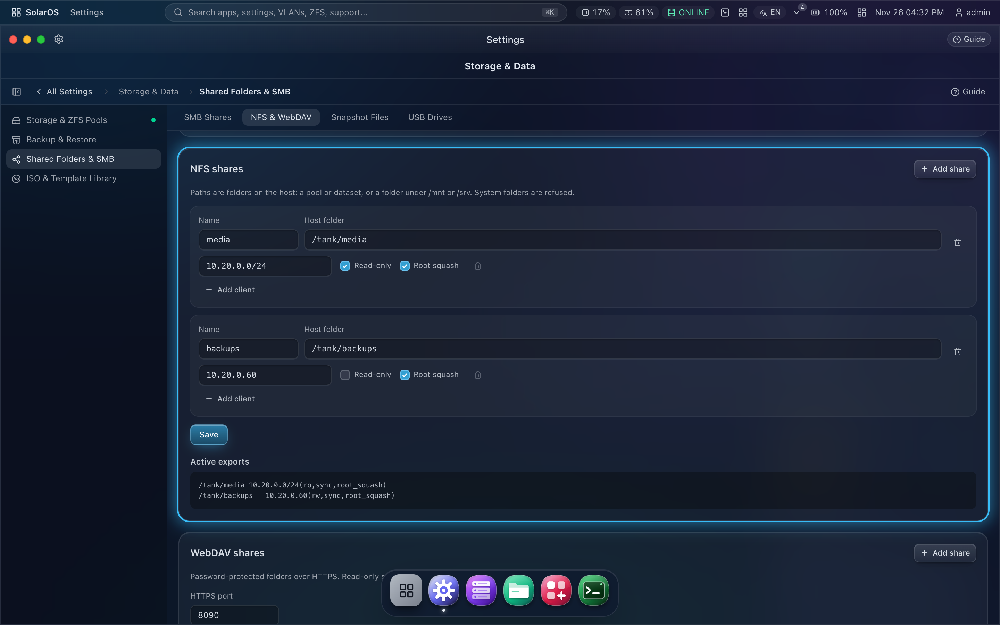
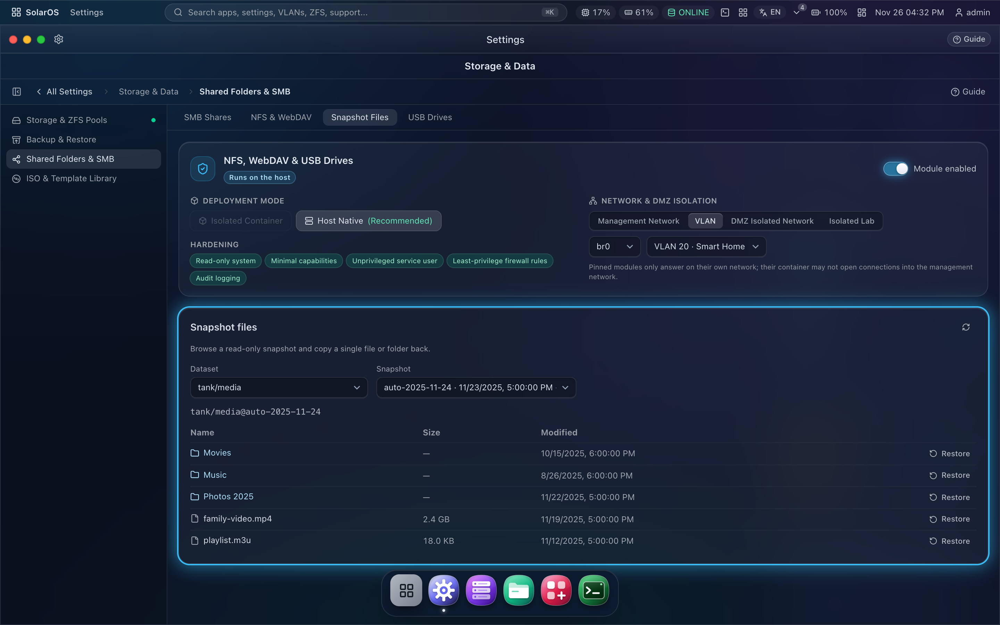
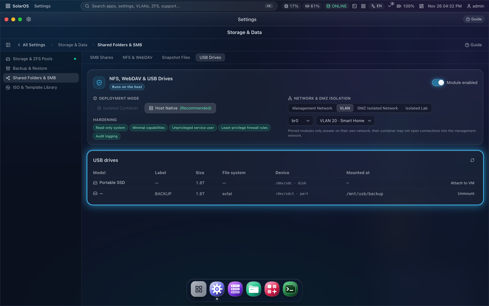
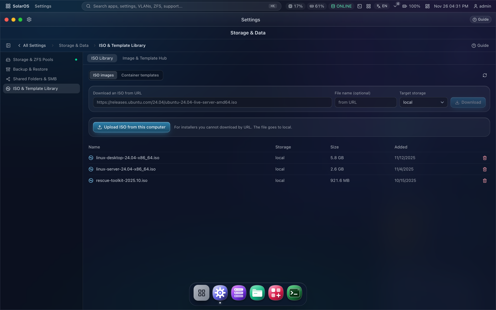
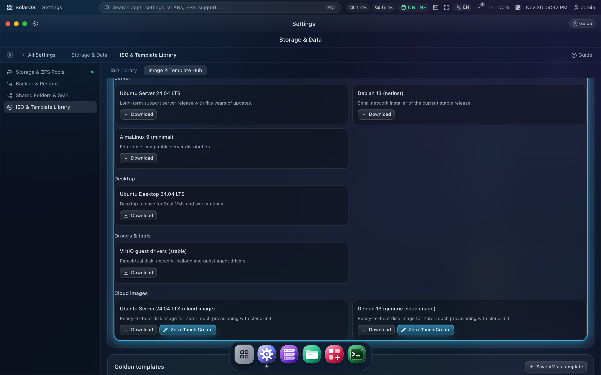

<!-- Generated by scripts/generate-support-docs.mjs from frontend/src/data/knowledgeRegistry.ts. Do not edit by hand. -->

# Settings › Storage & Data

ZFS storage pools, disk SMART health, backups & disaster recovery, snapshots, shared folders (SMB/NFS/WebDAV) and ISO library.

[← Manual](README.md)

**Sub-modules:** [Storage & ZFS Pools](#storage--zfs-pools) · [Backup & Restore](#backup--restore) · [Shared Folders & SMB](#shared-folders--smb) · [ISO & Template Library](#iso--template-library)

## Storage & ZFS Pools

### Overview

Manage ZFS pools (single, mirror, RAIDZ), datasets and volumes, snapshots and schedules, disk SMART health and benchmarks.

1. Open Settings › Storage & Data › Storage & ZFS Pools (or press “Open This Setting / App →” above).
2. Overview shows capacity and health of every pool.
3. ZFS Pools creates a pool from free disks.
4. Disks & SMART shows health per disk; Benchmark measures speed.

### Storage Overview

Capacity and health of every pool and storage at a glance.

1. Open Storage & ZFS Pools; Overview is the first tab.

### ZFS Pools

Create ZFS pools (single, mirror, RAIDZ1/2/3), see their vdevs, scrub and replace disks.

1. Press Create pool.
2. Pick the free disks and a layout (mirror or RAIDZ).
3. Name the pool and press Create.

> **Tip:** A mirror survives all but one disk failing; RAIDZ1 survives one disk failure.

### Volumes & Datasets

Datasets (filesystems) and ZVOLs (block volumes) with compression and quotas.

1. Press Create, choose Dataset or ZVOL, and set its options.

### Disks & SMART Health

Every physical disk with SMART health, temperature and wipe or initialize tools.

1. Click a disk to see its SMART attributes.
2. Use Wipe only on disks that hold no data you need.

### Disk Benchmarks

Measure the read and write speed and IOPS of a disk or pool.

1. Choose a target and a test profile.
2. Press Run and wait for the results.

### ZFS Snapshots & Schedules

ZFS snapshots and automatic snapshot schedules with retention.

1. Press Take snapshot to save the current state.
2. Add a schedule to take snapshots automatically.
3. Use Rollback to return a dataset to a snapshot.

### Storage Backends

The storage locations the hypervisor uses for disks, ISOs and backups.

1. Review the list of storage locations and what each one holds.

## Backup & Restore

### Overview

Back up virtual machines and containers to archives, schedule backups and restore any point in time.

1. Open Settings › Storage & Data › Backup & Restore (or press “Open This Setting / App →” above).
2. Press Back Up Now and choose the guests and the target storage.
3. Create a schedule under Schedules for automatic backups.
4. Select an archive and press Restore to bring a guest back.

### Backups & Restore

Every backup archive with restore and delete.

1. Press Back Up Now for an immediate backup.
2. Select an archive and press Restore.

### Backup Schedules

Automatic backup schedules with retention.

1. Press New schedule.
2. Pick the guests, the time and how many backups to keep.

### Host snapshots

Encrypted host snapshots of SolarDeck's own configuration: network, switches and VLANs, DHCP, reverse proxy rules and certificates, multi-seat, cluster, accounts and settings.

1. Enter a passphrase of at least 12 characters and press Create Snapshot.
2. Download it or let an offsite target copy it.
3. To restore, pick the snapshot, enter the passphrase and press Restore.

> **Tip:** Without the passphrase the snapshot cannot be opened.

### Offsite copies

Offsite copies to S3-compatible storage, SFTP or WebDAV, with retention, for the 3-2-1 rule.

1. Press Add Target and enter the connection details.
2. Press Sync now and follow the progress.

### Sandbox restore verification

Proof that a backup works: it is restored into an air-gapped lab, booted, checked for a guest agent heartbeat and removed again.

1. Pick a backup and the storage for the temporary guest.
2. Press Verify in sandbox and watch the steps.

## Shared Folders & SMB

### Overview

Share folders with every computer and phone on your network over SMB, with per-user permissions.

1. Open Settings › Storage & Data › Shared Folders & SMB (or press “Open This Setting / App →” above).
2. Press New shared folder, choose a path and a name.
3. Or use a Quick preset: Public guest share creates a read-only 'public' share anyone on the network can open without a password; Storage share creates a read/write 'storage' share of the whole storage root for SMB users, with a recycle bin.
4. Add share users under Users and give them read or write access.
5. Connect from another computer with the address shown on the share card.

### SMB Shared Folders

SMB shared folders visible to every computer and phone on the network, with one-click presets for a read-only guest share and an authenticated storage share.

1. Press New shared folder and choose a path, or press a Quick preset.
2. Copy the address on the card to connect from another computer.

### Share Users

Users that can connect to the shared folders, with read or write access.

1. Add a user with a password.
2. Give the user access on each share.

### NFS shares

NFS shares of host folders for other servers and computers on your network.

1. Add a share with a host folder and the networks allowed to use it.
2. Choose read-only and root squash per network, then Save.

### WebDAV shares

Password-protected WebDAV shares over HTTPS on their own port, read-only or writable.

1. Add a share with a host folder and users.
2. Connect from a file manager to the address shown.

### Snapshot files

Browse a dataset's snapshots read-only and bring back a single file or folder.

1. Pick a dataset and a snapshot.
2. Open folders until you find the file.
3. Press Restore; it lands next to the current file unless you choose to overwrite.

### USB drives

External USB drives: mount one on the host or give it to a VM as a disk.

1. Press Mount and give the drive a name, or Attach to VM.
2. Unmount before you unplug it.

## ISO & Template Library

### Overview

Download and upload bootable ISO images, cloud images and container templates used by the VM and container wizards.

1. Open Settings › Storage & Data › ISO & Template Library (or press “Open This Setting / App →” above).
2. Paste a download link and press Download, or upload a file from your computer.
3. Container templates can be downloaded from the template list.

### Image catalog

Curated server, desktop, driver and cloud images, downloaded with checksum verification.

1. Pick the storage under Download to.
2. Press Download next to an image; cloud images offer Zero-Touch Create.

### Golden templates

Golden templates: save a configured VM as a template and clone new VMs from it.

1. Shut the VM down and press Save VM as Template.
2. Press Clone to create a new VM from it.

