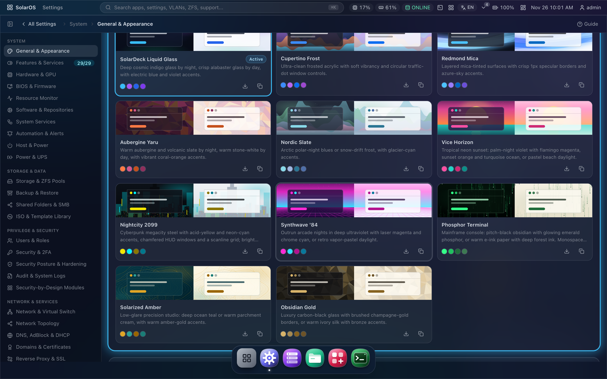
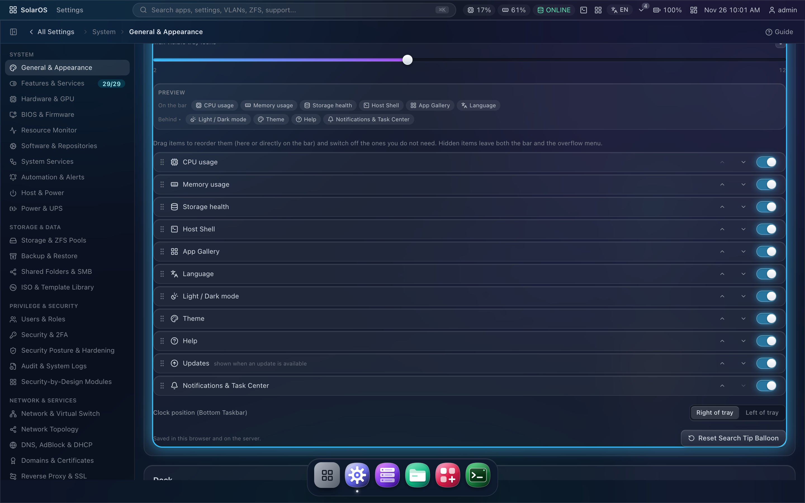
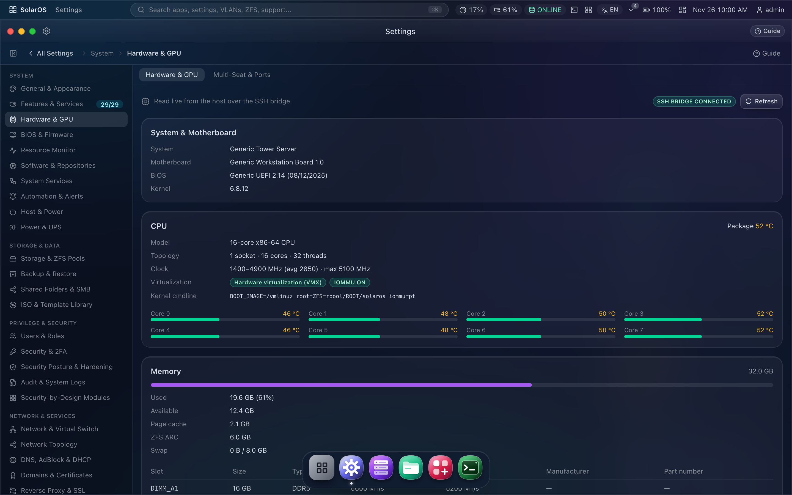
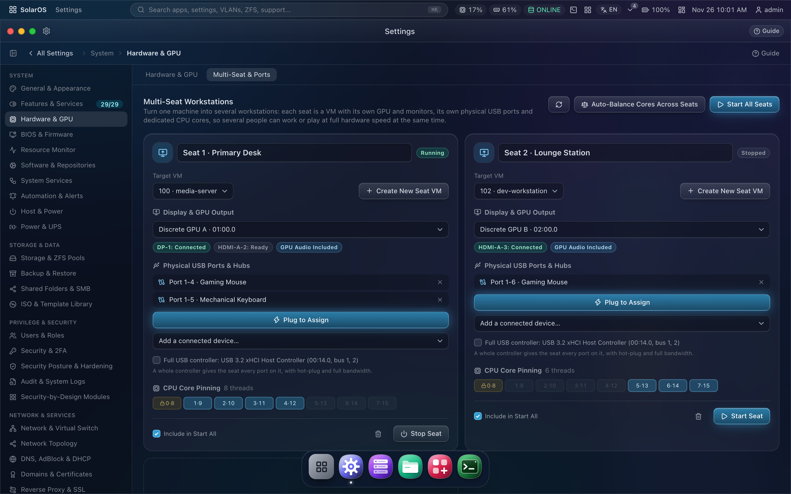
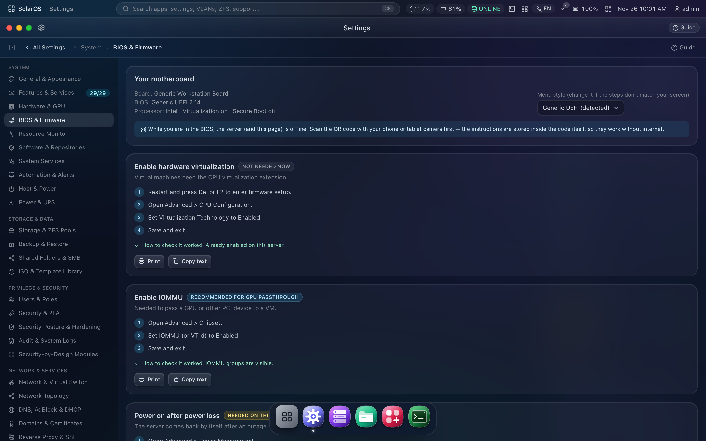
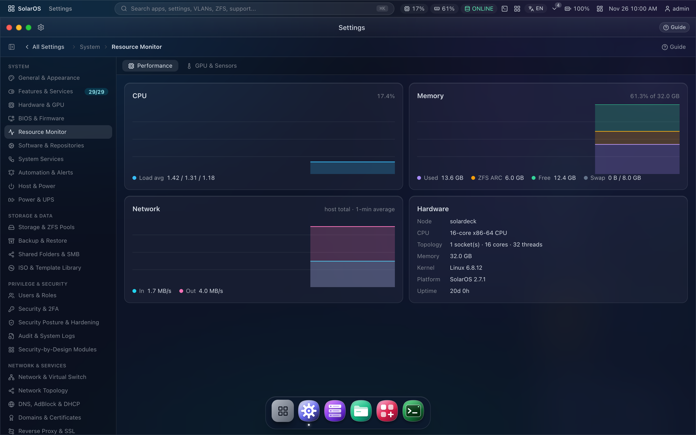
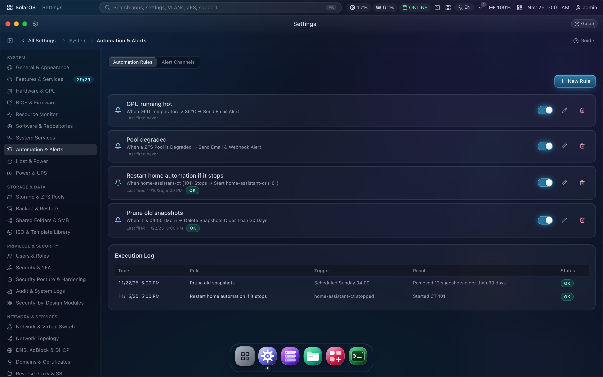
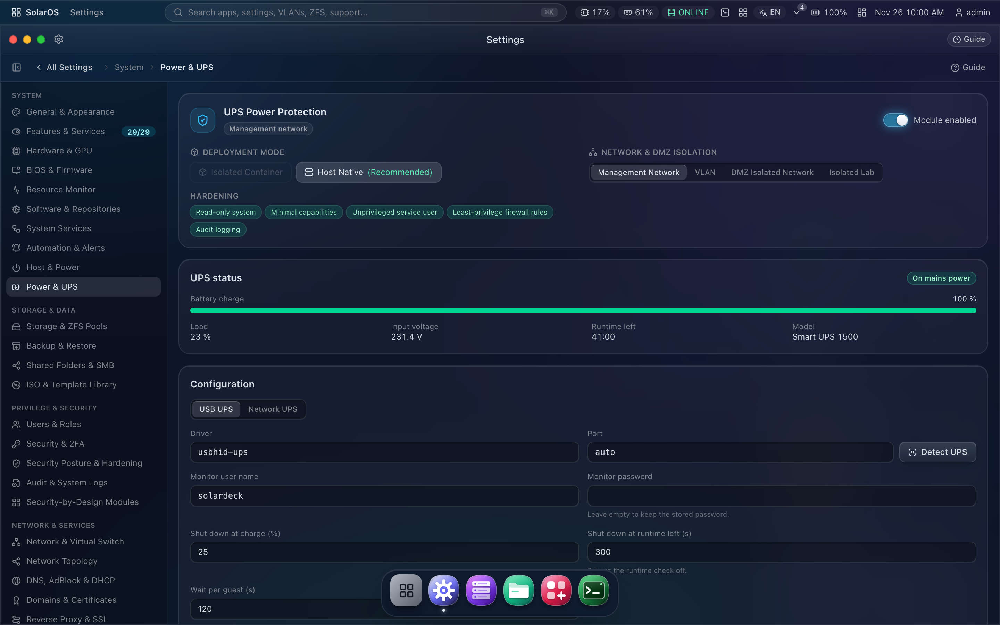

<!-- Generated by scripts/generate-support-docs.mjs from frontend/src/data/knowledgeRegistry.ts. Do not edit by hand. -->

# Settings › System

Core hardware, OS repositories, firmware, live telemetry, power and updates.

[← Manual](README.md)

**Sub-modules:** [General & Appearance](#general-appearance) · [Features & Services](#features-services) · [Hardware & GPU](#hardware-gpu) · [BIOS & Firmware](#bios-firmware) · [Resource Monitor](#resource-monitor) · [Software & Repositories](#software-repositories) · [System Services](#system-services) · [Automation & Alerts](#automation-alerts) · [Host & Power](#host-power) · [Power & UPS](#power-ups)

## General & Appearance

### Overview

Personalize the desktop: themes, light and dark mode, wallpapers, language, widgets, the Dock and the desktop layout.

1. Open Settings › System › General & Appearance (or press “Open This Setting / App →” above).
2. Pick a theme in the Theme Gallery and choose Dark, Light or Auto.
3. Scroll down to set the language, widgets, layout and Dock behaviour.

### Theme Studio

Choose, create, import and export desktop themes, and switch between Dark, Light and Auto mode.

1. Click a theme card to apply it.
2. Use the Dark / Light / Auto switch at the top of the gallery.
3. Press New theme to edit colors, style and wallpapers, then Save.

> **Tip:** Export a theme as a file to use it on another server.

### Wallpapers

Pick or upload the desktop wallpaper for dark and light mode.

1. Open a theme in the editor.
2. Choose a wallpaper or upload your own image.

### Wallpaper Studio

Put the product logo and this server's name on the desktop wallpaper as a glass watermark, with a live preview, and download a branded wallpaper as SVG.

1. Pick a theme and one of its 4 wallpapers.
2. Under Brand Watermark Overlay choose Logo + product name or Logo + server name.
3. Set the position, opacity and size; the preview shows the real server name.
4. Press Download as SVG for a 1920×1080 copy with the watermark drawn in.

### Language

Switch the whole interface between English, Nederlands, Deutsch, Español and Français.

1. Click a language in the Language card. The change is immediate.

### Desktop Widgets

Show or hide the live widgets on the desktop and customize which ones appear.

1. Turn Show desktop widgets on or off.
2. Press Customize widgets to add, remove and arrange them.

### Desktop Layout

Choose between the Dock with TopBar and the taskbar layout, and set icon sizes.

1. Pick a layout and an icon size in Desktop Layout.

### Top Bar & Taskbar Tray

Choose which status and quick-action icons sit in the top bar or taskbar tray, their order, how many stay on the bar before the rest move behind the overflow chevron, and the clock position.

1. Set Max visible tray icons; the preview shows which ones move behind the chevron.
2. Drag items to reorder them and use the switches to hide the ones you do not need.
3. In the Bottom Taskbar layout, choose whether the clock sits right or left of the tray.

> **Tip:** Right-click the top bar, taskbar or Dock and choose Customize Bar & Tray... to jump here.

> **Tip:** Reset Search Tip Balloon brings back the Type to begin tip under the search field.

### Dock

Dock magnification and auto-hide.

1. Choose a magnification strength.
2. Turn on auto-hide to give open apps more room.

## Features & Services

### Overview

Choose which optional features this server shows. A feature you switch off disappears from the Settings sidebar, its inner tabs, the TopBar search and the desktop, so you only see what you use. Its saved settings stay, and switching it back on brings everything back. Features with a background service (WireGuard server and client tunnels, per-VLAN DHCP servers, UPS monitoring) pause that service while they are off and start it again when you switch them on.

1. Open Settings › System › Features & Services (or press “Open This Setting / App →” above).
2. Flip the switch next to a feature to show or hide it; the counter at the top shows how many are active.
3. Sub-features sit indented under their parent: WireGuard VPN has separate switches for the server (remote access in) and the client (tunnels out); Per-VLAN DHCP Servers sit under Virtual Switch.
4. Use a quick preset (Minimal Core, Home & Media Server, Full Hypervisor Lab, Enable All) to set many switches at once.
5. Press Re-run Setup Wizard to pick server roles again.

> **Tip:** General & Appearance, Users & Roles, Software & Repositories and Features & Services itself can never be hidden, so you cannot lock yourself out.

### Quick presets

Quick presets switch many features at once: Minimal Core, Home & Media Server, Full Hypervisor Lab or Enable All.

1. Press a preset button; the switches below update right away.
2. Fine-tune single switches afterwards.

### Server Setup

The Server Setup Wizard opens on the first sign-in of a new installation and any time from Re-run Setup Wizard. Pick one or more server roles on wireframe cards (storage & media, virtualization host, multi-seat gaming, high-availability cluster, network gateway & VPN, AI compute or other services), choose Standalone Server or Cluster Host, fine-tune single services, tick App Center apps to install, review the summary and press Setup My Server. Live progress runs from 0 to 100 %, then the finish screen shows the server address, roles and apps.

1. Press Re-run Setup Wizard.
2. Tick one or more roles and pick Standalone Server or Cluster Host.
3. Press Customize Services to fine-tune, then pick apps.
4. Review the summary, choose whether to skip the desktop tour and press Setup My Server.

> **Tip:** Skip Setup & Use Defaults (first run only) keeps every feature on and skips the tour.

## Hardware & GPU

### Overview

See the CPU, memory, GPUs, PCIe and IOMMU groups and network adapters of the host, and switch the GPU driver mode.

1. Open Settings › System › Hardware & GPU (or press “Open This Setting / App →” above).
2. Read the CPU and memory cards for model, cores, temperature and usage.
3. In GPU & Drivers, choose between host use and passthrough to a VM.

### CPU & Memory

Processor model, cores, temperature and memory modules of the host.

1. Read the CPU and Memory cards at the top of Hardware & GPU.

### GPU & Drivers

Every GPU with its IOMMU group, and the driver mode: used by the host or passed through to a VM.

1. Find your GPU in the GPU & Drivers card.
2. Choose Passthrough to give it to a VM, or Host to use it on the server.
3. Reboot when asked.

> **Tip:** IOMMU must be enabled in the BIOS; see BIOS & Firmware.

### System & Motherboard

Motherboard model, BIOS version and system details.

1. Read the System & Motherboard card.

### Multi-Seat & Ports

Several people work or play on one machine at the same time: every seat is a VM with its own GPU and monitors, its own physical USB ports and dedicated CPU cores.

1. Press + Create Seat and pick the seat's VM (or Create New Seat VM).
2. Choose the GPU whose monitors the seat uses; its HDMI/DP audio comes along.
3. Press Plug to Assign and plug the seat's keyboard, mouse or USB hub into a free port on the server within 30 seconds.
4. Press Auto-Balance Cores Across Seats, then Start All Seats.

> **Tip:** USB ports are bound by their physical position, so two identical mice on different ports go to different seats.

> **Tip:** When the seat uses the GPU the server boots on, the server's own console screen switches off while that seat runs.

> **Tip:** IOMMU must be enabled in the BIOS; see BIOS & Firmware.

### Network Interfaces

Physical network adapters with link speed and driver.

1. Read the Network interfaces card at the bottom.

## BIOS & Firmware

### Overview

Check whether a newer BIOS exists for your motherboard, read the recommended BIOS settings for virtualization and take the guide along on your phone.

1. Open Settings › System › BIOS & Firmware (or press “Open This Setting / App →” above).
2. Read the detected motherboard and BIOS version.
3. Open a guide card for the setting you need (virtualization, IOMMU, power).
4. Press the QR button and scan it with your phone to read the steps while you are in the BIOS.

> **Tip:** The QR guide works offline: the text is inside the code.

### BIOS Update Check

Detects your motherboard and BIOS version and checks whether a newer BIOS is available, with a verified download.

1. Read the detected board and version in Your motherboard.
2. Press Check for update and follow the download link when one is found.

> **Tip:** Never turn the server off while a BIOS is flashing.

### BIOS Optimization Guide & Mobile QR

Step-by-step guides for the BIOS settings that matter (virtualization, IOMMU, power) with a QR code to read them on your phone.

1. Open the guide for the setting you need.
2. Press the QR button and scan it with your phone.
3. Reboot into the BIOS and follow the steps on your phone.

## Resource Monitor

### Overview

Live CPU, memory, network, GPU and temperature telemetry of the host.

1. Open Settings › System › Resource Monitor (or press “Open This Setting / App →” above).
2. Performance shows live graphs for CPU, memory and network.
3. GPU & Sensors shows GPU load, video engines and temperatures.

### Live Performance

Live graphs of CPU, memory and network use.

1. Open Resource Monitor; Performance is the first tab.

### GPU & Sensors

GPU load, video engines and temperature sensors.

1. Click GPU & Sensors at the top of Resource Monitor.

## Software & Repositories

### Overview

Keep SolarDeck and the operating system up to date, choose package sources, roll back a release and report bugs.

1. Open Settings › System › Software & Repositories (or press “Open This Setting / App →” above).
2. SolarDeck Updates checks for a new release and installs it.
3. OS Repositories chooses the package sources.
4. OS Updates lists and installs pending operating system packages.

### SolarDeck Updates

Check for and install a new SolarDeck release; the update runs in the background and the page reloads when done.

1. Press Check now.
2. Press Install update when a new version is shown.

### Automatic Updates & Schedule

Manual or automatic scheduled updates: background checks every 1, 6, 12 or 24 hours, and a daily, weekly or monthly install time.

1. Choose Automatic Scheduled Updates.
2. Pick the frequency, day and time, then press Save Schedule.

### Version History & Downgrade

Earlier releases with their notes, and a one-click downgrade.

1. Pick an earlier version and press Install to roll back.

### Report a Bug

Send a bug report with system details attached.

1. Describe what happened and press Send.

### OS Repositories

Choose the operating system package sources.

1. Turn the sources you want on or off and press Save.

### OS Updates

Pending operating system package updates.

1. Press Refresh, then Install all.

## System Services

### Overview

Start, stop, restart and enable the background services of the host and of deployed apps.

1. Open Settings › System › System Services (or press “Open This Setting / App →” above).
2. Find a service in the list (filter by name).
3. Use the buttons on its row to start, stop, restart or enable it at boot.

### Service Manager

The background services of the host and deployed apps with start, stop, restart and enable at boot.

1. Filter the list by name.
2. Use the row buttons to control a service.

### Docker Engine & Compose

Docker Engine & Compose is a built-in platform feature, switched on and off with its card in Features & Services. While it is on, Compute › Docker and Settings › System Services show its Security-by-Design options: Isolated Container (recommended) or Host Native, and the network it is pinned to (management, VLAN, DMZ or isolated lab). Containers and stacks are managed in Compute › Docker.

1. Switch on Docker Engine & Compose in Features & Services.
2. Pick Isolated Container or Host Native and the network, then press Save.
3. Open Compute › Docker to install the engine and manage containers.

## Automation & Alerts

### Overview

Send alerts to chat, webhook and email channels and build no-code rules that react to server events.

1. Open Settings › System › Automation & Alerts (or press “Open This Setting / App →” above).
2. Set up at least one notification channel and press Test.
3. Create a rule: pick a trigger, a condition and an action.
4. Check the Execution Log to see when rules fired.

### Notification Channels

Chat, webhook and SMTP email channels that receive alerts.

1. Fill in a channel's details and switch it on.
2. Press Test to send a test message.

### Automation Rules

No-code rules: when a trigger fires and the condition holds, run an action or send an alert.

1. Press New rule.
2. Choose a trigger (for example a pool degraded or high CPU), a condition and an action.
3. Save the rule and switch it on.

### Execution Log

When each rule ran and what it did.

1. Scroll to the Execution Log at the bottom of Automation & Alerts.

## Host & Power

### Overview

Reboot or shut down the host, see its uptime and open the host console.

1. Open Settings › System › Host & Power (or press “Open This Setting / App →” above).
2. Press Reboot or Shut down in the Power card and confirm.
3. Running guests are stopped cleanly first.

### Reboot & Shutdown

Reboot or shut down the host safely.

1. Press Reboot or Shut down and confirm.

> **Tip:** Guests with autostart come back on by themselves after a reboot.

## Power & UPS

### Overview

Protect the server with a UPS: live battery charge, load, input voltage and runtime, an ordered shutdown of every guest when the battery runs low, and eco power profiles that switch on a schedule.

1. Open Settings › System › Power & UPS (or press “Open This Setting / App →” above).
2. Connect the UPS by USB (or enter the UPS another machine serves) and press Save.
3. Set the battery percentage or runtime at which the server shuts down, and the order of the guests.
4. Pick a power profile, and add schedule entries to switch profiles automatically.

> **Tip:** The battery level also appears in the top bar while the module is on.

### UPS status

Live UPS battery charge, load, input voltage, remaining runtime and whether the server runs on battery.

1. Read the live values; they refresh every 10 seconds.

### Configuration

Connect a USB UPS or a UPS another machine serves, and choose when and in which order the guests shut down.

1. Press Detect UPS or enter the driver and port.
2. Set the battery percentage and runtime that trigger the shutdown.
3. Order the guests that must stop first, then Save.

> **Tip:** After the guests, ZFS is synced and the server powers off.

### Power profile

Power profiles (performance, balanced, eco) for the CPU, guests that eco mode shuts down, and a weekly schedule.

1. Pick a profile and the lab guests eco mode may stop.
2. Add schedule rows (time, days, profile) and press Apply.

