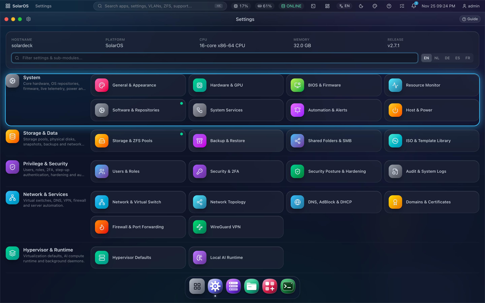
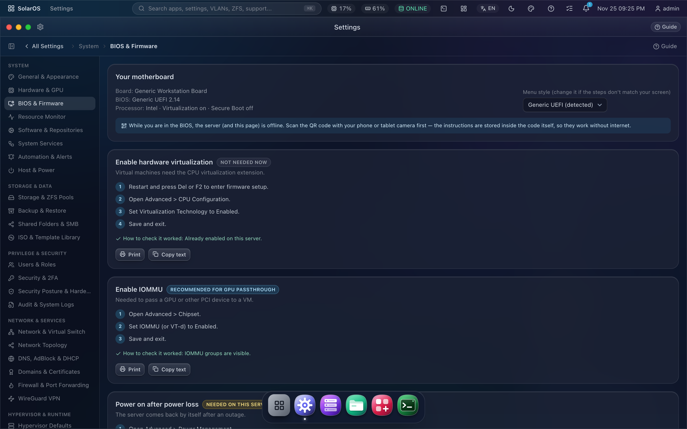
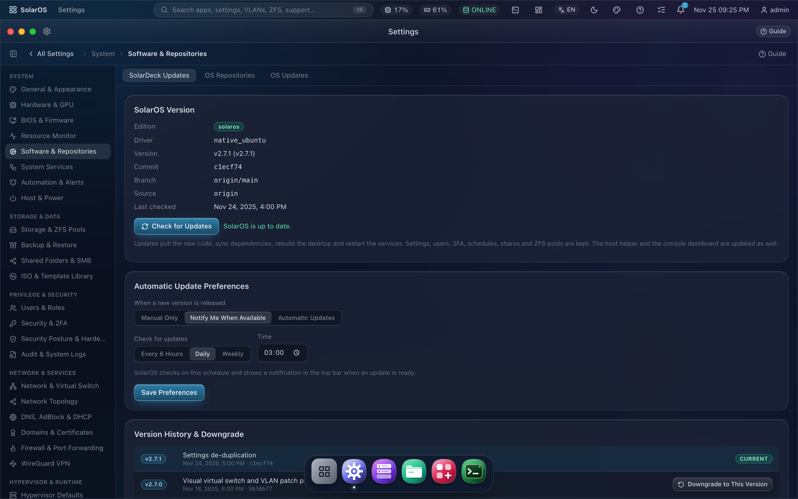
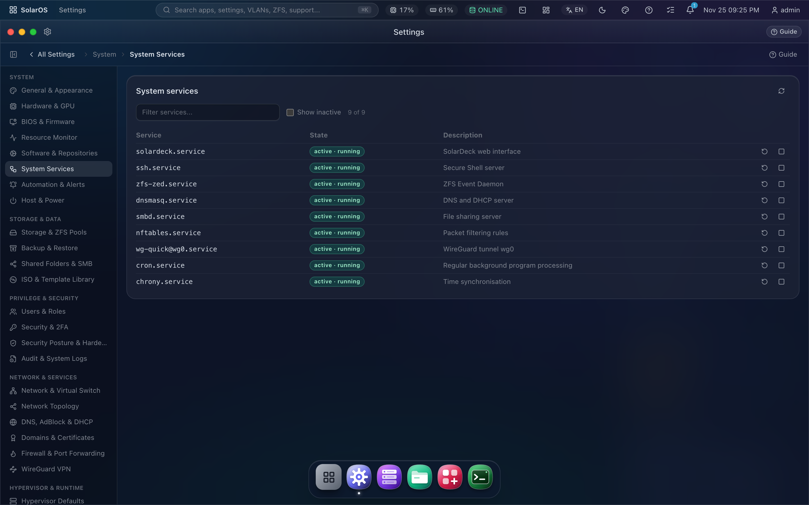
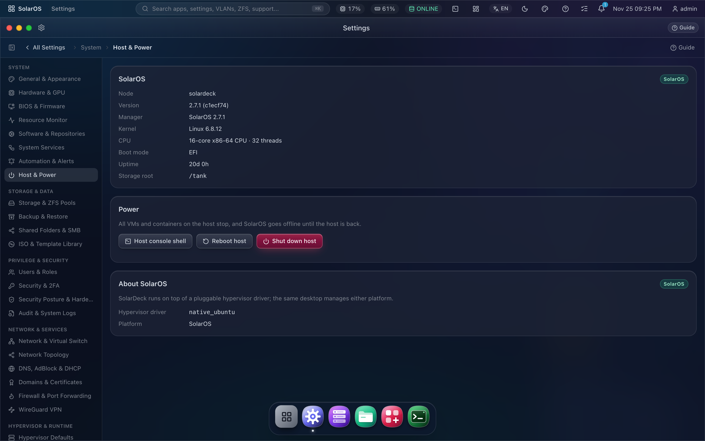

<!-- Generated by scripts/generate-support-docs.mjs from frontend/src/data/knowledgeRegistry.ts. Do not edit by hand. -->

# Settings › System

Core hardware, OS repositories, firmware, live telemetry, power and updates.

[← Manual](README.md)

**Sub-modules:** [General & Appearance](#general-appearance) · [Hardware & GPU](#hardware-gpu) · [BIOS & Firmware](#bios-firmware) · [Resource Monitor](#resource-monitor) · [Software & Repositories](#software-repositories) · [System Services](#system-services) · [Automation & Alerts](#automation-alerts) · [Host & Power](#host-power)

## General & Appearance

### Overview

Personalize the desktop: themes, light and dark mode, wallpapers, language, widgets, the Dock and the desktop layout.

1. Open Settings › System › General & Appearance (or press “Open This Setting / App →” above).
2. Pick a theme in the Theme Gallery and choose Dark, Light or Auto.
3. Scroll down to set the language, widgets, layout and Dock behaviour.

### Theme Studio

Choose, create, import and export desktop themes, and switch between Dark, Light and Auto mode.

1. Click a theme card to apply it.
2. Use the Dark / Light / Auto switch at the top of the gallery.
3. Press New theme to edit colors, style and wallpapers, then Save.

> **Tip:** Export a theme as a file to use it on another server.

### Wallpapers

Pick or upload the desktop wallpaper for dark and light mode.

1. Open a theme in the editor.
2. Choose a wallpaper or upload your own image.

### Language

Switch the whole interface between English, Nederlands, Deutsch, Español and Français.

1. Click a language in the Language card. The change is immediate.

### Desktop Widgets

Show or hide the live widgets on the desktop and customize which ones appear.

1. Turn Show desktop widgets on or off.
2. Press Customize widgets to add, remove and arrange them.

### Desktop Layout

Choose between the Dock with TopBar and the taskbar layout, and set icon sizes.

1. Pick a layout and an icon size in Desktop Layout.

### Dock

Dock magnification and auto-hide.

1. Choose a magnification strength.
2. Turn on auto-hide to give open apps more room.

## Hardware & GPU

### Overview

See the CPU, memory, GPUs, PCIe and IOMMU groups and network adapters of the host, and switch the GPU driver mode.

1. Open Settings › System › Hardware & GPU (or press “Open This Setting / App →” above).
2. Read the CPU and memory cards for model, cores, temperature and usage.
3. In GPU & Drivers, choose between host use and passthrough to a VM.

### CPU & Memory

Processor model, cores, temperature and memory modules of the host.

1. Read the CPU and Memory cards at the top of Hardware & GPU.

### GPU & Drivers

Every GPU with its IOMMU group, and the driver mode: used by the host or passed through to a VM.

1. Find your GPU in the GPU & Drivers card.
2. Choose Passthrough to give it to a VM, or Host to use it on the server.
3. Reboot when asked.

> **Tip:** IOMMU must be enabled in the BIOS; see BIOS & Firmware.

### System & Motherboard

Motherboard model, BIOS version and system details.

1. Read the System & Motherboard card.

### Network Interfaces

Physical network adapters with link speed and driver.

1. Read the Network interfaces card at the bottom.

## BIOS & Firmware

### Overview

Check whether a newer BIOS exists for your motherboard, read the recommended BIOS settings for virtualization and take the guide along on your phone.

1. Open Settings › System › BIOS & Firmware (or press “Open This Setting / App →” above).
2. Read the detected motherboard and BIOS version.
3. Open a guide card for the setting you need (virtualization, IOMMU, power).
4. Press the QR button and scan it with your phone to read the steps while you are in the BIOS.

> **Tip:** The QR guide works offline: the text is inside the code.

### BIOS Update Check

Detects your motherboard and BIOS version and checks whether a newer BIOS is available, with a verified download.

1. Read the detected board and version in Your motherboard.
2. Press Check for update and follow the download link when one is found.

> **Tip:** Never turn the server off while a BIOS is flashing.

### BIOS Optimization Guide & Mobile QR

Step-by-step guides for the BIOS settings that matter (virtualization, IOMMU, power) with a QR code to read them on your phone.

1. Open the guide for the setting you need.
2. Press the QR button and scan it with your phone.
3. Reboot into the BIOS and follow the steps on your phone.

## Resource Monitor

### Overview

Live CPU, memory, network, GPU and temperature telemetry of the host.

1. Open Settings › System › Resource Monitor (or press “Open This Setting / App →” above).
2. Performance shows live graphs for CPU, memory and network.
3. GPU & Sensors shows GPU load, video engines and temperatures.

### Live Performance

Live graphs of CPU, memory and network use.

1. Open Resource Monitor; Performance is the first tab.

### GPU & Sensors

GPU load, video engines and temperature sensors.

1. Click GPU & Sensors at the top of Resource Monitor.

## Software & Repositories

### Overview

Keep SolarDeck and the operating system up to date, choose package sources, roll back a release and report bugs.

1. Open Settings › System › Software & Repositories (or press “Open This Setting / App →” above).
2. SolarDeck Updates checks for a new release and installs it.
3. OS Repositories chooses the package sources.
4. OS Updates lists and installs pending operating system packages.

### SolarDeck Updates

Check for and install a new SolarDeck release; the update runs in the background and the page reloads when done.

1. Press Check now.
2. Press Install update when a new version is shown.

### Automatic Update Preferences

Automatic update checks, the update branch and the install time.

1. Turn automatic updates on and pick when they install.

### Version History & Downgrade

Earlier releases with their notes, and a one-click downgrade.

1. Pick an earlier version and press Install to roll back.

### Report a Bug

Send a bug report with system details attached.

1. Describe what happened and press Send.

### OS Repositories

Choose the operating system package sources.

1. Turn the sources you want on or off and press Save.

### OS Updates

Pending operating system package updates.

1. Press Refresh, then Install all.

## System Services

### Overview

Start, stop, restart and enable the background services of the host and of deployed apps.

1. Open Settings › System › System Services (or press “Open This Setting / App →” above).
2. Find a service in the list (filter by name).
3. Use the buttons on its row to start, stop, restart or enable it at boot.

### Service Manager

The background services of the host and deployed apps with start, stop, restart and enable at boot.

1. Filter the list by name.
2. Use the row buttons to control a service.

## Automation & Alerts

### Overview

Send alerts to chat, webhook and email channels and build no-code rules that react to server events.

1. Open Settings › System › Automation & Alerts (or press “Open This Setting / App →” above).
2. Set up at least one notification channel and press Test.
3. Create a rule: pick a trigger, a condition and an action.
4. Check the Execution Log to see when rules fired.

### Notification Channels

Chat, webhook and SMTP email channels that receive alerts.

1. Fill in a channel's details and switch it on.
2. Press Test to send a test message.

### Automation Rules

No-code rules: when a trigger fires and the condition holds, run an action or send an alert.

1. Press New rule.
2. Choose a trigger (for example a pool degraded or high CPU), a condition and an action.
3. Save the rule and switch it on.

### Execution Log

When each rule ran and what it did.

1. Scroll to the Execution Log at the bottom of Automation & Alerts.

## Host & Power

### Overview

Reboot or shut down the host, see its uptime and open the host console.

1. Open Settings › System › Host & Power (or press “Open This Setting / App →” above).
2. Press Reboot or Shut down in the Power card and confirm.
3. Running guests are stopped cleanly first.

### Reboot & Shutdown

Reboot or shut down the host safely.

1. Press Reboot or Shut down and confirm.

> **Tip:** Guests with autostart come back on by themselves after a reboot.

