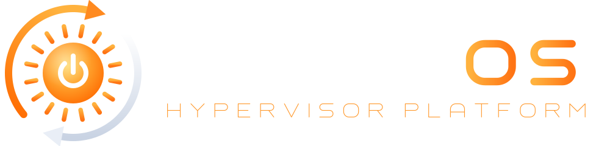

# SolarOS (standalone edition)

SolarDeck normally runs on top of Proxmox VE (`install.sh`, *SolarDeck for Proxmox VE*, an LXC container). This folder turns a plain
**Ubuntu Server 24.04 / 26.04 LTS** machine into **SolarOS**, where SolarDeck itself manages
QEMU/KVM virtual machines (libvirt), Linux containers (Incus), OpenZFS storage, disks, backups and the network.
Both editions are built from the same `main` branch; `HYPERVISOR_DRIVER` in `backend/.env` selects the driver.

| File | Purpose |
|---|---|
| `install-hypervisor.sh` | Single-command installer for a clean Ubuntu Server host (run as root) |
| `solardeck-console-tui.py` | Console dashboard for the server's own monitor (tty1), installed as `/usr/local/bin/solardeck-console` |
| `solardeck-backend.service` | Backend unit (`/opt/solardeck/backend`, runs as root on the host) |
| `solardeck-console.service` | Runs the dashboard on tty1 instead of the login prompt |
| `solardeck-firstboot.service`, `firstboot-setup.sh` | ISO installs only: first-boot appliance setup (br0, installer in bundle mode, Incus profile), then disables itself |
| `build-iso.sh`, `autoinstall/` | Builds a bootable installer ISO (Ubuntu autoinstall + SolarDeck source, prebuilt desktop and Python wheels) |
| `test-in-proxmox-vm.sh` | Creates and boots a nested test VM for the ISO on a Proxmox VE host |

## Install on an existing Ubuntu Server

```bash
bash -c "$(curl -fsSL https://raw.githubusercontent.com/Legend-Services/SolarOS/main/hypervisor/install-hypervisor.sh)" -- --with-console-tui
```

From a checkout: `sudo hypervisor/install-hypervisor.sh --with-console-tui`.

The installer:

1. installs `qemu-kvm`, `libvirt-daemon-system`, `libvirt-clients`, `ovmf`, `swtpm`, `incus`, `zfsutils-linux`,
   `bridge-utils`, `smartmontools`, `hdparm`, `nvme-cli`, `lm-sensors`, `fio`, `websockify`, `samba`, `nginx`,
   `python3-venv`, `python3-pip`, `cloud-image-utils` and Node.js 22,
2. creates the `br0` bridge on the uplink NIC if there is none (Netplan `60-solardeck-bridge.yaml`; a static address
   stays static). Run it from the console, or expect a short network drop over SSH. `--bridge-nic <nic>` or
   `--no-bridge` change this,
3. initializes Incus (`incus admin init --minimal`) if needed,
4. deploys SolarDeck to `/opt/solardeck` (`/opt/proxmox-os` links to it), writes `backend/.env` with
   `HYPERVISOR_DRIVER=native_ubuntu` and a generated `ADMIN_PASSWORD` and `JWT_SECRET`,
5. installs the root helper locally and authorizes the backend's SSH key for `root@127.0.0.1` only,
6. builds the desktop, configures nginx (HTTP + self-signed HTTPS) and Samba, starts `solardeck-backend`,
7. with `--with-console-tui`, replaces the tty1 login prompt with the dashboard,
8. prints the web URL and the admin credentials (also saved in `/etc/solardeck/initial-credentials.txt`, mode 0600).

Re-running it is safe: `.env`, `data/` and `.ssh/` are kept.

## Console dashboard

On the server's monitor: host name, kernel, CPU and RAM, every LAN IPv4 address with its `http://<IP>` management
URL, the initial admin password (until you clear it), ZFS pool health, and:

```
[1] Configure Network Interface / Static IP (Netplan)
[2] Reset / Clear Initial Password Display (r: new admin password, c: remove the initial password from screen and disk)
[3] Update SolarDeck from Git (main)
[4] Open Root Diagnostic Shell
[5] Reboot or Shut Down Server
[6] Show Nested Virtualization & Hardware Readiness (VT-x/AMD-V, /dev/kvm, nested KVM, libvirtd, Incus, ZFS, br0)
```

Anyone at the physical console can use these, like on other appliance consoles. Keep the server in a locked room.
`solardeck-console --self-test` checks its parsers without a terminal.

## Bootable installer ISO

On a Linux machine with `xorriso`, `curl` and `openssl` (plus Node.js 22 and `python3-pip` to bundle the desktop
and the Python wheels):

```bash
sudo bash hypervisor/build-iso.sh                 # -> ./dist/SolarOS-v2.2.1-amd64.iso
# options: --source-iso ubuntu-24.04.3-live-server-amd64.iso  --output <path>  --auto-disk /dev/sda  --deploy-to-pve
#          --ubuntu-release 26.04  --hostname hv1  --password <console user password>
```

Without `--source-iso` the latest official live-server ISO of the release is downloaded and checked against
`SHA256SUMS`. To stay under GitHub's 2 GiB release-asset limit, the ISO leaves out Ubuntu's offline package
pool and the HWE kernel, so the installer needs internet access (first boot needs it anyway). The default boot entry, **Install SolarOS (Interactive Disk Selection)**, asks for the
target disk, so it is safe on servers with data disks. `--auto-disk <device>` adds **SolarDeck Hypervisor - Automated
VM Test Install**, which erases that disk without asking. `--deploy-to-pve` copies the ISO to
`/var/lib/vz/template/iso/` on a Proxmox VE host.

The ISO embeds the SolarDeck source (the committed `HEAD` of a checkout), the built desktop (`frontend/dist`) and the
backend's Python wheels for Ubuntu's Python. If Node.js or pip is missing on the build machine, that part is fetched on
first boot instead. Ubuntu installs with the console user `solardeck` (password printed by `build-iso.sh`). On first
boot `solardeck-firstboot.service` runs `firstboot-setup.sh`. It:

1. bridges the primary Ethernet port into `br0` with DHCP (`/etc/netplan/60-solardeck-bridge.yaml`; the installer's
   Netplan files are parked in `/etc/solardeck/netplan-installer/` and restored if the bridge gets no address),
2. runs `install-hypervisor.sh --bundle /opt/solardeck-src --with-console-tui`: KVM/libvirt, Incus, OpenZFS, Samba and
   nginx from the Ubuntu mirrors, and SolarDeck from the bundled wheels and desktop, with no Node.js build,
3. puts the Incus `default` profile on `br0`, enables libvirtd, ZFS, smbd, nginx, `solardeck-backend` and
   `solardeck-console`, then disables itself.

The tty1 console then shows the web URL and the initial `admin` password (`/etc/solardeck/initial-credentials.txt`).

## Testing the SolarOS ISO inside a Proxmox VE VM

You can test the whole standalone edition (installer, first-boot setup, tty1 console, VMs, containers and ZFS) in a
nested VM on any Proxmox VE host. Run as root on the Proxmox host:

```bash
# 1. Build the ISO with an extra unattended entry for the test VM's first disk and copy it to local:iso
git clone https://github.com/Legend-Services/SolarOS.git && cd SolarOS
apt install -y xorriso                  # + Node.js 22 and python3-pip to bundle the desktop and Python wheels
bash hypervisor/build-iso.sh --auto-disk /dev/sda --deploy-to-pve

# 2. Create and start the test VM (q35, OVMF, host CPU, 4 cores, 8 GiB, 32 GB OS disk + two 32 GB data disks)
bash hypervisor/test-in-proxmox-vm.sh   # --vmid 950 --storage local-zfs --bridge vmbr0 --enable-nested --dry-run
```

`test-in-proxmox-vm.sh` checks nested virtualization (`/sys/module/kvm_intel/parameters/nested` or `kvm_amd`) and
prints the `modprobe` command to turn it on (or does it with `--enable-nested` when no VM is running). It picks the
next free VMID from 900, `local-zfs` or `local-lvm` and `vmbr0` unless you pass them, and never touches an existing VM.

Then open **Datacenter → your node → the VM → Console** (noVNC):

1. Choose **SolarOS - Automated VM Test Install** in the boot menu. The default entry,
   **Install SolarOS (Interactive Disk Selection)**, asks for the disk and is the one to use on real servers.
2. After the reboot, the first-boot setup bridges the NIC into `br0`, installs KVM/libvirt, Incus, OpenZFS and
   SolarDeck, and starts the tty1 console. It shows the web URL and the initial `admin` password.
3. Sign in at `http://<VM IP>`, then build a ZFS mirror or RAIDZ1 from the two blank data disks in Storage & ZFS and
   check SMART health and disk benchmarks. Option **[6]** on the console checks `/dev/kvm`, nested virtualization,
   libvirtd, Incus, ZFS and `br0`.

Eject the ISO afterwards with `qm set <vmid> --ide2 none,media=cdrom`; remove the VM with `qm destroy <vmid> --purge`.


## Updates

Control Panel → System & Updates shows *SolarOS* and tracks `origin/main`, the same branch as
the Proxmox VE edition. **Install Update Now** can also upgrade the host's Ubuntu packages
(`include_system_packages`). Settings, users, data, keys and shares are kept; the root helper and the console
dashboard are refreshed with the code.
